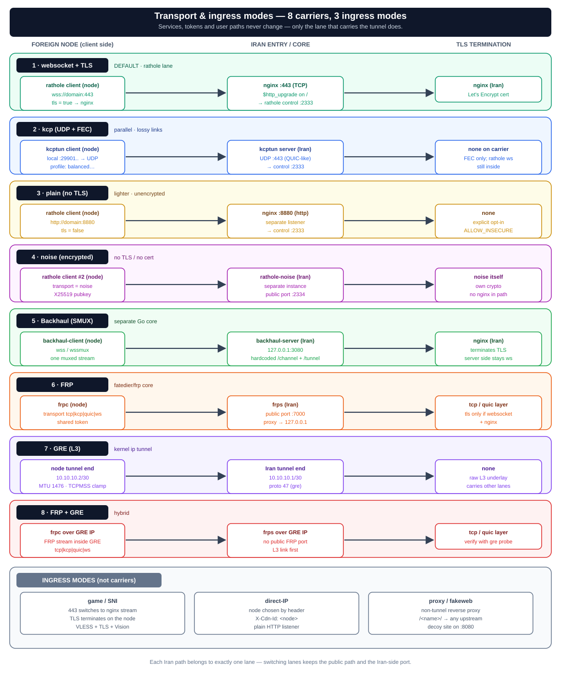
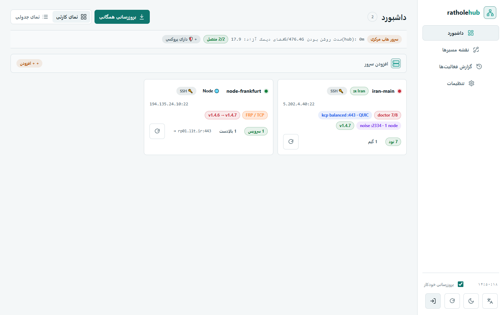

<div align="center">


# RatholeEngine

**Multi-location reverse-tunnel system on rathole + Nginx**

_One port · one domain · one certificate · many foreign nodes routed by URL path._
_Built for censorship-resistant tunneling into Iran._

<!-- badges -->
[](https://github.com/l8PYGIT/RatholeEngine/actions/workflows/ci.yml)
[](https://l8pygit.github.io/RatholeEngine/)
[](https://github.com/l8PYGIT/RatholeEngine/releases/latest)
[](LICENSE)
[](https://github.com/l8PYGIT/RatholeEngine/stargazers)
[](https://t.me/l8PY4NET)
<br/>


[**English**](#what-is-this) · [**فارسی**](docs/README.fa.md) · [**Docs site**](https://l8pygit.github.io/RatholeEngine/) · [**Full Wiki**](https://l8pygit.github.io/RatholeEngine/wiki/Home/) · [Quick start](#quick-start) · [Documentation](#documentation) · [**Telegram channel**](https://t.me/l8PY4NET)

</div>

> The CLI tools live under [`rathole-manager/`](rathole-manager/). For the full Persian reference see [`docs/README.fa.md`](docs/README.fa.md); a Persian summary is at the bottom of this page.

---

## Contents

- [What is this](#what-is-this)
- [Three roles + REST Agent](#three-roles--rest-agent)
- [Transport modes](#transport-modes)
- [Quick start](#quick-start)
- [REST Agent & private repos](#rest-agent--private-repos)
- [Update & rollback](#update--rollback)
- [Documentation](#documentation)
- [Repository layout](#repository-layout)
- [Community & support](#community--support)
- [Donate](#donate)
- [خلاصه‌ی فارسی](#خلاصهی-فارسی)

## What is this

A single **Iran server** — behind one domain, one Let's Encrypt cert, one public port `443` — fronts many **foreign nodes** that connect back over a reverse tunnel. User traffic is routed to a node **by URL path** (`map $uri $backend_port` in nginx). By default nothing but `:443` is exposed on the Iran server (optional lanes — plain/noise/direct-IP and the REST Agent — open their own ports only when you enable them); the foreign nodes have no public port.


## Three roles + REST Agent

| Role | Program | Responsibility |
|------|---------|----------------|
| **Iran panel** | [`rathole-manager/ratholectl`](rathole-manager/ratholectl) (bash) | rathole **server** + nginx. Owns node inventory. Generates `server.toml` + `rathole.conf`. |
| **Foreign node** | [`rathole-manager/ratholenode`](rathole-manager/ratholenode) (bash) | rathole **client**. Generates `client.toml`. |
| **Hub** | [`rathole-manager/ratholehub/hub.py`](rathole-manager/ratholehub/hub.py) (Python, stdlib only) | Central web panel driving many Iran servers and nodes over **SSH or the REST Agent**: per-service controls, read-only routing map, multi-core carrier management, audit log. |
| **REST Agent** *(optional)* | [`rathole-manager/ratholeagent.py`](rathole-manager/ratholeagent.py) (Python, stdlib only) | Token-authenticated HTTP(S) daemon on `:8089` (`rathole-agent.service`) so the hub can manage a server **without SSH**. |

The core design principle everywhere: **change state → regenerate config → validate → hot-reload**. Configs are never hand-edited; they are rewritten in place (inode preserved) so rathole hot-reloads without dropping active tunnels, with automatic rollback if `nginx -t` fails.

## Transport modes

The rathole lane supports **four carriers** (WebSocket/TLS, KCP, plain, and Noise); Backhaul is a separate SMUX lane that can run alongside rathole on the same node. Game/SNI, direct-IP, and proxy are ingress modes, not carriers. Switching a rathole carrier never changes user services, tokens, or paths.



- **websocket + TLS** (default) — `wss://domain:443`, TLS terminated by nginx.
- **kcp** — parallel UDP+FEC path for lossy links (looks like QUIC on UDP/443).
- **plain** — no-TLS websocket to a separate HTTP listener (lighter, unencrypted).
- **noise** — encrypted transport (Noise/X25519) on a second rathole instance, no TLS/cert.
- **backhaul** *(v1.9)* — a separate Go core (`Musixal/Backhaul`, patched with a uTLS Chrome fingerprint) beside rathole that multiplexes user connections via **SMUX**. It uses the separate `bh-services.conf` registry and can run as a dual-core lane alongside `rathole-client`; nginx proxies the hardcoded `/channel` + `/tunnel` paths on the same 443.
- **game / SNI** — L4 passthrough on 443; TLS terminates on the node (VLESS+TLS+Vision).
- **direct-IP** *(ingress, not a tunnel carrier)* — a separate HTTP listener where node selection comes from a hidden header (`X-Cdn-Id: <node_name>`) instead of URL path; users connect to the raw server IP, no domain/TLS required.
- **frp** *(v2.0)* — a standalone reverse-tunnel core (`fatedier/frp`) supporting TCP, KCP, QUIC, and WebSocket multiplexing with shared token authentication.
- **gre** *(v2.0)* — Linux kernel Layer 3 point-to-point network tunnel (`ip tunnel`) with /30 subnet addressing, MTU 1476, and iptables TCPMSS clamping.
- **frp + gre** *(v2.0)* — hybrid carrier combining FRP's obfuscated multiplexed stream (QUIC, KCP, WebSocket, TCP) with Linux kernel Layer 3 point-to-point GRE routing for censorship resistance and direct L3 IP connectivity.
- **adaptive failover** *(v1.5.0)* — timer-driven probes classify each carrier (`healthy / tls_failed / tcp_timeout / …`) and auto-switch between ws and kcp with hysteresis + cooldown; plain requires explicit `ALLOW_INSECURE=1`.
- **secret control path** *(v1.5.0)* — WebSocket control upgraded from `/` to `/_rh/<32 hex>`; nginx routes that exact path to rathole, while `/` with a WebSocket Upgrade stays a fallback for not-yet-updated nodes and all other paths keep fake-site behaviour.

Details: [`docs/transport-modes.md`](docs/transport-modes.md).

## Quick start

**One command, then just answer the prompts.** It asks for the version (Enter = latest), shows a
role menu (`1` Iran panel · `2` foreign node · `3` update · `7` uninstall), and then asks only the
few details that role needs:

```bash
curl -fsSL https://raw.githubusercontent.com/l8PYGIT/RatholeEngine/main/install.sh | sudo bash
```

For the panel that is **the domain and the certificate paths** (everything else: press Enter); for a
node it is **server address, name, token and inbound port**.

> **Step-by-step walkthrough** (what each prompt means, with expected answers and a
> troubleshooting table): [`docs/quickstart.md`](docs/quickstart.md) ·
> [English](docs/quickstart.en.md).

Prefer no questions at all? Pass everything as flags (defaults to `l8PYGIT/RatholeEngine`,
override with `RATHOLE_GH`):

```bash
# Iran server (panel), non-interactive:
curl -fsSL https://raw.githubusercontent.com/l8PYGIT/RatholeEngine/main/install.sh | sudo bash -s -- --panel \
  --domain panel.example.ir \
  --fullchain /root/cert/panel.example.ir/fullchain.pem \
  --key       /root/cert/panel.example.ir/privkey.pem

# Foreign node, non-interactive:
curl -fsSL https://raw.githubusercontent.com/l8PYGIT/RatholeEngine/main/install.sh | sudo bash -s -- --node -- \
  --server panel.example.ir:443 --name trk01 --token <T> --inbound-port 2087
```

> `install.sh` fetches `rathole-manager.zip` + `bootstrap.sh` from the latest GitHub Release (published by the release workflow), then hands off to `bootstrap.sh`. Override the source repo with `RATHOLE_GH="you/repo"`.

Install a **specific released version** with `--release` (run with no arguments and it asks; Enter = latest):

```bash
curl -fsSL https://raw.githubusercontent.com/l8PYGIT/RatholeEngine/main/install.sh | sudo bash -s -- --release v2.0.3 --panel --domain panel.example.ir --fullchain /path/fullchain.pem --key /path/privkey.pem
```

`--beta` takes the newest pre-release, `--stable` the newest stable. From an installed server: `ratholectl update v2.0.2` / `ratholenode update v2.0.2`. Note `RATHOLE_RELEASE=... curl ... | sudo bash` does **not** work — the variable goes to `curl` and `sudo` strips it; use the flag.

Offline / local bundle (no download) still works via `bootstrap.sh` directly — see [`docs/README.fa.md`](docs/README.fa.md).

> **Re-running the panel installer** is safe: it detects a previous or partial install, prints a ✓/✗ status per component, and offers **resume** (complete missing pieces, keep state — `--repair`, the default) or **fresh** (back up + wipe config/state, reinstall — `--fresh`). Under `curl … | bash` (no TTY) it defaults to the safe resume path.

Then add nodes from the Iran panel:

```bash
ratholectl hub on <port>             # enable hub on port <port>
ratholectl add trk01 2087            # → path /trk01 routed to that node
ratholectl proxy add mysvc http://127.0.0.1:9000   # /mysvc/ → any upstream, no rathole involved
ratholectl ls                        # list nodes + user paths
ratholectl status                    # full dashboard: domain, ports, cert, services, nodes (--json for the hub)
ratholectl paths                     # every config/file path with a ✓/✗
ratholectl version                   # manager_version + rathole_version
ratholectl doctor                    # health check
```

`ratholectl add` also prints a ready-to-paste `curl … | sudo bash -s -- --node -- …` one-liner for the foreign node, with the token/inbound already filled in.

**From the hub** you can drive all of this without the CLI:
- **Service controls** — every service row, on both the Iran page and the node page, has **Carrier and protocol** (switch carrier), **Health test** (runs `doctor` and shows its output), **Create VLESS config** (copies a `vless://…` link; needs the real Xray user UUID + the public Iran domain/IP), **Manage peer** (jump to the other side), and **Remove both ends** (delete from Iran *and* the node in one action).
- **Carrier labels report the actual protocol** — e.g. `FRP / TCP`, `FRP / QUIC`, `Backhaul / WSMUX`, `KCP / UDP · balanced`; `?` means the protocol was not reported by the server. A label alone does not prove connectivity — use the health test.
- **Routing map** — `#/routing` is a **read-only** topology of ingress → Iran → nodes (console / graph / table views); carrier switching and config copy live on the service rows, not here.
- **Update all** rolls the update across every server one-by-one (progress bar + per-server status, with a green/red version badge on each).
- **Add to node** wires an Iran node (name/token/inbound) onto a foreign node or upstream.
- **Set main tunnel** links a node to its Iran server with single-click auto-configuration.



*The Hub dashboard (mock-mode screenshot): server cards with version/carrier badges. More screenshots — service controls, routing map, settings — are in [`docs/assets/screenshots/`](docs/assets/screenshots/) and on the [docs site](docs/website.md).*

## REST Agent & private repos

**REST Agent** *(optional; HTTPS since v2.0.1)* — an optional Python-stdlib daemon that lets the hub manage a server over HTTP(S) instead of SSH (the server record then has `transport: "api"`). It listens on `:8089` by default and requires `Authorization: Bearer <token>`; it exposes `GET /api/ping` and `POST /api/exec` with an argv list (`{"cmd": ["ratholectl","status","--json"], "timeout": 120}`), a binary allow-list and a 1 MiB payload cap. HTTPS is optional: pass `--tls-cert`/`--tls-key` (or env `RATHOLE_AGENT_TLS_CERT`/`RATHOLE_AGENT_TLS_KEY`), or drop `cert.pem` + `key.pem` into `/etc/rathole-agent/`. A **self-signed** cert is accepted only when the server record has `"insecure_ssl": true` in `/etc/ratholehub/inventory.json` (or the hub runs with `RATHOLE_AGENT_INSECURE_SSL=1`).

```bash
sudo install-agent.sh --role iran|node [--port 8089] [--token <T>]   # shipped with the panel/node installers
ratholectl agent on   /   ratholenode agent on                      # same thing from the CLIs (panel / node)
```

Then add the server in the hub with **Connection = Agent REST API**, its **API URL** (e.g. `http://1.2.3.4:8089`) and the **token** (printed by the installer, or `ratholectl agent token`). The unit is `rathole-agent.service` and the token lives in `/etc/rathole-agent/token` (mode 600, or `RATHOLE_AGENT_TOKEN`).

**Private GitHub repositories** — `install.sh` accepts `--token <pat>` / `-t` (or the `RATHOLE_GH_TOKEN`, `GH_TOKEN` or `GITHUB_TOKEN` env var). With a token it downloads the private `bootstrap.sh` from raw GitHub and gets the bundle from the Release assets first (with the GitHub API tarball as fallback) using `Authorization: Bearer`, and skips the public ghproxy mirrors (which cannot reach a private repo). To update an already-installed server from a private repo, run `sudo bash tools/update-private.sh` from a repo checkout — it prompts for a hidden token (or reads the env), updates from the Release assets or from `main` source via `bootstrap.sh --local --update`, and unsets the token variables on exit.

## Update & rollback

Updates take a **full snapshot** (CLI + configs + systemd units) into `/var/backups/rathole-manager/` before touching anything, run a per-role **health check** afterwards, and **auto-roll-back** to the snapshot if the service fails to come up or `nginx -t` breaks.

```bash
# Update in place (auto-detects panel/node/hub; snapshot + health-check + auto-rollback)
curl -fsSL https://raw.githubusercontent.com/l8PYGIT/RatholeEngine/main/install.sh | sudo bash -s -- --update
#   or, from an installed tree:  sudo bash /opt/rathole-manager/update.sh

sudo bash update.sh --list-backups        # list snapshots
sudo bash update.sh --rollback            # revert to the latest snapshot
sudo bash update.sh --rollback 20260713-2210   # revert to a specific one
sudo bash update.sh --no-rollback         # update but never auto-revert (snapshot only)
```

Full CLI reference and install flows (Persian): [`docs/README.fa.md`](docs/README.fa.md).

## Uninstall

`bootstrap.sh` auto-detects which roles are installed (panel / node / hub) and runs the matching uninstaller for each:

```bash
sudo bash bootstrap.sh --uninstall        # remove installed roles (asks to confirm)
sudo bash bootstrap.sh --purge --yes      # + rathole binary and hub config, no prompt
#   or per-role directly:  sudo bash uninstall-panel.sh [--purge] [--yes]
```

TLS certs are never removed. The shared `common.sh` is removed only when no other role remains on the host. The same option is item 7 in the interactive `bootstrap.sh` menu.

## Documentation

| Doc | Contents |
|-----|----------|
| [**Docs site (Pages)**](https://l8pygit.github.io/RatholeEngine/) | **Online documentation site** — Persian docs + wiki + English, built with MkDocs Material ([build guide](docs/website.md)). |
| [**Wiki**](https://l8pygit.github.io/RatholeEngine/wiki/Home/) | **Complete wiki** (Getting Started, CLI Reference, Adaptive Filtering, Hub, Troubleshooting) — Persian pages served by the docs site. |
| [`docs/architecture.md`](docs/architecture.md) | Three roles, state→regenerate→reload principle, path==name==map==inbound invariant. |
| [`docs/transport-modes.en.md`](docs/transport-modes.en.md) · [`fa`](docs/transport-modes.md) | All transport and ingress modes with commands (English · فارسی). |
| [`docs/traffic-flow.md`](docs/traffic-flow.md) | Layer-by-layer packet path incl. direct-IP and proxy (Mermaid + SVG). |
| [`docs/hub.en.md`](docs/hub.en.md) · [`fa`](docs/hub.md) | Hub web panel: service controls, routing map, REST API + REST Agent, security model (English · فارسی). |
| [`docs/performance.md`](docs/performance.md) | Tuning beyond the tunnel (BBR, kcp profiles, non-tunnel bottlenecks). |
| [`docs/amneziawg-reverse.md`](docs/amneziawg-reverse.md) | A separate AmneziaWG reverse-tunnel design (not part of the rathole flow). |
| [`docs/website.md`](docs/website.md) · [`en`](docs/website.en.md) | How to build/publish the static docs website + platform comparison (MkDocs Material, VitePress — what Marzban uses —, Docusaurus, Docsify). |
| [`docs/README.fa.md`](docs/README.fa.md) | **Full Persian CLI reference + install/uninstall flows.** |
| [`docs/quickstart.md`](docs/quickstart.md) · [`en`](docs/quickstart.en.md) | **Quick start (interactive):** one command, every prompt explained, verification, add-node, troubleshooting table. |
| [`docs/install-manual.md`](docs/install-manual.md) | **Full manual install (English):** Iran panel + Pasargad config + foreign nodes + hub, step by step. |
| [`docs/install-manual.fa.md`](docs/install-manual.fa.md) | Same manual install guide, **Persian**. |
| [`CHANGELOG.en.md`](CHANGELOG.en.md) | English changelog (translated from the Finglish source). |
| [`CONTRIBUTING.md`](CONTRIBUTING.md) | How to contribute: tests, shellcheck, conventions, PR process. |
| [`SECURITY.md`](SECURITY.md) | Vulnerability reporting policy. |
| [`rathole-multilocation-pasargad.md`](rathole-multilocation-pasargad.md) | Original detailed design & troubleshooting doc (Persian). |

## Repository layout

```
install.sh                one-command installer from GitHub (curl | sudo bash)
bootstrap.sh              env prep + unpack + hand-off to installer (local or --url)
package.sh                build the distributable rathole-manager.zip
.github/workflows/        release.yml (build+publish on tag v*) · ci.yml (lint)
rathole-manager/
  ratholectl              Iran panel CLI (rathole server + nginx)
  ratholenode             foreign node CLI (rathole client)
  ratholeagent.py         optional REST Agent daemon (Bearer token, HTTP/HTTPS :8089)
  common.sh               shared bash helpers
  ratholehub/hub.py       central web panel (stdlib Python) — router/state/SSH/agent/parsers
  ratholehub/hubcmds.py   security-critical action→argv allow-list (RE_* regexes)
  ratholehub/ui/          web UI assets (index.html, app.css, app.js, i18n.js)
  install-*.sh            per-role installers (panel/node/hub/agent)
  update.sh               safe update: snapshot + health-check + rollback
  uninstall-*.sh
tools/update-private.sh   update an installed server from a private GitHub repo
docs/                     documentation + assets/ (SVG/PNG diagrams)
```

## Community & support

| Where | What |
|---|---|
| 📢 **[Telegram channel — @l8PY4NET](https://t.me/l8PY4NET)** | Release announcements, setup tips, carrier/tunnel news and the fastest place to ask a question. |
| 🐙 **[GitHub Issues](https://github.com/l8PYGIT/RatholeEngine/issues)** | Bug reports and feature requests (include `ratholectl doctor` output). |
| 📚 **[Docs site](https://l8pygit.github.io/RatholeEngine/)** | Quick start, CLI reference, architecture, carriers, hub, troubleshooting. |

> Support requests are usually answered fastest on Telegram; use Issues when you have logs to attach
> or want the outcome tracked publicly.

## <a id="donate"></a>Donate

If RatholeEngine helps you, consider supporting continued development:

| Network | Address |
|---------|---------|
| **USDT (BEP-20 / BSC)** | `0x2364898407e8A42DA554B909989cd9B28eE61314` |
| **TON** | `UQCondoXRwQNt0fQvvmYGa_Fn39D9szjQH4eBqIcUd5r1yfH` |
| **TRX (Tron)** | `TRhnkJFpj9uxA2aqUxapJAFhkzNPbfxKwp` |

---

## خلاصه‌ی فارسی

`RatholeEngine` یک سیستم تونل معکوس **چند-موقعیتی** روی **rathole + Nginx** است: یک سرور ایران (پشت یک دامنه، یک گواهی، یک پورت ۴۴۳) جلوی چند نود خارجی قرار می‌گیرد که با تونل معکوس به آن وصل می‌شوند و ترافیک با **path** به هر نود مسیریابی می‌شود. به‌طور پیش‌فرض فقط پورت ۴۴۳ روی سرور ایران عمومی است؛ لاین‌های اختیاری (plain/noise/direct-IP و آژنت REST) فقط وقتی خودت فعالشان کنی پورت جداگانه باز می‌کنند.

**سه نقش (+ ایجنت اختیاری):** پنل ایران (`ratholectl` — rathole server + nginx)، نود خارج (`ratholenode` — rathole client)، هاب مرکزی (`hub.py` — پنل وب مدیریت چند سرور از طریق SSH یا REST API)، و **ایجنت REST** (`ratholeagent.py` — دیمن HTTP(S) روی پورت ۸۰۸۹ با توکن Bearer و HTTPS اختیاری).

**اصل مرکزی:** تغییر state → بازتولید کانفیگ → `nginx -t` → hot-reload (با حفظ inode و بازگشت خودکار در صورت خطا).

**هسته‌ها و حامل‌ها:** پشتیبانی از حامل‌های پیش‌فرض rathole (شامل WebSocket/TLS، KCP، Plain و Noise)، هسته‌ی مالتی‌پلکس **Backhaul (SMUX)**، هسته‌ی ریورس تونل **FRP (`fatedier/frp`)**، و تونل شبکه **GRE (لایه ۳ کرنل لینوکس)**؛ برچسب هر حامل همراه پروتکل گزارش‌شده نمایش داده می‌شود (مثل `FRP / TCP` یا `Backhaul / WSMUX` و `?` یعنی پروتکل گزارش نشده).

**دستورهای مفید CLI:** `ratholectl status` (داشبورد کامل: دامنه، پورت‌ها، گواهی، سرویس‌ها، نودها — با `--json` برای هاب)، `ratholectl paths` (مسیر همه‌ی فایل‌ها با ✓/✗)، `ratholectl version` (نسخه‌ی مدیر + rathole). `ratholectl add` یک دستور آماده‌ی `curl … | sudo bash -s -- --node -- …` هم برای نصب نود چاپ می‌کند.

**از هاب:** در ردیف هر سرویس — هم صفحه‌ی ایران و هم صفحه‌ی نود — دکمه‌های **«حامل و پروتکل»**، **«تست سلامت»** (خروجی `doctor`)، **«ساخت کانفیگ VLESS»** (نیازمند UUID واقعی کاربر Xray و دامنه/IP عمومی ایران)، **«مدیریت سمت مقابل»** و **«حذف از دو سمت»**؛ نقشه‌ی مسیرها (`#/routing`) فقط نمایش توپولوژی (فقط‌خواندنی) است. دکمه‌های **«آپدیت همه»**، **«افزودن به نود»** و **«تنظیم تونل اصلی»** هم سر جای خود هستند.

**نصب/آپدیت از مخزن خصوصی:** `install.sh --token <pat>` (یا `RATHOLE_GH_TOKEN`) و `tools/update-private.sh`؛ در حالت private آینه‌های عمومی ghproxy کنار گذاشته می‌شوند.

**شروع سریع و مرجع کامل CLI (فارسی):** [`docs/README.fa.md`](docs/README.fa.md)

**📢 کانال تلگرام:** [**@l8PY4NET**](https://t.me/l8PY4NET) — اعلان نسخه‌های جدید، نکته‌های راه‌اندازی و سریع‌ترین جای پرسیدن سؤال.

**فهرست مستندات فارسی:**
- [معماری](docs/architecture.md) · [حالت‌های transport](docs/transport-modes.md) · [مسیر ترافیک](docs/traffic-flow.md)
- [هاب](docs/hub.md) · [پرفورمنس](docs/performance.md) · [AmneziaWG معکوس](docs/amneziawg-reverse.md)
- [سند طراحی تفصیلی اصلی](rathole-multilocation-pasargad.md)
