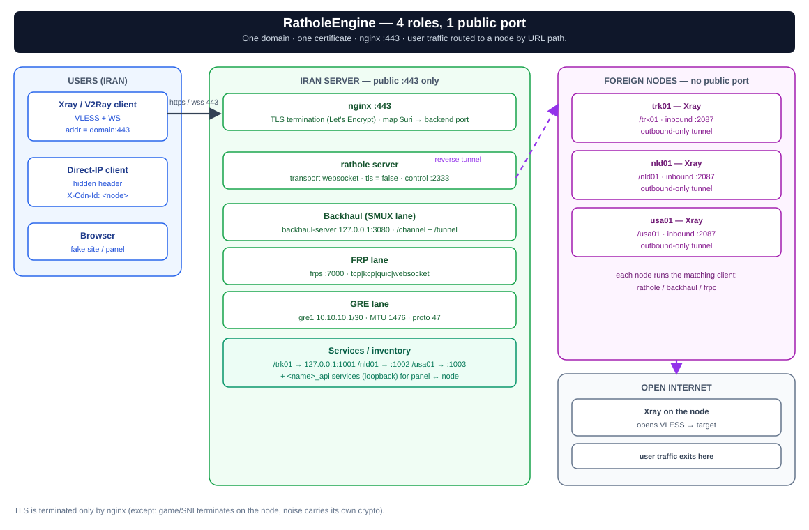
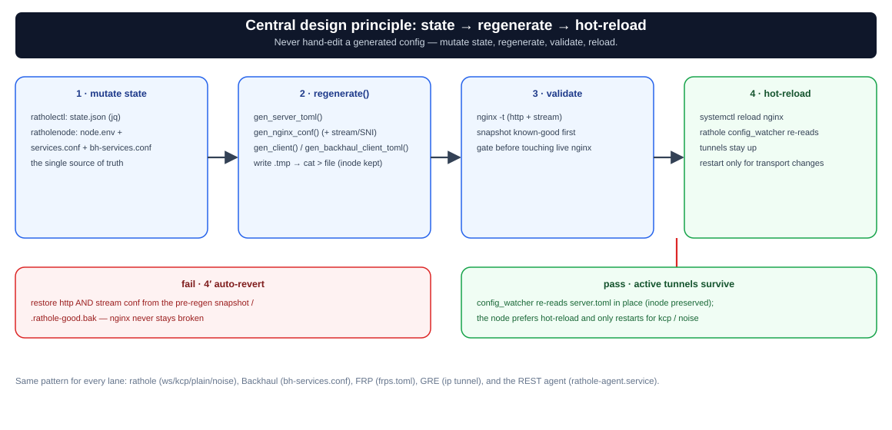

# Architecture — Three Roles and the Central Design Principle

`rathole-manager` is a multi-location reverse-tunnel system built on **rathole + Nginx**. A single Iran server — behind one domain, one certificate, one port 443 — fronts many foreign "nodes" that connect back over a reverse tunnel. User traffic is routed to nodes **by URL path** (`map $uri $backend_port` in nginx).



*Everything on one port/domain behind Nginx; foreign nodes connect to the Iran server via reverse tunnel.*

---

## Three Roles, Three Programs

| Role | Program | Responsibility |
|------|---------|----------------|
| **Iran panel** | [`ratholectl`](../rathole-manager/ratholectl) (bash) | rathole **server** + nginx. Owns node inventory. Generates `server.toml` + `rathole.conf`. |
| **Foreign node** | [`ratholenode`](../rathole-manager/ratholenode) (bash) | rathole **client**. Generates `client.toml`. |
| **Hub** | [`ratholehub/hub.py`](../rathole-manager/ratholehub/hub.py) (Python, stdlib only) | Central web panel driving multiple Iran servers/nodes over SSH **or** the REST Agent. Details: [`hub.en.md`](hub.en.md). |
| **REST Agent** (optional) | [`ratholeagent.py`](../rathole-manager/ratholeagent.py) (Python, stdlib only; unit `rathole-agent.service`) | Lightweight management daemon on an Iran server/node so the hub can manage it without SSH. Details: [`hub.en.md`](hub.en.md). |

`common.sh` is sourced by both bash tools (colors/logging, `kcp_profile`, `install_kcptun`, `backhaul_mux_profile`, `backhaul_client_transport`, `install_backhaul`, `install_frp`, `frp_systemd_unit`, `gre_setup_interface`, `gre_teardown_interface`, `apply_sysctl_tuning`, `fakeweb_service`).

---

## Management Plane: SSH or REST Agent

The hub has two ways to run commands on a server; each server record's `transport` field selects one:

- **`transport: "ssh"` (default):** SSH key auth; the command runs as an argv list with every argument passed separately.
- **`transport: "api"`:** the hub sends the request to the server's REST Agent — `POST <api_url>/api/exec` with body `{"cmd":[...], "timeout": N}` and header `Authorization: Bearer <api_token>`. `GET /api/ping` is public and returns `{ok, role, version, hostname}`.
- **Security:** on both paths the hub never runs raw shell strings; `hubcmds.build_iran_cmd`/`build_node_cmd` map an action + regex-validated args (`RE_*`) to an argv list. The agent only accepts argv (binary allow-list, payload capped at 1 MiB, constant-time token compare).
- **HTTPS:** the agent listens on HTTP at `0.0.0.0:8089` by default (port configurable); `--tls-cert`/`--tls-key` (or the default `/etc/rathole-agent/cert.pem` + `key.pem`) switch it to HTTPS. A self-signed cert is accepted only when the hub server record sets `insecure_ssl: true` (or `RATHOLE_AGENT_INSECURE_SSL=1`).
- **Install:** `install-agent.sh [--port 8089] [--token T] [--role iran|node]`, or from the CLIs: `ratholectl agent on [port] [token]` and `ratholenode agent on [port] [token]`. The token lives in `/etc/rathole-agent/token` (chmod 600).

---

## Core Principle: State → Regenerate → Hot-Reload

Every mutation follows this pattern — **never hand-edit generated configs**; change state and regenerate:



- **ratholectl:** state is `/etc/rathole-manager/state.json` (jq-manipulated). Commands mutate state, then call `regenerate()` → `gen_server_toml()` + `gen_nginx_conf()` → `nginx -t` → reload. Configs are written **in place (inode preserved)** so rathole's `config_watcher` hot-reloads without dropping active tunnels. Auto-reverts to `.rathole-good.bak` if `nginx -t` fails.
- **ratholenode:** base state is `/etc/rathole/node.env`; `/etc/rathole/services.conf` owns rathole-lane services and `/etc/rathole/bh-services.conf` owns Backhaul-lane services. `gen_client()` and `gen_backhaul_client_toml()` build their independent configs. `reload_svc` prefers hot-reload for rathole; transport/core changes restart only the affected unit.

---

## Path == Node Name == Nginx Map == Xray Inbound

A node's `name` is simultaneously its URL path, its nginx `map` entry, and the Xray inbound path on the node. These three must stay identical. Each node has a data service; adding `--api-port` also creates a `<name>_api` service (bound to `127.0.0.1`) for panel↔node management over the tunnel.

---

## Transport Modes and Independent Cores

The rathole lane has four carriers (websocket+TLS default, KCP, plain, Noise). Beside it run **independent lanes/cores**; each Iran path belongs to exactly one lane:

| Lane/core | What it is | Key point |
|---|---|---|
| **Backhaul** (SMUX) | separate Go core (`Musixal/Backhaul`) with SMUX multiplexing | behind the same nginx/443 via `/channel` and `/tunnel`; own `bh-services.conf` registry |
| **FRP** | standalone reverse-tunnel core `fatedier/frp` (frps on Iran, frpc on the node) | transports `tcp\|kcp\|quic\|websocket`, shared token auth, default port 7000 |
| **GRE** | Linux kernel L3 tunnel (`ip tunnel`) on a /30 | no userspace daemon; MTU 1476 + TCPMSS clamping; default interface `gre1` |
| **FRP + GRE** | hybrid: FRP over the GRE L3 link | FRP's multiplexed stream inside GRE; selectable from the hub service controls |

A service/path on an Iran server lives in exactly one of these lanes, while several lanes may run at once for different services. Moving a service between lanes **does not change its path or Iran-side port**. Full details: [`transport-modes.en.md`](transport-modes.en.md).

---

## User Ingress Modes

Beyond standard path-routing on 443, three alternative user entry points exist:

- **direct-IP:** a separate HTTP port (default 8081) where users connect directly to the Iran server IP. Node selection uses a hidden header (`X-Cdn-Id: <node_name>`) instead of URL path. The tunnel between Iran↔node is untouched. Backhaul also has an optional direct-IP exposure, which is separate from this user ingress.
- **proxy:** a `/<name>/` path on the same 443 that `proxy_pass`es to any upstream — **without going through rathole**. For independent services that don't need a tunnel.
- **fakeweb:** the default fake site on `fake_port` (default 8080) for servers without a real panel, so `/` never returns 502. Managed with `ratholectl fakeweb start|stop|rm|status`.

---

## Multi-Domain and IP Certificate

One Iran server can serve multiple domains — each with its own nginx server block on the same port 443:

```bash
ratholectl domain add cdn.example.ir [--certbot]
ratholectl domain primary cdn.example.ir
```

For users connecting directly via IP (no domain), a self-signed cert for the IP can be created and trusted on the node:

```bash
ratholectl ip-cert <IPv4>                           # Iran: create self-signed cert
ratholenode set-main <ip>:443 <ip> /path/to/cert    # Node: trust the cert
```

---

## See Also

- [`transport-modes.en.md`](transport-modes.en.md) — all transport/ingress modes with commands
- [`hub.en.md`](hub.en.md) — Hub panel, REST API, security model
- [`traffic-flow.md`](traffic-flow.md) — packet path layer by layer (Persian)
- [`performance.en.md`](performance.en.md) — tuning beyond the tunnel
- [`README.fa.md`](README.fa.md) — full CLI reference and install flows (Persian)
- [`install-manual.md`](install-manual.md) — full manual install walkthrough (English)
- [Wiki — CLI Reference](https://github.com/l8PYGIT/RatholeEngine/wiki/CLI-Reference)
