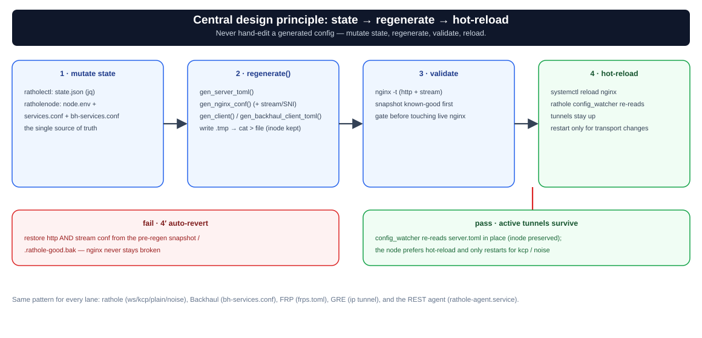

# معماری — سه نقش و اصل مرکزی طراحی

`rathole-manager` یک سیستم تونل معکوس چند-موقعیتی بر پایه‌ی **rathole + Nginx** است. یک سرور ایران (پشت یک دامنه، یک گواهی، یک پورت ۴۴۳) جلوی چند «نود» خارجی قرار می‌گیرد که با تونل معکوس به آن وصل می‌شوند. ترافیک کاربر با **path** به نودها مسیریابی می‌شود (`map $uri $backend_port` در nginx).


*همه‌چیز روی یک پورت/دامنه پشت Nginx؛ نودهای خارج با تونل معکوس به سرور ایران وصل می‌شوند.*

## سه نقش، سه برنامه

| نقش | برنامه | کار |
|-----|--------|-----|
| **پنل ایران** | [`ratholectl`](../rathole-manager/ratholectl) (bash) | rathole **server** + nginx. مالک inventory نودها. `server.toml` و `rathole.conf` را تولید می‌کند. |
| **نود خارج** | [`ratholenode`](../rathole-manager/ratholenode) (bash) | rathole **client**. `client.toml` را تولید می‌کند. |
| **هاب** | [`ratholehub/hub.py`](../rathole-manager/ratholehub/hub.py) (Python، فقط stdlib) | پنل وب مرکزی که چند سرور ایران/نود را از طریق SSH یا REST Agent مدیریت می‌کند. جزئیات: [`hub.md`](hub.md). |
| **REST Agent** (اختیاری) | [`ratholeagent.py`](../rathole-manager/ratholeagent.py) (Python، فقط stdlib؛ unit `rathole-agent.service`) | دیمن مدیریتی سبک روی سرور ایران/نود برای مدیریت بدون SSH از طرف هاب. جزئیات: [`hub.md`](hub.md). |

`common.sh` توسط هر دو ابزار bash سورس می‌شود (رنگ/لاگ، `kcp_profile`، `install_kcptun`، `backhaul_mux_profile`، `backhaul_client_transport`، `install_backhaul`، `install_frp`، `frp_systemd_unit`، `gre_setup_interface`، `gre_teardown_interface`، `apply_sysctl_tuning`، `fakeweb_service`).

## صفحه‌ی مدیریت (Management plane): SSH یا REST Agent

هاب برای اجرای دستور روی هر سرور دو مسیر دارد و رکورد هر سرور با `transport` مشخص می‌کند که کدام استفاده شود:

- **`transport: "ssh"` (پیش‌فرض):** کلید SSH؛ دستور به‌صورت argv و با هر آرگومان جدا اجرا می‌شود.
- **`transport: "api"`:** هاب درخواست را به REST Agent روی سرور می‌فرستد — `POST <api_url>/api/exec` با بدنه‌ی `{"cmd":[...], "timeout": N}` و هدر `Authorization: Bearer <api_token>`. `GET /api/ping` عمومی است و `{ok, role, version, hostname}` برمی‌گرداند.
- **امنیت:** در هر دو مسیر هاب هیچ رشته‌ی shell خام اجرا نمی‌کند؛ `hubcmds.build_iran_cmd`/`build_node_cmd` اکشن + آرگومان‌های اعتبارسنجی‌شده (`RE_*`) را به لیست argv تبدیل می‌کند. Agent هم فقط argv می‌گیرد (لیست سفید باینری، payload حداکثر ۱ MiB، توکن با مقایسه‌ی constant-time).
- **HTTPS:** Agent به‌صورت پیش‌فرض HTTP روی `0.0.0.0:8089` (پورت قابل تغییر) گوش می‌دهد؛ با `--tls-cert`/`--tls-key` (یا فایل‌های پیش‌فرض `/etc/rathole-agent/cert.pem` و `key.pem`) HTTPS می‌شود. گواهی self-signed فقط وقتی هاب قبول می‌کند که رکورد سرور `insecure_ssl: true` داشته باشد (یا `RATHOLE_AGENT_INSECURE_SSL=1`).
- **نصب:** `install-agent.sh [--port 8089] [--token T] [--role iran|node]` یا از خود CLIها: `ratholectl agent on [port] [token]` و `ratholenode agent on [port] [token]`. توکن در `/etc/rathole-agent/token` (chmod 600) نگه داشته می‌شود.

## اصل مرکزی: state → regenerate → hot-reload

هر تغییری همین الگو را دارد — **هیچ‌وقت کانفیگ‌های تولیدشده را دستی ویرایش نکن**؛ state را عوض کن و بازتولید کن:



- **ratholectl**: state در `/etc/rathole-manager/state.json` (با jq). دستورها state را تغییر می‌دهند، سپس `regenerate()` → `gen_server_toml()` + `gen_nginx_conf()` → `nginx -t` → reload. کانفیگ‌ها **در جای خود** (با حفظ inode) نوشته می‌شوند تا `config_watcher` در rathole بدون قطع تونل‌های فعال hot-reload کند. اگر `nginx -t` شکست بخورد، به `.rathole-good.bak` برمی‌گردد.
- **ratholenode**: state پایه در `/etc/rathole/node.env` است؛ `/etc/rathole/services.conf` سرویس‌های lane رتهول و `/etc/rathole/bh-services.conf` سرویس‌های lane بک‌هال را نگه می‌دارند. `gen_client()` و `gen_backhaul_client_toml()` کانفیگ‌های مستقل را می‌سازند؛ hot-reload برای رتهول ترجیح دارد و تغییر core/transport فقط unit مربوط را restart می‌کند.

## path == نام نود == نگاشت nginx == inbound Xray

نام یک نود هم‌زمان مسیر URL آن، ورودی `map` در nginx، و path اینباند Xray روی نود است. این سه باید یکسان بمانند. هر نود یک سرویس داده دارد؛ افزودن `--api-port` یک سرویس `<name>_api` هم می‌سازد (bind روی `127.0.0.1`) برای مدیریت پنل↔نود از طریق تونل.

## حالت‌های transport و هسته‌های مستقل

lane اصلی rathole چهار حامل دارد (websocket+TLS پیش‌فرض، KCP، plain و Noise). کنار آن، **هسته‌ها/لاین‌های مستقل** هم اجرا می‌شوند و هر مسیر ایران فقط به یکی از laneها تعلق دارد:

| lane/core | چیست | نکته‌ی کلیدی |
|---|---|---|
| **Backhaul** (SMUX) | هسته‌ی جدا (Go، `Musixal/Backhaul`) با مالتی‌پلکسینگ SMUX | پشت همان nginx/۴۴۳ روی `/channel` و `/tunnel`؛ registry جدای `bh-services.conf` |
| **FRP** | هسته‌ی ریورس‌تونل `fatedier/frp` (frps روی ایران، frpc روی نود) | ترنسپورت `tcp\|kcp\|quic\|websocket`، احراز هویت توکن مشترک، پورت پیش‌فرض ۷۰۰۰ |
| **GRE** | تونل L3 کرنل لینوکس (`ip tunnel`) روی /30 | بدون دیمن userspace؛ MTU ۱۴۷۶ + TCPMSS clamping؛ اینترفیس پیش‌فرض `gre1` |
| **FRP + GRE** | حالت هیبرید: FRP روی لینک L3 GRE | استریم مالتی‌پلکس‌شده‌ی FRP داخل GRE؛ از سرویس‌کنترل‌های هاب قابل انتخاب است |

هر سرویس/مسیر روی یک سرور ایران فقط در یکی از این laneهاست، ولی چند lane می‌توانند هم‌زمان برای سرویس‌های متفاوت روشن باشند. جابه‌جایی یک سرویس بین laneها **path و پورت ایران را عوض نمی‌کند**. جزئیات کامل: [`transport-modes.md`](transport-modes.md).

## ورودی‌های کاربری (Ingress)

علاوه بر مسیریابی استاندارد با path روی ۴۴۳، سه ورودی جایگزین برای کاربر وجود دارد:

- **direct-IP:** یک پورت HTTP جداگانه (پیش‌فرض ۸۰۸۱) که کاربر مستقیم به IP سرور وصل می‌شود. انتخاب نود با یک هدر استتارشده (`X-Cdn-Id: <node_name>`) انجام می‌شود — نه path. مسیر تونل ایران↔نود دست‌نخورده می‌ماند. direct-IP بک‌هال، اگر فعال شود، یک exposure جدا برای خودِ lane بک‌هال است.
- **proxy:** یک `/<name>/` روی همان ۴۴۳ که به یک upstream دلخواه proxy می‌شود — **بدون عبور از rathole**. برای سرویس‌های مستقل که نمی‌خواهی یک تونل جداگانه باز کنی.
- **fakeweb:** سایت فیک پیش‌فرض روی `fake_port` (پیش‌فرض ۸۰۸۰)؛ برای سرورهایی که پنل واقعی ندارند و `/` نباید ۵۰۲ بدهد. با `ratholectl fakeweb start|stop|rm|status` مدیریت می‌شود.

## چند دامنه و گواهی IP

یک سرور ایران می‌تواند چند دامنه را پشتیبانی کند — هر کدام با server block جداگانه روی همان ۴۴۳:

```bash
ratholectl domain add cdn.example.ir [--certbot]   # دامنه اضافی
ratholectl domain primary cdn.example.ir           # تغییر دامنه اصلی
```

برای کاربرانی که می‌خواهند مستقیم با IP سرور وصل شوند (بدون دامنه)، می‌توان یک گواهی self-signed برای آن IP ساخت و روی نود به‌عنوان trusted root ثبت کرد:

```bash
ratholectl ip-cert <IPv4>                          # ساخت گواهی self-signed
ratholenode set-main <ip>:443 <ip> /path/to/cert   # ثبت trusted root روی نود
```

## مستندات مرتبط

- [`transport-modes.md`](transport-modes.md) — حالت‌های transport (فارسی)
- [`transport-modes.en.md`](transport-modes.en.md) — Transport Modes (English)
- [`hub.md`](hub.md) — پنل هاب، REST API و مدل امنیتی (فارسی)
- [`hub.en.md`](hub.en.md) — Hub panel, REST API and security model (English)
- [`traffic-flow.md`](traffic-flow.md) — مسیر بسته لایه‌به‌لایه (شامل direct-IP و proxy).
- [`performance.md`](performance.md) — تیونینگ فراتر از تونل (BBR، kcp، گلوگاه‌های غیرتونل).
- [`README.fa.md`](README.fa.md) — مرجع کامل CLI و روش‌های نصب.
- [`install-manual.fa.md`](install-manual.fa.md) — نصب دستی گام‌به‌گام (فارسی)
- [`install-manual.md`](install-manual.md) — Manual install walkthrough (English)
- [**Wiki — مرجع کامل دستورات**](https://github.com/loopy-iri/tunnelplus/wiki/CLI-Reference)
- [`../rathole-multilocation-pasargad.md`](../rathole-multilocation-pasargad.md) — سند طراحی/عیب‌یابی تفصیلی اصلی.
