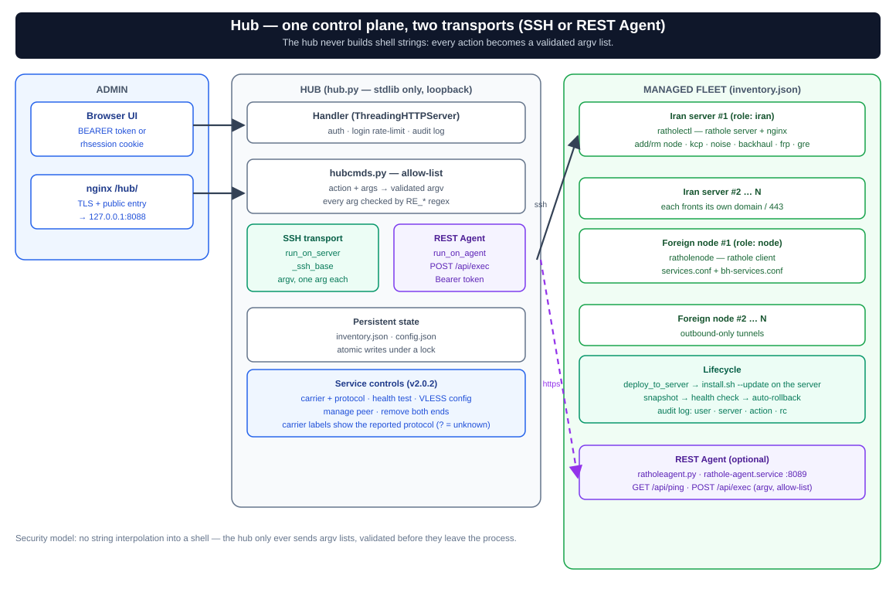

# ratholehub — Web Management Panel

Central web panel for managing multiple Iran servers and foreign nodes without touching the existing system. The hub speaks **SSH with key auth** by default and can optionally drive servers through a token-authenticated **REST Agent** (no SSH).



*Hub listens on `127.0.0.1` behind nginx at `/hub/`. It runs `ratholectl`/`ratholenode` on each server through a **validated argv list** — over SSH or the REST Agent, never raw shell strings.*

## Why this design

- **SSH by default, agent optional** — the hub runs on one server (usually rp01) and drives the rest over SSH with the already-tested CLIs; no new port or service on nodes. If SSH is not possible, install `ratholeagent.py` on the server and the hub runs the same argv lists over a token-authenticated REST API (default port `8089`) — see [REST Agent Mode](#rest-agent-mode-ssh-free).
- **No pip dependencies** — hub and agent are pure Python stdlib. No conflicts with anything on the server.
- **Token-authenticated REST API** — for automation and external tooling.
- **Secure** — listens on `127.0.0.1`; access via SSH forward or nginx under the same domain. Single-port/single-domain is preserved. Details in [Security Model](#security-model).

## Installation

```bash
cd rathole-manager/ratholehub
sudo bash install-hub.sh          # asks for admin password, generates an API token
```

Or from the Iran server itself (auto-installs on first use, syncs the port afterwards):
```bash
sudo ratholectl hub on 8088       # → https://<domain>/hub/
```

## Adding Servers

**1) Provision (recommended) — the "Provision" button in the dashboard, or `POST /api/provision`:** connects once with an **SSH password** (requires `sshpass` on the hub), appends the hub's public key to `authorized_keys` (idempotent), deploys from GitHub, and registers the server in the inventory. The hub key comes from config (`ssh_key_path`; the installer creates `/root/.ssh/id_ed25519`); if absent the hub generates `/etc/ratholehub/id_ed25519`.

**2) Manual:** set up the key yourself, then add the record with `POST /api/servers` and `transport: "ssh"`:
```bash
ssh-copy-id -i /root/.ssh/id_ed25519.pub root@<node_ip>
```

**3) REST Agent (no SSH):** install the agent on the target with `install-agent.sh` or `ratholectl agent on` / `ratholenode agent on`, then add the record with `transport: "api"`, `api_url`, and `api_token` — see [REST Agent Mode](#rest-agent-mode-ssh-free).

> If the hub was brought up with `ratholectl hub on` on the same Iran server, the local server (`iran-main` at `127.0.0.1`) is auto-registered in the inventory and the hub key is authorized locally (`hub_auto_register_local`).

## Accessing the Panel

**Most secure (no port opened):**
```bash
ssh -L 8088:127.0.0.1:8088 root@<server_ip>
# Browser: http://localhost:8088
```

**Via nginx under the same domain:**
```bash
sudo ratholectl hub on 8088   # → https://<domain>/hub/
```

## UI

The UI is a static asset tree under `ratholehub/ui/`, served by the stdlib backend with a **filename whitelist**. It has no frontend build step or runtime dependency. It is bilingual (Persian/English) with RTL/LTR switching, light/dark themes, responsive desktop/mobile layouts, accessible dialogs, keyboard focus management, inline validation, and reduced-motion support. `install-hub.sh` and `update.sh` install/update the whole tree (`hub.py` + `hubcmds.py` + `ui/`). Refresh is page-aware (default 20 seconds).

### UI Pages

| Page | Hash | Content |
|------|------|---------|
| **Dashboard** | `#/dashboard` | Server cards/list, availability and version badges, add-server and Provision forms, hub status strip (uptime/load/RAM/disk, connected count, proxy badge), and Update All progress. |
| **Server page** | `#/server/<name>` | Iran server: four tabs (Nodes & Paths, Carriers & Protocols, Network & Ingress, Maintenance & System) plus domain/certificate, the Ports section, ingress modes, and diagnostics. Node: main tunnel, quick presets, carrier select, watchdog and adaptive toggles, unified services table (rathole lane + Backhaul lane), upstreams, and diagnostics. |
| **Routing map** | `#/routing` | **Read-only**: three views — a draggable SVG graph (layout persisted in the browser, with reset), a summary table, and an ingress/output console with per-node client connection recipes. Routing changes happen on the server/node pages. |
| **Activity log** | `#/audit` | Last 100 audit records: time, user, server, action, and `rc`. |
| **Settings** | `#/settings` | API-token hint, listen address, token rotation, admin-password change, and the insecure-default warning. Language/theme are controlled from the sidebar buttons. |

On mobile widths (≤820px) the navigation collapses into a fixed bottom bar with the same four sections. There is no wiring-board page; the legacy `#/wiring` hash falls back to the dashboard.

### Service Controls (v2.0.2)

The visual wiring board (`#/wiring`) was removed in v2.0.2 and replaced by **service controls** on every service row — on both the Iran server page and the node page:

| Button | Action |
|--------|--------|
| **Carrier and protocol** | Opens the carrier/protocol switcher: `ws`, `kcp`, `plain`, `noise`, `backhaul`, `frp`, `gre`, and the `frp+gre` hybrid — plus the peer node, public Iran/node IP, GRE virtual address, FRP/Backhaul transport, profile, and an optional carrier port. |
| **Health test** | Runs `doctor` on the Iran server and shows the output; the overview is re-read afterwards. |
| **Create VLESS config** | Builds and copies a `vless://` link (details below). |
| **Manage peer** | From the Iran page it jumps to the peer node's server page (and reports an error when the peer is ambiguous); from the node page, if several Iran servers carry the same service, it asks which Iran server to use. |
| **Remove both ends** | After confirmation removes the node from Iran (`rm_node`) and, when present, `rm_svc`/`rm_bh_svc` on the node. It refuses when the peer overview is unreachable or its service lists are incomplete. |

**VLESS config**: takes the actual Xray user UUID, public Iran domain/IP, port (default 443), SNI, and the WebSocket path (`/<name>`); validates the UUID, port 1–65535, a path starting with `/`, and a non-loopback host; then copies `vless://<uuid>@<host>:<port>?type=ws&security=tls&path=/<name>[&sni=...]#<name>`. It does not create an Xray user.

**Carrier label**: the carrier is shown together with the protocol reported by the server, e.g. `FRP / QUIC`, `FRP / TCP`, `Backhaul / WSMUX`, `KCP / UDP · balanced`, `Noise / TCP`, `WebSocket / TLS`, `WebSocket / TCP`, `GRE / WebSocket`, and `SNI / TLS`. A `?` means the protocol was not reported by the server. The label alone does not prove connectivity; the health test shows the `doctor` output.

**Carrier switching behavior**:
- Switching reads the existing inbound port from fresh Iran state and does not change it (the `127.0.0.1:<iran_port>` mapping and the node inbound are preserved).
- Backhaul has its own registry (`bh-services.conf`): a service moved to Backhaul leaves `services.conf` and is registered in the Backhaul registry, and vice versa.
- The main carrier is shared by a node's Rathole services; changing the port/protocol of a shared Iran listener may require syncing the other nodes of that listener.
- Game/SNI services: the carrier and VLESS buttons show a hint toast; manage them in the "Game services (SNI/443)" section of the Iran page.
- If a multi-server operation is interrupted, the partial result is reported and state is re-read; a complete automatic rollback for every carrier combination is not guaranteed.

### Ports Section

Since **1.6.0-beta.6** the Iran server ports live in a **separate section** on each server page (previously inside the Domain & TLS modal):

| Port | Editable? | Description |
|------|-----------|-------------|
| `fake-port` | ✅ | Fake site port (default 8080) |
| `sub-port` | ✅ | Subscription port (default 2096) |
| `control-port` | ✅ | rathole control port (default 2333) |
| `internal` | Display only | Internal panel port (behind SNI) |
| `hub` | Display only | Hub port |
| `plain` | Display only | Plain (no-TLS ws) port |
| `noise` | Display only | Noise port |
| `backhaul` | Display only | Backhaul (SMUX) port |
| `direct` | Display only | Direct-IP port |

To edit, click **Manage** in the **Ports** section. `sub-path` and `hub-path` are editable too. Carrier-owned ports are display-only because enabling/disabling that carrier owns their lifecycle.

### Key Capabilities (v2.0)

- **Multi-level carrier/lane model** — RATHOLE carriers, the Backhaul core, the FRP core, and GRE interfaces are controlled independently on the Iran side.
- **Full FRP and GRE support** — FRP server/client controls (`frp_on`, `frp_off`, `frp_status`, `frp_show`) and Linux L3 GRE interfaces (`gre_on`, `gre_off`, `gre_status`, `gre_probe`) plus the FRP+GRE hybrid.
- **Per-service controls** (v2.0.2) — replaced the wiring board: set carrier/protocol, health test, create a VLESS config, manage the peer, and remove both ends (previous section).
- **Directed carrier selection** — picking a carrier for a node is one action: enable it on Iran if needed, point the node at it on Iran for `noise`/`backhaul`/`frp`, configure the node with parameters **auto-derived from the Iran server**, and remove the previous carrier on Iran so no inconsistent state is left.
- **More complete settings page** — `fake-port`, `sub-port`, and `control-port` are editable from the UI.
- **Non-tunnel reverse proxy (`proxy`)** — `proxy_add`/`proxy_rm`/`proxy_ls` build a `/<name>/` path on the same 443 that proxies to an arbitrary upstream (not rathole).
- **File split** — the action→argv security map lives in **`hubcmds.py`**; the UI lives in `ui/` with no external dependency.
- **Backhaul dual-core** — a separate services table for the Backhaul lane with `add_bh_svc`/`rm_bh_svc`/`backhaul_status`/`backhaul_logs`.
- **Hub proxy** — a global proxy (config) or a per-server `proxy` field; applied to SSH through `ssh_proxy.py` and to REST Agent requests themselves.

### Recent Capabilities (v1.4.5–v1.4.7)

- **"Status" button** on every Iran server page — runs `status` (`ratholectl status --json`) and renders it as a dashboard instead of raw text: a port table (control/sub/internal/plain/direct/hub/noise), certificate status (expiry + self-signed badge), and a node table (name / port / inbound / user URL). Falls back to plain text when the JSON cannot be parsed.
- **"Update All"** — updates every server sequentially through the `deploy` action (equivalent to `install.sh --update` with snapshot + auto-rollback). A progress bar shows `done/total` and each server's live state: queued → updating → ✓ (with the new version) or ✗ (rc=N). The hub's own server is included; since the update may restart the hub service, that one row may stay incomplete while the rest finish.
- **Version badge** — green means up to date, red `vX → vY` means outdated. The version comes from `ratholectl`/`ratholenode version` and is compared with `latest_version` from `GET /api/hubstatus` (read from `MANAGER_VERSION` in the deployed `common.sh`).
- **"Wire to node"** on the Iran node table — registers an Iran node (real name/token/inbound) as a service on a foreign node or one of its upstreams. Endpoint: `GET /api/servers/<iran>/nodeconnect/<node>` (the token is masked in `ls`), then `add_svc` (or `upstream_add_svc`).
- **"Set main tunnel"** on every node page — links the node to a registered Iran server by setting `SERVER=host:443` (`set_server`/`set_main`). The Provision form also has an "Iran server" select and sets the main tunnel automatically after a successful deploy.

## REST Agent Mode (SSH-free)

`rathole-manager/ratholeagent.py` is a **stdlib-only** daemon that lets the hub manage a server without SSH. Its systemd unit is `rathole-agent.service`.

### Install and manage

```bash
# On the target itself (root; python3 required) — role auto-detected from /etc/rathole/server.toml or state.json
sudo install-agent.sh
sudo install-agent.sh --role iran --port 8089 --token <TOKEN>

# Or from the installed CLI:
sudo ratholectl agent on 8089 [TOKEN]     # Iran
sudo ratholenode agent on 8089 [TOKEN]    # node
sudo ratholectl agent status|token|show|restart|off
```

On an installed server the agent is already shipped: `install-panel.sh`/`install-node.sh` place `ratholeagent.py` and `install-agent.sh` in `/usr/local/share/rathole/` and symlink `install-agent.sh` into `/usr/local/bin/`, so `sudo install-agent.sh ...` works without downloading anything. `update.sh` refreshes both files, restarts the unit, and keeps the existing token; the uninstallers remove the unit and `/etc/rathole-agent`.

The token is stored in `/etc/rathole-agent/token` (chmod 600); if no token is supplied and the file does not exist, an automatic hex token is generated. `agent show` prints the API URL and token for the hub record.

### API contract

```
GET /api/ping
→ {"ok":true,"role":"node","version":"1.0.0","hostname":"..."}      # no auth required

POST /api/exec
Authorization: Bearer <token>
{"cmd":["ratholectl","status","--json"],"timeout":120}
→ {"ok":true,"rc":0,"out":"...","err":""}
```

- Auth: `Authorization: Bearer <token>` with a constant-time compare; missing header/invalid scheme → `401`, wrong token → `403`.
- Body: 1 byte to 1 MiB; `cmd` must be a non-empty list of strings (no NUL); `timeout` is an integer from 1 to 3600 seconds. An optional leading `["timeout", N, ...]` wrapper is accepted and clamped.
- **Binary allow-list**: `ratholectl`, `ratholenode`, `bash`, `python3`, `python`, `systemctl`, `journalctl`, `curl`, `jq`, `cat`, `tail`, `ls`. Anything else → `403`.
- Execution is a direct argv (no shell); on timeout the process group is killed.
- Default listen: `--host 0.0.0.0 --port 8089 --role node|iran`.

### HTTPS and self-signed certificates

- Agent: `--tls-cert`/`--tls-key`, or `RATHOLE_AGENT_TLS_CERT`/`RATHOLE_AGENT_TLS_KEY`, or the default files `/etc/rathole-agent/cert.pem` and `key.pem`.
- The hub verifies the certificate by default; for a self-signed certificate set `insecure_ssl: true` on the server record or `RATHOLE_AGENT_INSECURE_SSL=1` on the hub.

### Hub side

The inventory record:

```json
{"name":"node1","role":"node","transport":"api",
 "api_url":"https://203.0.113.10:8089","api_token":"<token>",
 "insecure_ssl":true}
```

`api_url` must be a scheme (`http`/`https`), a host, and an optional port only — no credentials, path, or query. The hub POSTs each argv to `<api_url>/api/exec` (`run_on_agent`) and returns `{rc,out,err}` just like SSH; the global/per-server proxy is applied to these requests too. Every action still goes through the `hubcmds.py` allow-list, and mutating operations are audit-logged. The agent listens on all interfaces by default; restrict/protect port `8089` and its token.

## REST API Reference

All routes require `Authorization: Bearer <API_TOKEN>` (or the session cookie from the UI); only `GET /api/health` is public. The same routes are also accepted under the `/hub/api/...` prefix (nginx serves the hub under `/hub/`).

| Method | Route | Description |
|--------|-------|-------------|
| GET | `/api/health` | Public: `{ok, mock}` |
| POST | `/api/login` | `{"password":"..."}` → `{ok, token}` (the API token) + `rhsession` cookie |
| GET | `/api/hubstatus` | Hub status: uptime/load/RAM/disk, services, proxy, `latest_version` |
| GET | `/api/servers` | Inventory list |
| POST | `/api/servers` | Add a server: `{name, role, transport, host/ssh_user/ssh_port or api_url/api_token, proxy?}` |
| PUT | `/api/servers/<name>` | Edit the record |
| DELETE | `/api/servers/<name>` | Delete the record |
| POST | `/api/provision` | Auto-install with an SSH password (key + deploy + register) |
| GET | `/api/servers/<name>/status` | Runs several read-only checks (`status`, `doctor`, `kcp_status`, `plain_status`, `noise_status`, `backhaul_status`, …) |
| GET | `/api/servers/<name>/overview` | Compact overview + version + doctor + carriers + status |
| GET | `/api/servers/<name>/discover` | Nodes defined on an Iran server |
| GET | `/api/servers/<name>/details` | Text diagnostics |
| GET | `/api/servers/<name>/frpconnect` | FRP connection autofill data |
| GET | `/api/servers/<name>/kcpconnect` | KCP connection autofill data |
| GET | `/api/servers/<name>/noiseconnect` | Noise connection autofill data |
| GET | `/api/servers/<name>/backhaulconnect` | Backhaul connection autofill data |
| GET | `/api/servers/<name>/mainconnect` | Main-tunnel autofill data (`server`, `domain`, `tls_hostname`, `control_path`, `dial_ip`) |
| GET | `/api/servers/<iran>/nodeconnect/<node>` | Real token/inbound/remote_port of an Iran node |
| POST | `/api/servers/<name>/action` | `{"action":"...","args":{...}}` → run one allowed action |
| GET | `/api/config` | Redacted configuration (token shown as a hint only) |
| POST | `/api/config` | Rotate token / change admin password / proxy / `ssh_key_path` |
| GET | `/api/audit?limit=N` | Audit log (1–500, default 100) |
| POST | `/api/ip-tls/prepare` | Prepare IP-TLS data for a node |

**Example:**
```bash
TOKEN=your_api_token ; B=http://localhost:8088
curl -s -H "Authorization: Bearer $TOKEN" $B/api/servers
curl -s -H "Authorization: Bearer $TOKEN" -X POST \
  $B/api/servers/rp01/action \
  -H 'Content-Type: application/json' \
  -d '{"action":"status","args":{}}'

# Register a server over the REST Agent
curl -s -H "Authorization: Bearer $TOKEN" -X POST $B/api/servers \
  -H 'Content-Type: application/json' \
  -d '{"name":"node1","role":"node","transport":"api",
       "api_url":"http://203.0.113.10:8089","api_token":"<agent-token>"}'
```

## Security Model

The hub never executes raw strings on servers. Every request is mapped to an allowed `action`, every argument is validated against the `RE_*` regex family, and `build_iran_cmd`/`build_node_cmd` turn it into an **argv list**:

- Over SSH: the argv is passed shell-safe (`shlex.join`) after `--` to SSH (`run_on_server` → `_ssh_base`).
- Over the REST Agent: the same argv is POSTed as a JSON array to `/api/exec`; no shell involved.

This map (regexes, `build_*_cmd`, `WRITE_ACTIONS`) has lived in the small, reviewable **`hubcmds.py`** module since v1.6.

- **Strict whitelist** — a new action must be added to the right `build_*_cmd` and the allow-list, and every argument must be regex-validated.
- *Shared (both roles):* `deploy` (remote update: `install.sh --update` on the server itself + snapshot/rollback), `status`, `version`, `logs`.
- *Iran:* `ls`, `doctor`, `status`, `regen`, transport management (`kcp_*`, `plain_*`, `noise_*`, `backhaul_*`, `frp_*`, `gre_*`, `direct_*`), game management (`game_*` — `game_cert` fetches a Let's Encrypt cert and returns the **private key**; only use from an authenticated hub and don't log it), node management (`add_node`, `rm_node`, `edit_node`, `rename_node`, `rotate_node`, `show_node`), domain/TLS (`domain_*`, `tls_*`), and the non-tunnel reverse proxy (`proxy_*`).
- *Node:* `show`, `ls`, `upstream_*`, `set_server`, `set_main`, service management (`add_svc`, `rm_svc`, `add_bh_svc`, `rm_bh_svc`), control path (`control_path_*`), transport (`kcp_*`, `plain_*`, `noise_*`, `backhaul_*`, `frp_*`, `gre_*`), watchdog/adaptive, and `apply`/`restart`/`migrate`.
- **`WRITE_ACTIONS`** marks the mutating actions; those (plus `deploy`, `provision`, and `config_save`) are written to the **audit log**: user (IP), server, action, command, and `rc` — an append-only file at `/etc/ratholehub/audit.log`, visible at `#/audit`.
- Listens on `127.0.0.1` (behind nginx at `/hub/` or via SSH forward); no new public port is opened. Admin login is limited to 5 failed attempts per 5 minutes per IP (`429`); the session cookie `rhsession` is `hmac(api_token, expiry)` valid for 24 hours.
- `deploy_to_server` (the "Update"/"Update All" buttons) fetches the latest `install.sh` **on the server itself** from GitHub (through the ghproxy mirror loop) and runs it with `--update`; the repo slug comes from config (`gh_repo`, default `l8PYGIT/RatholeEngine`, validated by `RE_SLUG`) and the channel from `update_channel` (`stable|beta`, `RE_CHAN`), and only those two validated values are substituted into the fixed `bash -c` script.
- **REST Agent**: Bearer auth, constant-time compare, binary allow-list, 1 MiB body cap, and a 1–3600 s timeout. See [REST Agent Mode](#rest-agent-mode-ssh-free).

## Local Development (Mock Mode)

```bash
RATHOLEHUB_MOCK=1 RATHOLEHUB_PORT=8088 python3 rathole-manager/ratholehub/hub.py
# Browser: http://127.0.0.1:8088
# RATHOLEHUB_MOCK=1 → no SSH is executed; fake responses are returned
```

Environment variables: `RATHOLEHUB_HOST`, `RATHOLEHUB_PORT`, `RATHOLEHUB_CONF`, `RATHOLEHUB_INV`, `RATHOLEHUB_AUDIT`, `RATHOLEHUB_MOCK`.

## File Layout (v1.6+)

The UI is no longer inlined in `hub.py`; it lives in `ratholehub/ui/` alongside `hub.py`:

```
ratholehub/
├── hub.py          Main server (ThreadingHTTPServer, routing, SSH/Agent, API)
├── hubcmds.py      Action→argv map + argument regexes (security-critical, keep small)
├── ssh_proxy.py    SOCKS5/HTTP CONNECT bridge for SSH through a proxy
├── README.md       Condensed copy of this document
└── ui/
    ├── index.html
    ├── app.css
    ├── app.js
    └── i18n.js     Persian/English strings
```

Files are served with a **filename whitelist** (no path joining, so path traversal is impossible). `install-hub.sh` and `update.sh` both install/update the full tree.

## See also

- [CLI Reference (Wiki)](https://github.com/l8PYGIT/RatholeEngine/wiki/CLI-Reference) — `ratholectl hub` / `ratholectl agent` and related commands
- [Hub Management (Wiki)](https://github.com/l8PYGIT/RatholeEngine/wiki/Hub-Management) — Persian wiki version of this page
- [`hub.md`](hub.md) — Persian version of this document
- [`architecture.md`](architecture.md) — System architecture overview
- [`README.fa.md`](README.fa.md) — full CLI reference
