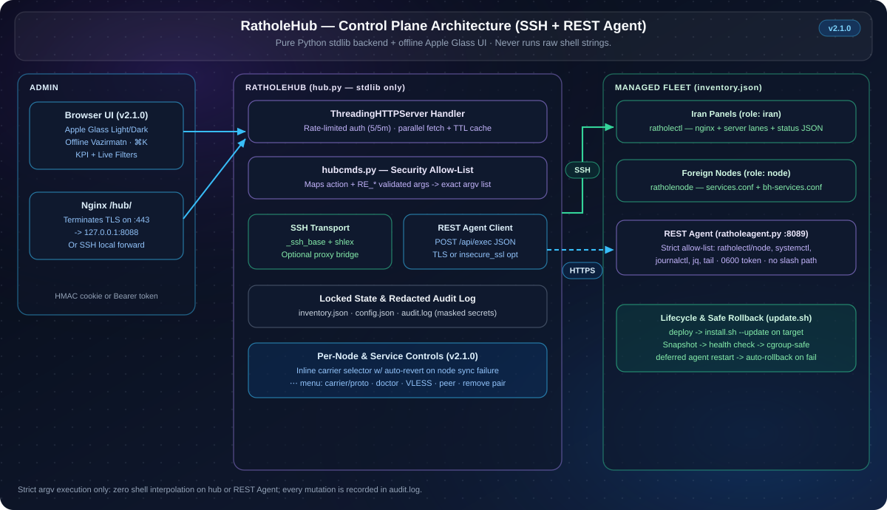
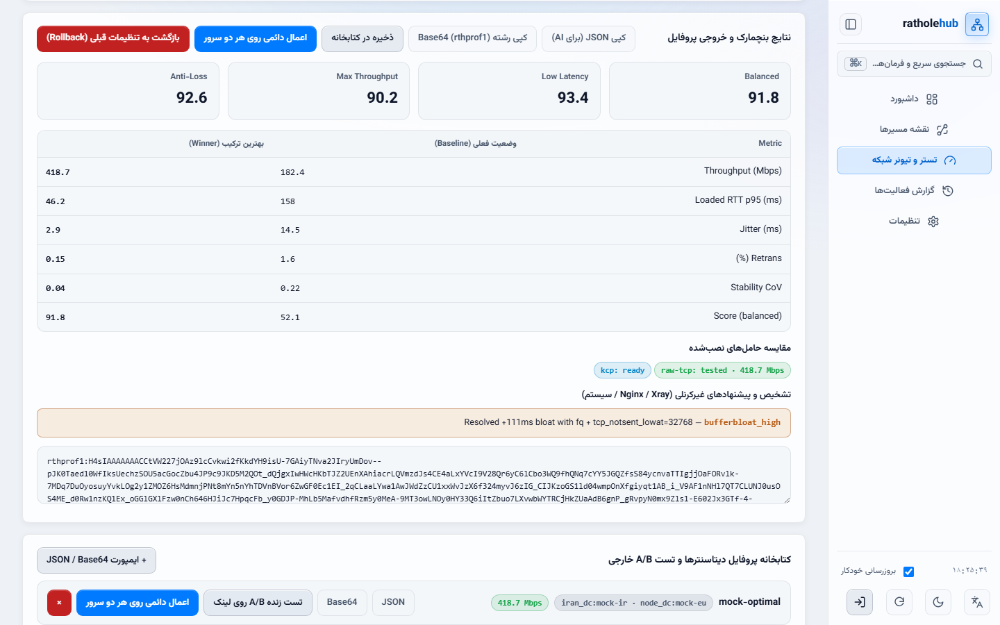

# ratholehub — پنل وب مدیریت (REST API + UI)

پنل مرکزی برای مدیریت چند سرور ایران و چند نود، بدون تداخل با سیستم فعلی. هاب از سه روش اتصال پشتیبانی می‌کند: **SSH با کلید** (پیش‌فرض)، **REST Agent** توکن‌دار (بدون SSH) و **Reverse WebSocket Agent (`reverse_ws`)** برای نودهای پشت NAT یا دارای IP فیلترشده بدون نیاز به هیچ پورت ورودی باز.



*هاب روی `127.0.0.1` پشت nginx `/hub/` می‌شنود و `ratholectl`/`ratholenode` را با یک **argv اعتبارسنجی‌شده** روی هر سرور اجرا می‌کند — از طریق SSH، REST Agent یا Reverse WebSocket؛ هرگز رشته‌ی شل خام.*

## چرا این طراحی
- **SSH پیش‌فرض، Agent مستقیم یا معکوس (Reverse WS):** پنل فقط روی یک سرور (معمولاً rp01) نصب می‌شود و از طریق **SSH با کلید** همان `ratholectl`/`ratholenode` تست‌شده را روی بقیه اجرا می‌کند؛ اگر SSH ممکن نبود، `ratholeagent.py` (نسخه `2.0.0`) هم می‌تواند با REST توکن‌دار (پیش‌فرض پورت `8089`) گوش دهد و هم با ماژول `wsutil.py` به‌صورت خروجی از سمت سرور مقصد به `/hub/ws/agent` (روی همان پورت ۴۴۳ پشت Nginx) وصل شود — [حالت REST و Reverse WS Agent](#حالت-rest-و-reverse-ws-agent-بدون-ssh).
- **بدون وابستگی pip**: هاب و Agent فقط پایتون stdlib هستند (`wsutil.py` هم از کتابخانه استاندارد RFC 6455 استفاده می‌کند). با هیچ‌چیز روی سرور تداخل نمی‌کنند.
- **REST API توکن‌دار**: برای اتصال ابزارهای دیگر/اتوماسیون و کنترل وضعیت.
- **امن**: روی `127.0.0.1` می‌شنود؛ دسترسی از طریق SSH-forward یا nginx زیر همان دامنه (یک پورت/یک دامنه حفظ می‌شود). جزئیات در [مدل امنیتی](#مدل-امنیتی).

## نصب
```bash
cd rathole-manager/ratholehub
sudo bash install-hub.sh          # رمز مدیریت می‌پرسد، API TOKEN تولید می‌کند
```

یا از روی خود سرور ایران (بار اول نصب خودکار، دفعات بعد همگام‌سازی پورت):
```bash
sudo ratholectl hub on 8088       # → https://<domain>/hub/
```

## افزودن سرورها — چهار راه

**۱) نصب خودکار (پیشنهادی): دکمه‌ی Provision در داشبورد** — یا `POST /api/provision`. یک‌بار با **رمز SSH** به سرور وصل می‌شود (نیازمند `sshpass` روی هاب)، کلید عمومی هاب را به `authorized_keys` اضافه می‌کند (idempotent)، همان‌جا deploy از GitHub را اجرا و سرور را در inventory ثبت می‌کند. کلید هاب از config (`ssh_key_path`؛ نصاب `/root/.ssh/id_ed25519` می‌سازد) می‌آید و اگر خالی باشد هاب خودش `/etc/ratholehub/id_ed25519` تولید می‌کند.

**۲) دستی:** خودت کلید را ست کن، بعد رکورد را با `POST /api/servers` و `transport: "ssh"` اضافه کن:
```bash
ssh-copy-id -i /root/.ssh/id_ed25519.pub root@<node_ip>
```

**۳) REST Agent مستقیم (بدون SSH):** روی سرور مقصد `install-agent.sh` یا `ratholectl agent on` / `ratholenode agent on` را اجرا کن، بعد رکورد را با `transport: "api"`، `api_url` و `api_token` اضافه کن.

**۴) Reverse WebSocket Agent (`reverse_ws` — بدون SSH و بدون پورت ورودی باز، مناسب نودهای فیلترشده یا پشت NAT):** در هاب نوع اتصال را روی `reverse_ws` بگذارید (یا در صفحهٔ یک سرور آفلاین روی دکمهٔ تبدیل به `reverse_ws` بزنید)، سپس دستور یک‌خطی نمایش‌داده‌شده در مودال (`sudo ratholenode agent reverse ...` یا `ratholectl agent reverse ...`) را روی سرور مقصد اجرا کنید تا خودش از طریق WebSocket خروجی به `/hub/ws/agent` (پورت ۴۴۳ Nginx) وصل شود — [بخش Reverse WebSocket Agent](#reverse-websocket-agent-reverse_ws--v240).

> اگر هاب را با `ratholectl hub on` روی همان سرور ایران بالا آورده باشید، سرور لوکال (`iran-main` روی `127.0.0.1`) به‌طور خودکار در inventory ثبت می‌شود و کلید هاب همان‌جا authorize می‌گردد (`hub_auto_register_local`).

## دسترسی
امن‌ترین (بدون باز کردن پورت) — از سیستم خودت:
```bash
ssh -L 8088:127.0.0.1:8088 root@<rp01_ip>
# مرورگر:  http://localhost:8088
```
یا پشت nginx زیر همان دامنه: `sudo ratholectl hub on 8088` → `https://<domain>/hub/`.

## رابط کاربری (UI)

از نسخه‌ی **۱.۶**، UI دیگر یک رشته‌ی درون `hub.py` نیست؛ در پوشه‌ی **`ratholehub/ui/`** کنار `hub.py` زندگی می‌کند (`index.html`، `app.css`، `app.js`، `i18n.js` و فونت متغیر آفلاین **`vazirmatn.woff2`**) و با **لیست‌سفید نام فایل** سرو می‌شود. در نسخه‌ی **۲.۱.۰** رابط وب با سبک **شیشه‌ای Apple Glass** بازطراحی شد: تم **روشن / تاریک / هماهنگ با سیستم**، مودال‌های native Top-Layer (`<dialog>`)، **پالت فرمان `⌘K / Ctrl+K`**، کارت‌های KPI، فیلتر زندهٔ جدول‌ها، بارگذاری موازی سریع‌تر وضعیت سرورها و پیام صریح همگام‌سازی دوطرفهٔ حامل؛ همراه با فارسی/انگلیسی (RTL/LTR)، layout ریسپانسیو و `prefers-reduced-motion`. هیچ build step، CDN یا وابستگی pip ندارد؛ `install-hub.sh` و `update.sh` کل درخت (`hub.py` + `hubcmds.py` + `ui/`) را نصب/به‌روز می‌کنند. refresh هوشمند فقط صفحه‌ی فعال را (پیش‌فرض هر ۲۰ ثانیه، همراه با کش TTL کوتاه‌مدت در بک‌اند) می‌خواند.

### صفحه‌های UI

| صفحه | Hash | محتوا |
|------|------|-------|
| **داشبورد** | `#/dashboard` | **۴ کارت KPI** (کل سرورها، وضعیت اتصال، تعداد نود/سرویس، سلامت هاب)، نوار وضعیت هاب، فیلتر سریع (نقش/وضعیت/متن)، کارت/فهرست سرورها با badge پروتکل و نسخه، وضعیت آنلاین/در انتظار اتصال `reverse_ws`، فرم افزودن/Provision و progress «آپدیت همه». |
| **صفحه سرور** | `#/server/<name>` | سرور ایران: چهار تب «نودها و مسیرها»، «پروتکل‌ها و حامل‌ها»، «شبکه و ورودی‌ها»، «نگهداری و سیستم»، `paqet`، جستجوی زنده، Ports و ابزارهای عیب‌یابی. نود: تونل اصلی، پروفایل‌های سریع، `paqet`، `Managed Xray` + اسکنر کاور، جدول سرویس‌ها، مودال دستور `reverse_ws` / دکمه تبدیل از سرور آفلاین و upstreamها. |
| **تستر و تیونر شبکه** | `#/tuner` | اجرای غیرهم‌زمان بنچمارک ۶ مرحله‌ای `rathole-tuner` (با ماندگاری جاب‌ها هنگام رفرش از `GET /api/tuner/jobs`)، نمایش وضعیت زنده کرنل دو سرور (`GET /api/tuner/status`)، امتیاز ۵بعدی، کپی/ایمپورت `rthprof1:` و JSON برای AI، کتابخانه پروفایل دیتاسنترها، تست A/B و اعمال/Rollback دوفازه‌ای (`--confirm-ttl 45` + `bench confirm`). |
| **نقشه مسیرها** | `#/routing` | **فقط‌خواندنی**: سه نما — گراف SVG قابل جابه‌جایی (چیدمان در مرورگر ذخیره می‌شود و دکمه‌ی reset دارد)، جدول خلاصه، و کنسول ingress/خروجی با دستور اتصال کلاینت برای هر نود. |
| **گزارش فعالیت‌ها** | `#/audit` | ۱۰۰ رکورد آخر audit زنجیره‌ای SHA-256 (با جستجو/فیلتر زنده): زمان، کاربر، سرور، action و `rc`. |
| **تنظیمات** | `#/settings` | انتخابگر سه‌حالتهٔ پوسته (**روشن / تاریک / هماهنگ با سیستم**)، تغییر زبان، پروکسی هاب، TOTP 2FA، توکن‌های RBAC، مانیتور مستقل و ربات تلگرام، رله آپدیت Ed25519 و تغییر رمز مدیر. |



در هر صفحه با **`⌘K / Ctrl+K`** (یا دکمه‌ی جستجوی بالای نوار کناری) **پالت فرمان** باز می‌شود تا فوری به هر سرور، صفحه (از جمله `#/tuner`) یا تغییر تم/زبان بپرید. در عرض موبایل (≤820px) ناوبری به نوار پایین‌چسبیده تبدیل می‌شود (`v2.3.0`). از نسخهٔ `v2.4.0` هم قابلیت **Reverse WebSocket (`reverse_ws`)** و محافظ دوفازه‌ای Watchdog تیونر به‌صورت بومی در همین UI در دسترس است. صفحه‌ی «بورد سیم‌کشی» وجود ندارد؛ لینک قدیمی `#/wiring` به داشبورد برمی‌گردد.

### سلکتور حامل در ردیف هر نود (نسخهٔ ۲.۰.۴)

در صفحه‌ی **ایران**، ردیف هر نود یک **سلکتور حامل** دارد؛ یعنی بدون باز کردن مودال، حامل همان نود را از داخل جدول عوض می‌کنید:

```
حذف · ⋯ · [حامل ▾] · چرخش توکن · تغییر نام · ویرایش · افزودن به نود · نصب / توکن
```

گزینه‌های سلکتور: `ws` · `kcp` · `plain` · `noise` · `backhaul` · `frp` · `gre` · `frp_gre`

**رفتار (یک‌کلیکی و دوطرفه):**

1. یک تأیید کوتاه می‌پرسد.
2. حامل را روی **هر دو سمت** اعمال می‌کند — سمت ایران و سمت نود — با پارامترهای خودکار: پورت اینباند فعلی حفظ می‌شود، IP عمومی هر دو سمت خودکار تشخیص داده می‌شود، ترانسپورت FRP از وضعیت فعلی و پروفایل KCP/Backhaul روی `balanced` می‌ماند.
3. اگر همگام‌سازی سمت نود شکست بخورد، **مقدار سلکتور به حالت قبل برمی‌گردد** تا تانل نیمه‌کاره/قطع نشود.
4. برای `frp`، `gre` و `frp_gre` (که IP عمومی و ترانسپورت صریح می‌خواهند) به‌جای اعمال فوری، **مودال «حامل و پروتکل»** باز می‌شود تا مقادیر را تأیید کنید.
5. روی نودهای **Game/SNI** سلکتور نمایش داده نمی‌شود (به‌جایش برچسب `game`) چون سرویس L4 روی ۴۴۳ حاملی برای تعویض ندارد؛ مدیریتشان در بخش «سرویس‌های گیمینگ» است.

### کنترل سرویس‌ها — منوی ⋯ (نسخهٔ ۲.۰.۲، بازچینش‌شده در ۲.۰.۴)

بورد سیم‌کشی ویژوال (`#/wiring`) در v2.0.2 حذف شد و جایش **کنترل‌های سرویس** آمد. از v2.0.4 این پنج اکشن برای تک‌خطی‌ماندن ردیف، زیر دکمه‌ی **⋯** جمع شده‌اند — هم در صفحه‌ی ایران و هم در صفحه‌ی نود:

| دکمه | کار |
|------|-----|
| **حامل و پروتکل** | مودال کامل تغییر حامل/پروتکل سرویس: `ws`، `kcp`، `plain`، `noise`، `backhaul`، `frp`، `gre` و ترکیبی `frp+gre`؛ همراه با انتخاب نود خارجی، IP عمومی ایران/نود، آدرس مجازی GRE، ترانسپورت FRP/Backhaul، پروفایل و پورت اختصاصی حامل. |
| **تست سلامت** | `doctor` را روی سرور ایران اجرا می‌کند و خروجی را نشان می‌دهد؛ در پایان وضعیت تازه خوانده می‌شود. |
| **ساخت کانفیگ VLESS** | لینک `vless://` می‌سازد و کپی می‌کند (توضیح پایین). |
| **مدیریت سمت مقابل** | از صفحه‌ی ایران به صفحه‌ی نودِ سمت مقابل می‌رود (و اگر مقصد یکتا نباشد پیام خطا می‌دهد)؛ از صفحه‌ی نود، اگر چند سرور ایران همان سرویس را داشته باشند، سرور ایران از شما پرسیده می‌شود. |
| **حذف از دو سمت** | پس از تأیید، `rm_node` روی ایران و در صورت وجود `rm_svc`/`rm_bh_svc` روی نود را اجرا می‌کند؛ اگر overview نود در دسترس نباشد یا لیست سرویس‌هایش ناقص باشد، از حذف خودداری می‌کند. |

**تفاوت سلکتور و دکمهٔ «حامل و پروتکل»:** هر دو به یک موتور می‌رسند و هر دو دوطرفه‌اند؛ سلکتور برای جابه‌جایی سریع با مقادیر خودکار است و دکمهٔ مودال برای کنترل دستی (سرور چند-IP، GRE، پورت سفارشی، پروفایل لینک پرافت).

**ساخت کانفیگ VLESS**: UUID واقعی کاربر Xray، دامنه/IP عمومی ایران، پورت (پیش‌فرض 443)، SNI و مسیر WebSocket (`/<name>`) را می‌گیرد؛ UUID، پورت ۱–۶۵۵۳۵، مسیرِ شروع‌شده با `/` و هاست غیر-loopback را اعتبارسنجی می‌کند و لینک `vless://<uuid>@<host>:<port>?type=ws&security=tls&path=/<name>[&sni=...]#<name>` را کپی می‌کند. این ابزار کاربر Xray ایجاد نمی‌کند.

**برچسب حامل**: نام حامل همراه پروتکل گزارش‌شده از سرور نمایش داده می‌شود، مثل `FRP / QUIC`، `FRP / TCP`، `Backhaul / WSMUX`، `KCP / UDP · balanced`، `Noise / TCP`، `WebSocket / TLS`، `WebSocket / TCP`، `GRE / WebSocket` و `SNI / TLS`. علامت `?` یعنی پروتکل از سرور دریافت نشده است. این برچسب به‌تنهایی تضمین اتصال نیست؛ دکمه‌ی تست سلامت خروجی doctor را نشان می‌دهد.

**رفتار تغییر حامل**:
- تغییر حامل، پورت اینباند موجود را از وضعیت تازه‌ی ایران می‌خواند و آن را تغییر نمی‌دهد (نگاشت `127.0.0.1:<iran_port>` و اینباند نود حفظ می‌شود).
- Backhaul رجیستری جدا دارد (`bh-services.conf`): سرویس منتقل‌شده به Backhaul از `services.conf` خارج و در registry بک‌هال ثبت می‌شود و بالعکس.
- **ترانسپورت FRP به یاد می‌ماند** (v2.0.5): اگر FRP را روی `kcp`/`quic` گذاشته باشی و بعد حامل را موقتاً به `ws` ببری (`frp off` اجرا می‌شود)، دفعهٔ بعد که FRP را دوباره تنظیم کنی همان ترانسپورت قبلی پیش‌فرض می‌شود — نه `tcp`. `ratholectl frp status` هم در حالت خاموش آخرین ترانسپورت را نشان می‌دهد.
- حامل اصلی بین سرویس‌های Rathole یک نود مشترک است؛ تغییر پورت/پروتکل یک شنوندهٔ مشترک ایران ممکن است نیازمند هماهنگ‌سازی سایر نودهای همان شنونده باشد.
- سرویس‌های Game/SNI: دکمه‌های «حامل و پروتکل» و «ساخت کانفیگ» پیام راهنما نشان می‌دهند؛ مدیریت آن‌ها در بخش «سرویس‌های گیمینگ (SNI/443)» صفحه‌ی ایران است.
- اگر عملیات چندسروری نیمه‌کاره بماند، نتیجه‌ی ناقص اعلام و وضعیت دوباره خوانده می‌شود؛ بازگشت خودکار کامل برای همه‌ی ترکیب‌های حامل تضمین نشده است.

### بخش پورت‌ها (Ports)

از نسخه‌ی **1.6.0-beta.6**، پورت‌های سرور ایران در یک **بخش جداگانه** در صفحه‌ی هر سرور قرار گرفت (قبلاً داخل مودال Domain & TLS بود):

| پورت | قابل ویرایش؟ | توضیح |
|------|-------------|-------|
| `fake-port` | ✅ بله | پورت سایت فیک (پیش‌فرض: 8080) |
| `sub-port` | ✅ بله | پورت subscription (پیش‌فرض: 2096) |
| `control-port` | ✅ بله | پورت کنترل rathole (پیش‌فرض: 2333) |
| `internal` | ❌ فقط نمایش | پورت پنل داخلی (پشت SNI) |
| `hub` | ❌ فقط نمایش | پورت hub |
| `plain` | ❌ فقط نمایش | پورت plain (ws بدون TLS) |
| `noise` | ❌ فقط نمایش | پورت noise |
| `backhaul` | ❌ فقط نمایش | پورت backhaul (SMUX) |
| `direct` | ❌ فقط نمایش | پورت direct-IP |

برای ویرایش: روی **«Manage»** در بخش **Ports** کلیک کنید. `sub-path` و `hub-path` هم قابل ویرایش‌اند؛ پورت‌های متعلق به carrier فقط نمایش داده می‌شوند چون lifecycle آن‌ها با روشن/خاموش‌شدن carrier کنترل می‌شود.

### قابلیت‌های کلیدی (v2.0)

- **مدل چند سطحیِ carrier و lane** — سمت ایران carrierهای رتهول، هسته‌ی بک‌هال، هسته‌ی FRP، و اینترفیس‌های GRE جداگانه کنترل می‌شوند.
- **پشتیبانی کامل از هسته FRP و GRE** — کنترلرهای سرور و کلاینت FRP (`frp_on`, `frp_off`, `frp_status`, `frp_show`) و اینترفیس‌های L3 لینوکس GRE (`gre_on`, `gre_off`, `gre_status`, `gre_probe`) به همراه حالت ترکیبی FRP+GRE.
- **کنترل سرویس از ردیف سرویس** (v2.0.2) — جای بورد سیم‌کشی را گرفت: تعیین حامل/پروتکل، تست سلامت، ساخت کانفیگ VLESS، مدیریت سمت مقابل و حذف از دو سمت.
- **سلکتور حامل در ردیف نود** (v2.0.4) — تعویض حامل یک نود از داخل جدول صفحه‌ی ایران، یک‌کلیکی و با همگام‌سازی خودکار دوطرفه و بازگشت در صورت خطا (بخش قبل).
- **تعیین حاملِ هدایت‌شده** — انتخاب حامل برای یک نود یک عمل واحد است: اگر سمت ایران آن حامل فعال نباشد اول فعالش می‌کند، برای `noise`/`backhaul`/`frp` نود را سمت ایران به آن مسیر می‌برد، سمت نود را با پارامترهای **گرفته‌شده‌ی خودکار از سرور ایران** ست می‌کند، و حامل قبلی را سمت ایران پاک می‌کند تا state ناسازگار نماند.
- **صفحه‌ی تنظیماتِ کامل‌تر** — `fake-port`، `sub-port` و `control-port` حالا از UI قابل ویرایش‌اند.
- **ریورس‌پروکسی غیرتونلی (`proxy`)** — اکشن‌های `proxy_add`/`proxy_rm`/`proxy_ls` برای ساختن مسیر `/<name>/` روی همان ۴۴۳ که به یک upstream دلخواه (غیر از rathole) proxy می‌شود.
- **تقسیم فایل** — نقشه‌ی امنیتی action→argv در **`hubcmds.py`** و رابط کاربری کامل در `ui/` بدون هیچ وابستگی خارجی.
- **Backhaul dual-core** — جدول مستقل سرویس‌های lane بک‌هال و actionهای `add_bh_svc`/`rm_bh_svc`/`backhaul_status`/`backhaul_logs`.
- **پروکسی هاب** — پروکسی سراسری (config) یا مخصوص هر سرور (فیلد `proxy`)؛ برای SSH از پل `ssh_proxy.py` و برای REST Agent در خود درخواست‌های HTTP(S) اعمال می‌شود.

### قابلیت‌های تازه (v1.4.5–v1.4.7)

- **دکمه «وضعیت» (Status)** روی صفحه‌ی هر سرور ایران — action `status` را می‌زند (`ratholectl status --json`) و خروجی را به‌جای متن خام، به‌صورت یک **داشبورد** زیبا رندر می‌کند: جدول پورت‌ها (کنترل/sub/internal/plain/direct/hub/noise)، وضعیت **گواهی** (تاریخ انقضا + badge اگر self-signed)، و جدول **نودها** (name / port / inbound / URL کاربر). اگر خروجی JSON معتبر نبود، به نمایش متنی برمی‌گردد.

- **دکمه «آپدیت همه»** در داشبورد — همه‌ی سرورها را **یکی‌یکی و ترتیبی** از طریق action `deploy` (معادل `install.sh --update` با snapshot + rollback خودکار) آپدیت می‌کند. یک **progress bar** با شمارنده‌ی `done/total` و وضعیت زنده‌ی هر سرور: **در صف** → **در حال آپدیت** → **✓** (با نسخه‌ی جدید) یا **✗ (rc=…)**. سرورِ خودِ هاب هم در لیست است؛ چون آپدیت ممکن است سرویس هاب را ری‌استارت کند، همان یک سطر ممکن است نیمه‌کاره بماند.

- **نمایش نسخه روی هر سرور** — badge سبز یعنی هم‌سان با آخرین نسخه، قرمز به‌شکل `vX → vY` یعنی قدیمی است. نسخه از `ratholectl`/`ratholenode version` خوانده و با `latest_version` در `GET /api/hubstatus` مقایسه می‌شود (هاب آن را از `MANAGER_VERSION` در `common.sh` bundle می‌خواند).

- **دکمه «افزودن به نود» (wire-to-node)** در جدول نودهای هر سرور ایران — نود ایران (با name/token/inbound واقعی‌اش) را روی یک نود خارج یا اپ‌استریمِ آن به‌عنوان سرویس اضافه می‌کند. endpoint: `GET /api/servers/<iran>/nodeconnect/<node>` (چون توکن در `ls` ماسک شده) سپس `add_svc` (یا `upstream_add_svc`).

- **دکمه «تنظیم تانل اصلی» (set main tunnel)** در صفحه‌ی هر نود — نود را با ست‌کردن `SERVER=host:443` (action `set_server`/`set_main`) به یک سرور ایرانِ ثبت‌شده وصل می‌کند. فرم Provision هم select «سرور ایران» دارد و پس از deploy موفق تانل اصلی را خودکار ست می‌کند.

## حالت REST و Reverse WS Agent (بدون SSH)

`rathole-manager/ratholeagent.py` (نسخه **`2.0.0`**) به‌همراه ماژول خالص stdlib **`rathole-manager/wsutil.py`** یک دیمن دوحالته است که مدیریت بدون SSH را چه به‌صورت **REST مستقیم** و چه به‌صورت **Reverse WebSocket (`reverse_ws`)** ممکن می‌سازد. سرویس systemd آن روی هر دو نقش `rathole-agent.service` است (سخت‌سازی‌شده در v2.4.0 با `StartLimitIntervalSec=0`، `LimitNOFILE=65535` و `KillMode=process`).

### نصب و مدیریت (REST مستقیم)

```bash
# روی خود سرور (root؛ python3 لازم است) — role خودکار از /etc/rathole/server.toml یا state.json تشخیص داده می‌شود
sudo install-agent.sh
sudo install-agent.sh --role iran --port 8089 --token <TOKEN>

# یا از CLI نصب‌شده:
sudo ratholectl agent on 8089 [TOKEN]     # ایران
sudo ratholenode agent on 8089 [TOKEN]    # نود
sudo ratholectl agent status|token|show|restart|off
```

روی سرورِ نصب‌شده، فایل‌های agent از قبل همراه بسته نصب شده‌اند: `install-panel.sh`/`install-node.sh` فایل‌های `ratholeagent.py`، `wsutil.py` و `install-agent.sh` را در `/usr/local/share/rathole/` می‌گذارند و `install-agent.sh` را در `/usr/local/bin/` سیم‌لینک می‌کنند؛ پس همان `sudo install-agent.sh ...` بدون دانلود چیزی کار می‌کند. `update.sh` هر سه فایل را snapshot/به‌روز می‌کند و توکن موجود را نگه می‌دارد (و هنگام ری‌استارت از داخل خود agent از `_schedule_agent_restart` جداشده استفاده می‌کند تا سرویس وسط آپدیت کشته نشود)؛ uninstallerها unit و `/etc/rathole-agent` را پاک می‌کنند.

توکن در `/etc/rathole-agent/token` (chmod 600) نگهداری می‌شود؛ اگر توکنی با `--token` (یا آرگومان CLI) داده نشود و فایل هم نباشد، یک توکن hex خودکار ساخته می‌شود. `agent show` آدرس و وضعیت حالت فعال (REST یا Reverse WS) و توکن را چاپ می‌کند.

### Reverse WebSocket Agent (`reverse_ws` — v2.4.0)

وقتی IP نود یا پورت `8089` توسط فایروال/فیلترینگ/NAT بسته است ولی نود می‌تواند اتصال خروجی بزند، به‌جای گوش‌دادن سرور روی پورت ورودی، خودِ `ratholeagent.py` اتصال مداوم WebSocket (منطبق با RFC 6455 در `wsutil.py`) را از نود به هاب باز می‌کند:

- **مسیر اتصال روی هاب:** `GET /hub/ws/agent` (روی پورت `443` پشت TLS Nginx؛ مناسب عبور از فیلترینگ) یا `GET /ws/agent` (مثلاً اتصال مستقیم `ws://<HUB_IP>:8088/ws/agent`).
- **نصب از CLI (نود یا ایران):**
  ```bash
  sudo ratholenode agent reverse "wss://<DOMAIN>/hub/ws/agent" "<NAME>" "<TOKEN>" [--insecure-ssl] [--proxy <url>]
  # روی سرور ایران:
  sudo ratholectl agent reverse "wss://<DOMAIN>/hub/ws/agent" "<NAME>" "<TOKEN>" [--insecure-ssl] [--proxy <url>]
  # یا با install-agent.sh:
  sudo install-agent.sh --role node --reverse "wss://<DOMAIN>/hub/ws/agent" --name "<NAME>" --token "<TOKEN>" [--insecure-ssl] [--proxy <url>]
  ```
- **امکانات و ایمنی:** پشتیبانی از `--insecure-ssl` (برای گواهی self-signed هاب)، `--proxy <http://host:port>` (HTTP `CONNECT`)، Ping/Pong و TCP Keepalive خودکار، صف موازی اجرای دستورات (`ThreadPoolExecutor(16)`)، سقف فریم 4 MiB، backoff نمایی اتصال مجدد، شناسایی خودکار IP نود هنگام اعمال FRP/GRE/تیونر و اجرای آپدیت راه‌دور (`deploy`) روی نشست معکوس. در اتصال مجدد، نشست تازه به‌صورت اتمیک جایگزین نشست قبلی می‌شود.
- **در رابط کاربری هاب:** هنگام افزودن سرور، گزینهٔ **Reverse WebSocket (`reverse_ws`)** در `#conn_tr` مودال کپی دستور آماده را باز می‌کند؛ همچنین روی سرورهای آفلاین REST API در `#/server/<name>` دکمهٔ تبدیل یک‌کلیکی به `reverse_ws` نمایش داده می‌شود و پس از اتصال، badge وضعیت آنلاین/در انتظار و قابلیت چرخش توکن (`rotate_token`) فعال می‌گردد.

رکورد سرور `reverse_ws` در inventory:

```json
{"name":"node1","role":"node","transport":"reverse_ws","api_token":"<token>"}
```

### قرارداد API (حالت REST مستقیم)

```
GET /api/ping
→ {"ok":true,"role":"node","version":"2.0.0","hostname":"..."}      # بدون احراز هویت

POST /api/exec
Authorization: Bearer <token>
{"cmd":["ratholectl","status","--json"],"timeout":120}
→ {"ok":true,"rc":0,"out":"...","err":""}
```

- در سرور REST (`_AgentHTTPServer`) صف اتصال `request_queue_size = 64` به همراه `TCP_NODELAY` و TCP Keepalive فعال است و قطع سوکت پیش از پاسخ (`BrokenPipeError`/`ConnectionResetError`) تمیز مدیریت می‌شود.
- احراز هویت: هدر `Authorization: Bearer <token>` با compare ثابت‌زمان (اجرای agent با توکن خالی مسدود است)؛ هدر غایب/طرح نامعتبر → `401`، توکن اشتباه → `403`.
- بدنه: ۱ بایت تا ۱ مگابایت؛ `cmd` باید لیست غیرخالی از رشته‌ها باشد (بدون NUL)؛ `timeout` عدد صحیح ۱ تا ۳۶۰۰ ثانیه. پیشوند اختیاری `["timeout", N, ...]` هم پذیرفته و clamp می‌شود.
- **لیست‌سفید باینری**: `ratholectl`، `ratholenode`، `systemctl`، `journalctl`، `jq`، `tail` (هر باینری دیگری یا `cmd[0]` دارای `/` → `403`).
- اجرا مستقیم argv است (بدون شل)؛ در timeout، process group کشته می‌شود.
- پیش‌فرض شنود REST: `--host 0.0.0.0 --port 8089 --role node|iran`.

### HTTPS و گواهی self-signed

- Agent: `--tls-cert`/`--tls-key`، یا `RATHOLE_AGENT_TLS_CERT`/`RATHOLE_AGENT_TLS_KEY`، یا فایل‌های پیش‌فرض `/etc/rathole-agent/cert.pem` و `key.pem`.
- هاب به‌طور پیش‌فرض گواهی را verify می‌کند؛ برای گواهی self-signed در حالت REST رکورد سرور `insecure_ssl: true` بگذارید (یا `RATHOLE_AGENT_INSECURE_SSL=1`) و در حالت Reverse WS از فلگ `--insecure-ssl` روی کلاینت نود استفاده کنید.

### سمت هاب (REST مستقیم)

رکورد سرور در inventory:

```json
{"name":"node1","role":"node","transport":"api",
 "api_url":"https://203.0.113.10:8089","api_token":"<token>",
 "insecure_ssl":true}
```

`api_url` فقط باید طرح (`http`/`https`) + هاست + پورت اختیاری داشته باشد (بدون مسیر، userinfo یا query). هاب هر argv را به `<api_url>/api/exec` می‌فرستد (`run_on_agent`) و `{rc,out,err}` را مثل SSH برمی‌گرداند؛ پروکسی سراسری/سرور روی همین درخواست هم اعمال می‌شود. در حالت `reverse_ws` همان argv از طریق `run_on_reverse_agent` روی سوکت WebSocket بازشده از سوی نود فرستاده می‌شود. همه‌ی actionها همچنان از allow-list `hubcmds.py` عبور می‌کنند و عملیات نوشتاری در audit ثبت می‌شود.

## مرجع REST API

همه‌ی مسیرها هدر `Authorization: Bearer <API_TOKEN>` (یا کوکی نشست از UI) می‌خواهند؛ فقط `GET /api/health` عمومی است و `GET /ws/agent` با توکن سرور یا کوکی هاب احراز هویت می‌شود. همان مسیرها با پیشوند `/hub/api/...` (و `/hub/ws/agent`) هم پذیرفته می‌شوند (چون nginx هاب را زیر `/hub/` سرو می‌کند).

| متد | مسیر | توضیح |
|-----|------|-------|
| GET | `/api/health` | عمومی: `{ok, mock}` |
| GET | `/ws/agent` \| `/hub/ws/agent` | نقطه اتصال WebSocket برای `reverse_ws` Agent (ارتقای RFC 6455 + احراز هویت Bearer) |
| POST | `/api/login` | `{"password":"..."}` → `{ok, token}` (همان API token) + کوکی `rhsession` |
| GET | `/api/hubstatus` | وضعیت هاب: uptime/load/RAM/دیسک، سرویس‌ها، پروکسی، `latest_version` |
| GET | `/api/servers` | لیست inventory (به‌همراه وضعیت نشست آنلاین/در انتظار برای `reverse_ws`) |
| POST | `/api/servers` | افزودن سرور: `{name, role, transport ("ssh"|"api"|"reverse_ws"), ...}` |
| PUT | `/api/servers/<name>` | ویرایش رکورد (پشتیبانی از `rotate_token` برای تولید توکن جدید در `reverse_ws`) |
| DELETE | `/api/servers/<name>` | حذف رکورد (و بستن نشست فعال در `reverse_ws`) |
| POST | `/api/provision` | نصب خودکار با رمز SSH (کلید + deploy + ثبت) |
| GET | `/api/servers/<name>/status` | اجرای چند بررسی read-only (`status`، `doctor`، `kcp_status`، `plain_status`، `noise_status`، `backhaul_status` و …) |
| GET | `/api/servers/<name>/overview` | خلاصه + نسخه + doctor + carrierها + status |
| GET | `/api/servers/<name>/discover` | نودهای تعریف‌شده روی ایران |
| GET | `/api/servers/<name>/details` | خروجی تشخیصی متنی |
| GET | `/api/servers/<name>/frpconnect` | داده‌ی autofill اتصال FRP |
| GET | `/api/servers/<name>/kcpconnect` | داده‌ی autofill اتصال KCP |
| GET | `/api/servers/<name>/noiseconnect` | داده‌ی autofill اتصال Noise |
| GET | `/api/servers/<name>/backhaulconnect` | داده‌ی autofill اتصال Backhaul |
| GET | `/api/servers/<name>/paqetconnect` | آدرس/کلید/مد سرور Paqet روی نود |
| GET | `/api/servers/<name>/mainconnect` | داده‌ی autofill تونل اصلی (`server`، `domain`، `tls_hostname`، `control_path`، `dial_ip`) |
| GET | `/api/servers/<iran>/nodeconnect/<node>` | token/inbound/remote_port واقعی نود ایران |
| GET | `/api/fleet/drift` | بررسی انحراف نسخه/تنظیمات ناوگان (فقط‌خواندنی) |
| GET | `/api/audit/verify` | بررسی سلامت زنجیره هش SHA-256 لاگ ممیزی |
| GET | `/metrics` | متریک‌های Prometheus (دسترسی `read`) |
| GET/POST | `/api/tokens` | مدیریت توکن‌های باسطح دسترسی (`read`/`operate`/`admin`) |
| POST | `/api/2fa/setup` \| `enable` \| `disable` | راه‌اندازی احراز هویت دو مرحله‌ای TOTP 2FA |
| GET/POST | `/api/monitor/config` \| `test` \| `diagnose` | پیکربندی سرویس مانیتور مستقل و ربات تلگرام |
| GET | `/api/releases/asset` | رله دریافت بسته‌های ریلیز و امضای Ed25519 از درون تونل |
| POST | `/api/tuner/start` | شروع بنچمارک ۶ مرحله‌ای `rathole-tuner` (دسترسی `operate`) |
| GET/POST | `/api/tuner/jobs` \| `/api/tuner/jobs/<id>/cancel` | وضعیت یا توقف جاب‌های بنچمارک تیونر |
| GET | `/api/tuner/status` | دریافت وضعیت زنده کرنل دو سرور (`cc`، `qdisc`، `mtu`، `rmem_max`، `notsent_lowat`، پروفایل فعال) |
| GET/POST/DELETE | `/api/tuner/profiles` | کتابخانه پروفایل دیتاسنترها (ایمپورت/خروجی `rthprof1:` و JSON) |
| POST | `/api/tuner/apply` \| `/api/tuner/rollback` | اعمال دوفازه‌ای ایمن (`--confirm-ttl 45` + `bench confirm`) با بازگشت خودکار ایران در صورت شکست نود، یا Rollback دستی |
| POST | `/api/servers/<name>/action` | `{"action":"...","args":{...}}` → اجرای یک action مجاز |
| GET | `/api/config` | پیکربندی redact‌شده (توکن فقط hint) |
| POST | `/api/config` | چرخش توکن / تغییر رمز مدیر / پروکسی / `ssh_key_path` |
| GET | `/api/audit?limit=N` | لاگ فعالیت (۱ تا ۵۰۰، پیش‌فرض ۱۰۰) |
| POST | `/api/ip-tls/prepare` | آماده‌سازی IP-TLS برای نود |

نمونه:

```bash
TOKEN=... ; B=http://localhost:8088
curl -s -H "Authorization: Bearer $TOKEN" $B/api/servers
curl -s -H "Authorization: Bearer $TOKEN" -X POST $B/api/servers/rp01/action \
  -d '{"action":"status","args":{}}'

# ثبت یک سرور با REST Agent
curl -s -H "Authorization: Bearer $TOKEN" -X POST $B/api/servers \
  -d '{"name":"node1","role":"node","transport":"api",
       "api_url":"http://203.0.113.10:8089","api_token":"<agent-token>"}'
```

## مدل امنیتی

هاب هیچ‌وقت **رشته‌ی خام** روی سرورها اجرا نمی‌کند. هر درخواست به یک `action` مجاز از allow-list نگاشت می‌شود و آرگومان‌ها با regex (خانواده‌ی `RE_*`) اعتبارسنجی می‌شوند؛ سپس `build_iran_cmd`/`build_node_cmd` آن را به یک **argv لیستی** تبدیل می‌کنند:

- روی SSH: argv به‌صورت shell-safe (`shlex.join`) بعد از `--` به SSH داده می‌شود (`run_on_server` → `_ssh_base`).
- روی REST Agent / Reverse WS Agent: همان argv به‌صورت آرایه‌ی JSON از طریق `POST /api/exec` (یا فریم RFC 6455 روی `/hub/ws/agent` از طریق `run_on_reverse_agent`) فرستاده می‌شود؛ هیچ شلی در کار نیست.

این نقشه (regexها، `build_*_cmd`، `WRITE_ACTIONS`) از v1.6 در ماژول جدا و کوچکی به نام **`hubcmds.py`** زندگی می‌کند تا حساس‌ترین بخش هاب قابل‌مرور بماند.

- **whitelist دقیق**: هر action تازه باید هم به `build_*_cmd` مربوطه و هم به allow-list افزوده شود و هر آرگومانش با regex بررسی شود (`bench_confirm` در `v2.4.0` به `WRITE_ACTIONS` اضافه شده است).
- **مشترک (هر دو نقش)**: `deploy` (آپدیت از راه دور: `install.sh --update` روی خود سرور + snapshot/rollback، حتی از طریق `reverse_ws`)، `status`, `version`, `logs`, `bench_apply`, `bench_confirm`, `bench_rollback`, `bench_status`.
- **iran**: `ls`, `doctor`, `status`, `regen`, مدیریت transport (`kcp_*`, `plain_*`, `noise_*`, `backhaul_*`, `frp_*`, `gre_*`, `direct_*`)، مدیریت game (`game_*` — `game_cert` گواهی Let's Encrypt می‌گیرد و خروجی شامل **کلید خصوصی** است؛ فقط از هابِ احرازشده استفاده کن و لاگ نگه ندار)، مدیریت نود (`add_node`, `rm_node`, `edit_node`, `rename_node`, `rotate_node`, `show_node`)، دامنه/TLS (`domain_*`, `tls_*`) و ریورس‌پروکسی غیرتونلی (`proxy_*`).
- **node**: `show`, `ls`, `upstream_*`, `set_server`, `set_main`, مدیریت سرویس (`add_svc`, `rm_svc`, `add_bh_svc`, `rm_bh_svc`)، کنترل مسیر (`control_path_*`)، transport (`kcp_*`, `plain_*`, `noise_*`, `backhaul_*`, `frp_*`, `gre_*`)، watchdog/adaptive و `apply`/`restart`/`migrate`.
- **`WRITE_ACTIONS`** مجموعه‌ی actionهای نوشتاری را مشخص می‌کند؛ همان‌ها (به‌همراه `deploy`، `provision` و `config_save`) در **audit log** ثبت می‌شوند: کاربر (IP)، سرور، action، دستور و `rc` — فایل append-only در `/etc/ratholehub/audit.log` و قابل‌مشاهده در `#/audit`.
- روی `127.0.0.1` می‌شنود (پشت nginx زیر `/hub/` یا SSH-forward)؛ هیچ پورت عمومی جدیدی باز نمی‌شود. ورود مدیر محدود به ۵ تلاش ناموفق در ۵ دقیقه برای هر IP است (`429`)؛ کوکی نشست `rhsession` = `hmac(api_token, expiry)` با اعتبار ۲۴ ساعت.
- `deploy_to_server` (دکمه‌ی «آپدیت»/«آپدیت همه») روی خودِ سرور آخرین `install.sh` را از GitHub (از طریق حلقه‌ی mirror ghproxy) می‌گیرد و با `--update` اجرا می‌کند؛ slug مخزن از config (`gh_repo`، پیش‌فرض `l8PYGIT/RatholeEngine`، اعتبارسنجی با `RE_SLUG`) و کانال از `update_channel` (`stable|beta`، `RE_CHAN`) می‌آید و فقط همین دو مقدارِ اعتبارسنجی‌شده در دستور ثابت `bash -c` جای‌گذاری می‌شوند.
- **REST / Reverse WS Agent**: احراز هویت Bearer، مقایسهٔ ثابت‌زمان، لیست‌سفید باینری (`ALLOWED_BINARIES`)، سقف ۱ مگابایت بدنه در HTTP و سقف فریم ۴ مگابایت در WebSocket (`wsutil.py`)، و timeout ۱–۳۶۰۰ ثانیه. جزئیات در [حالت REST و Reverse WS Agent](#حالت-rest-و-reverse-ws-agent-بدون-ssh).

## توسعه‌ی محلی (حالت Mock)

```bash
RATHOLEHUB_MOCK=1 RATHOLEHUB_PORT=8088 python3 rathole-manager/ratholehub/hub.py
# مرورگر: http://127.0.0.1:8088
# RATHOLEHUB_MOCK=1 → هیچ SSH‌ای اجرا نمی‌شود و پاسخ‌های ساختگی برمی‌گردند
```

متغیرهای محیطی: `RATHOLEHUB_HOST`، `RATHOLEHUB_PORT`، `RATHOLEHUB_CONF`، `RATHOLEHUB_INV`، `RATHOLEHUB_AUDIT`، `RATHOLEHUB_MOCK`.

## ساختار فایل‌ها (v1.6+)

UI دیگر درون `hub.py` نیست و در `ratholehub/ui/` کنار آن زندگی می‌کند:

```
rathole-manager/
├── ratholeagent.py   دیمن Agent دوحالته (REST :8089 و Reverse WS خروجی)
├── wsutil.py         ماژول خالص stdlib کلاینت/سرور RFC 6455 WebSocket
└── ratholehub/
    ├── hub.py        سرور اصلی (ThreadingHTTPServer، routing، SSH/Agent/WS، API)
    ├── hubcmds.py    نقشهٔ action→argv + regexهای آرگومان (حساس؛ کوچک بماند)
    ├── ssh_proxy.py  پل SOCKS5/HTTP CONNECT برای SSH از طریق پروکسی
    ├── README.md     همین سند به‌صورت خلاصه
    └── ui/
        ├── index.html
        ├── app.css
        ├── app.js
        ├── i18n.js         رشته‌های فارسی/انگلیسی
        └── vazirmatn.woff2 فونت متغیر آفلاین (RTL)
```

فایل‌ها با **لیست‌سفید نام فایل** سرو می‌شوند (هیچ path joining، پس path traversal ممکن نیست). `install-hub.sh` و `update.sh` کل درخت را نصب/به‌روز می‌کنند.

## جستارهای مرتبط

- [مرجع CLI (ویکی)](https://l8pygit.github.io/RatholeEngine/wiki/CLI-Reference/) — `ratholectl hub` / `ratholectl agent` و دستورهای مرتبط
- [مدیریت هاب (ویکی)](https://l8pygit.github.io/RatholeEngine/wiki/Hub-Management/) — نسخهٔ ویکی همین صفحه
- [`hub.en.md`](hub.en.md) — نسخهٔ انگلیسی این سند
- [`architecture.md`](architecture.md) — نمای کلی معماری
- [`README.fa.md`](README.fa.md) — مرجع کامل CLI
