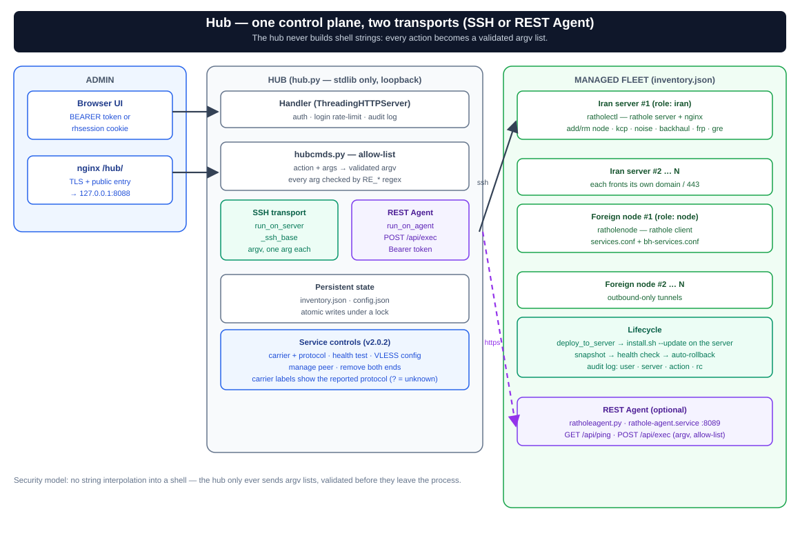

# ratholehub — پنل وب مدیریت (REST API + UI)

پنل مرکزی برای مدیریت ویژوال چند سرور ایران و چند نود، بدون تداخل با سیستم فعلی.



*هاب روی `127.0.0.1` پشت nginx `/hub/` می‌شنود و با SSH (کلید) روی هر سرور، `ratholectl`/`ratholenode` را با یک **argv اعتبارسنجی‌شده** اجرا می‌کند — هرگز رشته‌ی شل خام.*

## چرا این طراحی
- **بدون agent روی نودها**: پنل فقط روی یک سرور (معمولاً rp01) نصب می‌شود و از طریق **SSH با کلید** همان `ratholectl`/`ratholenode` تست‌شده را روی بقیه اجرا می‌کند. هیچ پورت/سرویس جدیدی روی نودها باز نمی‌شود.
- **بدون وابستگی pip**: فقط پایتون stdlib. با هیچ‌چیز روی سرور تداخل نمی‌کند.
- **REST API توکن‌دار**: برای اتصال ابزارهای دیگر/اتوماسیون و کنترل وضعیت.
- **امن**: روی `127.0.0.1` می‌شنود؛ دسترسی از طریق SSH-forward یا nginx زیر همان دامنه (یک پورت/یک دامنه حفظ می‌شود). جزئیات در [مدل امنیتی](#مدل-امنیتی).

## نصب
```bash
cd rathole-manager/ratholehub
sudo bash install-hub.sh          # رمز مدیریت می‌پرسد، API TOKEN تولید می‌کند
```

### افزودن سرورها — دو راه

**راه ساده (پیشنهادی): دکمه‌ی «نصب خودکار» (provision) در داشبورد** — یا `POST /api/provision`. یک‌بار با **رمز SSH** به سرور وصل می‌شود (نیازمند `sshpass` روی هاب)، کلید عمومی هاب را به `authorized_keys` اضافه می‌کند (idempotent)، همان‌جا deploy از GitHub را اجرا و سرور را در inventory ثبت می‌کند. کلید هاب از config (`ssh_key_path`؛ نصاب `/root/.ssh/id_ed25519` می‌سازد) می‌آید و اگر خالی باشد هاب خودش `/etc/ratholehub/id_ed25519` تولید می‌کند.

**راه دستی:** خودت کلید را ست کن:
```bash
ssh-copy-id -i /root/.ssh/id_ed25519.pub root@<node_ip>
ssh-copy-id -i /root/.ssh/id_ed25519.pub root@<iran2_ip>
```

## دسترسی
امن‌ترین (بدون باز کردن پورت) — از سیستم خودت:
```bash
ssh -L 8088:127.0.0.1:8088 root@<rp01_ip>
# مرورگر:  http://localhost:8088
```
یا پشت nginx زیر همان دامنه: `sudo ratholectl hub on 8088` → `https://<domain>/hub/`. (بار اول اگر هاب نصب نباشد خودش `install-hub.sh` را اجرا می‌کند؛ دفعات بعد پورت واقعی هاب را عوض و سرویس را ری‌استارت می‌کند.)

## رابط کاربری (UI)

از نسخه‌ی **۱.۶**، UI دیگر یک رشته‌ی درون `hub.py` نیست؛ در پوشه‌ی **`ratholehub/ui/`** کنار `hub.py` زندگی می‌کند (`index.html`، `app.css`، `app.js`، `i18n.js`) و با **لیست‌سفید نام فایل** سرو می‌شود. نسخه‌ی ۱.۹.۱ این UI را برای دسکتاپ/موبایل بازطراحی کرد: فارسی/انگلیسی با RTL/LTR، تم روشن/تیره، layout ریسپانسیو، دیالوگ‌های قابل‌دسترس با focus و Escape، validation درون‌خطی و `prefers-reduced-motion`. هیچ build step یا وابستگی pip ندارد؛ `install-hub.sh` و `update.sh` کل درخت (`hub.py` + `hubcmds.py` + `ui/`) را نصب/به‌روز می‌کنند. refresh هوشمند فقط صفحه‌ی فعال را (پیش‌فرض هر ۲۰ ثانیه) می‌خواند.

| صفحه | محتوا |
|------|-------|
| **داشبورد** (`#/dashboard`) | کارت سرورها، نمای grid/list، وضعیت دسترس‌پذیری و badge نسخه، فرم افزودن/Provision و progress آپدیت همه. |
| **بورد سیم‌کشی** (`#/wiring`) | پچ‌پنل تعاملی ۴ رکه (Ingress، Carriers، Inbounds، Outbounds)، کابل‌کشی Drag & Drop و Click-to-Wire، انیمیشن جرقه سوکت، HUD بازرس مدار (Circuit Inspector) با کپی دستور کلاینت، و مودال انتخاب حامل (FRP, GRE, Backhaul, KCP, ...). |
| **صفحه سرور** (`#/server/<name>`) | overview، دامنه/گواهی، پورت و path، carrierهای rathole، ingressها، جدول نود/سرویس، game/SNI، lane بک‌هال، کنترل‌های FRP و GRE، و دکمه‌های status/details/log. |
| **مسیریابی / کنسول** (`#/routing`) | نمودار SVG قابل جابه‌جایی + نمای console/table برای تفکیک ingress و lane تونل؛ هر نود به صفحه‌ی خودش لینک دارد. |
| **فعالیت** (`#/audit`) | تاریخچه‌ی احرازشده‌ی عملیات (زمان، کاربر، سرور، action، rc). |
| **تنظیمات** (`#/settings`) | hint پورت/توکن API، چرخش توکن و تغییر رمز مدیر. زبان/تم از دکمه‌های نوار کناری کنترل می‌شوند. |

### بخش پورت‌ها (Ports)

از نسخه‌ی **1.6.0-beta.6**، پورت‌های سرور ایران در یک **بخش جداگانه** در صفحه‌ی هر سرور قرار گرفت (قبلاً داخل مودال Domain & TLS بود):

| پورت | قابل ویرایش؟ | توضیح |
|------|-------------|-------|
| `fake-port` | ✅ بله | پورت سایت فیک (پیش‌فرض: 8080) |
| `sub-port` | ✅ بله | پورت subscription (پیش‌فرض: 2096) |
| `control-port` | ✅ بله | پورت کنترل rathole (پیش‌فرض: 2333) |
| `internal` | ❌ فقط نمایش | پورت پنل داخلی (پشت SNI) |
| `hub` | ❌ فقط نمایش | پورت hub |
| `plain` | ❌ فقط نمایش | پورت plain (ws بدون TLS) |
| `noise` | ❌ فقط نمایش | پورت noise |
| `backhaul` | ❌ فقط نمایش | پورت backhaul (SMUX) |
| `direct` | ❌ فقط نمایش | پورت direct-IP |

برای ویرایش: روی **«Manage»** در بخش **Ports** کلیک کنید. `sub-path` و `hub-path` هم قابل ویرایش‌اند؛ پورت‌های متعلق به carrier فقط نمایش داده می‌شوند چون lifecycle آن‌ها با روشن/خاموش‌شدن carrier کنترل می‌شود.

## بورد سیم‌کشی تعاملی (Visual Wiring Board / Patch Panel)

از نسخه‌ی **2.0**، بورد سیم‌کشی ویژوال (`#/wiring`) به پنل وب اضافه شده که مفهوم سنتی پچ‌پنل‌های دیتاسنتر را در بستر وب شبیه‌سازی می‌کند:

- **طراحی ۴ رک موازی (4-Rack Patch Panel):**
  1. **ورودی‌های ایران (Ingress):** دامنه، پورت‌های عمومی ۴۴۳، دایرکت IP، و پورت‌های اختصاصی.
  2. **حامل‌های تونل (Carriers):** رتهول (WS+TLS، KCP، Plain، Noise)، بک‌هال (SMUX)، هسته FRP، تونل GRE، و حالت هیبرید FRP+GRE.
  3. **اینباندهای نود (Inbounds):** پورت‌های محلی نودهای خارج (مثل ۱۰۸۰، ۱۰۰۸۶، ۲۰۸۰).
  4. **خروجی‌های خارج (Outbounds):** مسیرهای خروج به اینترنت آزاد (Direct، Warp، Tor، IPv6).
- **سیم‌کشی تعاملی (Drag-and-Drop & Click-to-Wire):**
  - امکان اتصال سوکت‌ها با کشیدن کابل یا کلیک روی سوکت مبدا و مقصد.
  - خطوط کابل به صورت منحنی‌های بزیه (Cubic Bézier) رندر می‌شوند (`.cable-wire`) با استایل و رنگ متمایز برای هر حامل.
  - انیمیشن فیزیکی جا رفتن سوکت، جرقه‌های نوری هنگام اتصال (Spark)، و پاف هنگام قطع اتصال.
- **بازرس شناور مدار (Circuit Inspector HUD):**
  - یک هاد نیمه‌شفاف شیشه‌ای در پایین صفحه که مسیر کامل بسته (`Client → Public Port → Path → Carrier Core → Local Bind → Remote Inbound → Internet Exit`) را پایش می‌کند.
  - پایش زنده پینگ و وضعیت سلامت مسیر.
  - دکمه‌ی کپی مستقیم کانفیگ V2Ray/Xray متناسب با مدار انتخاب‌شده.
- **مودال سوئیچ حامل (Carrier Switcher Modal):**
  - با کلیک روی هر سوکت یا گره، پنجره انتخاب حامل باز می‌شود و امکان جابه‌جایی آنی بین حامل‌ها (پیش‌فرض، KCP، Plain، Noise، Backhaul، FRP، GRE، FRP+GRE) با تنظیم خودکار پارامترها و اعتبارسنجی را فراهم می‌کند.
- **طراحی کاملاً ریسپانسیو برای موبایل:**
  - نوار ناوبری ۵ ستونه اختصاصی در موبایل (`داشبورد`، `سیم‌کشی`، `مسیریابی`، `لاگ‌ها`، `تنظیمات`).
  - قرارگیری شناور و امن Circuit Inspector در بالای نوار ناوبری با محاسبه safe-area-inset.

## قابلیت‌های فعلی (v2.0)

- **مدل چند سطحیِ carrier و lane** — سمت ایران carrierهای رتهول، هسته‌ی بک‌هال، هسته‌ی FRP، و اینترفیس‌های GRE جداگانه کنترل می‌شوند.
- **پشتیبانی کامل از هسته FRP و GRE** — کنترلرهای سرور و کلاینت FRP (`frp_on`, `frp_off`, `frp_status`, `frp_show`) و اینترفیس‌های L3 لینوکس GRE (`gre_on`, `gre_off`, `gre_status`) به همراه حالت ترکیبی FRP+GRE.
- **بورد سیم‌کشی تعاملی و HUD بازرس مدار** — پچ‌پنل و سوئیچر سریع حامل‌ها در `#/wiring`.
- **تعیین حاملِ هدایت‌شده** — انتخاب حامل برای یک نود یک عمل واحد است: اگر سمت ایران آن حامل فعال نباشد اول فعالش می‌کند، برای `noise`/`backhaul`/`frp` نود را سمت ایران به آن مسیر می‌برد، سمت نود را با پارامترهای **گرفته‌شده‌ی خودکار از سرور ایران** ست می‌کند، و حامل قبلی را سمت ایران پاک می‌کند تا state ناسازگار نماند.
- **صفحه‌ی تنظیماتِ کامل‌تر** — `fake-port`، `sub-port` و `control-port` حالا از UI قابل ویرایش‌اند.
- **ریورس‌پروکسی غیرتونلی (`proxy`)** — اکشن‌های `proxy_add`/`proxy_rm`/`proxy_ls` برای ساختن مسیر `/<name>/` روی همان ۴۴۳ که به یک upstream دلخواه (غیر از rathole) proxy می‌شود.
- **تقسیم فایل** — نقشه‌ی امنیتی action→argv در **`hubcmds.py`** و رابط کاربری کامل در `ui/` بدون هیچ وابستگی خارجی.
- **Backhaul dual-core** — جدول مستقل سرویس‌های lane بک‌هال و actionهای `add_bh_svc`/`rm_bh_svc`/`backhaul_status`/`backhaul_logs`.

## قابلیت‌های تازه (v1.4.5–v1.4.7)

- **دکمه «وضعیت» (Status)** روی صفحه‌ی هر سرور ایران — action `status` را می‌زند (`ratholectl status --json`) و خروجی را به‌جای متن خام، به‌صورت یک **داشبورد** زیبا رندر می‌کند: جدول پورت‌ها (کنترل/sub/internal/plain/direct/hub/noise)، وضعیت **گواهی** (تاریخ انقضا + badge اگر self-signed)، و جدول **نودها** (name / port / inbound / URL کاربر). اگر خروجی JSON معتبر نبود، به نمایش متنی برمی‌گردد.

- **دکمه «آپدیت همه» (apdit-e hame)** در داشبورد — همه‌ی سرورها را **یکی‌یکی و ترتیبی** از طریق action `deploy` (معادل `install.sh --update` با snapshot + rollback خودکار) آپدیت می‌کند. یک **progress bar** با شمارنده‌ی `done/total` نشان داده می‌شود و وضعیت زنده‌ی هر سرور کنار نامش می‌آید: **در صف** (upd_wait) → **در حال آپدیت** → **✓** (به‌همراه نسخه‌ی جدیدِ خوانده‌شده) یا **✗ (rc=…)**. نکته‌ی مهم: خودِ سروری که هاب روی آن اجرا می‌شود هم در این لیست است؛ چون آپدیت ممکن است سرویس هاب را ری‌استارت کند، ممکن است progress همان یک سطر نیمه‌کاره بماند (بقیه با موفقیت تمام می‌شوند).

- **نمایش نسخه روی هر سرور** — روی کارت/صفحه‌ی هر سرور یک **badge نسخه** نشان داده می‌شود: **سبز** یعنی هم‌سان با آخرین نسخه، **زرد** به‌شکل `vX → vY` یعنی قدیمی است و نیاز به آپدیت دارد. نسخه‌ی هر سرور از خروجی `ratholectl`/`ratholenode version` خوانده می‌شود (خطوط `manager_version=`/`rathole_version=`) و با `latest_version` در `GET /api/hubstatus` مقایسه می‌گردد — که خودِ هاب آن را از `MANAGER_VERSION` در `common.sh` (بخشی از bundle که deploy می‌شود) می‌خواند.

- **دکمه «افزودن به نود» (wire-to-node)** در جدول نودهای هر سرور ایران — یک نود ایران (با name/token/inbound واقعی‌اش) را روی یک نود خارج یا اپ‌استریمِ آن به‌عنوان سرویس اضافه می‌کند تا سیم‌کشی تانل کامل شود. مقصدها همه‌ی نودها و اپ‌استریم‌هایشان‌اند؛ آن‌هایی که تانلشان به همین سرور ایران وصل است با ✓ علامت خورده و پیش‌فرض انتخاب می‌شوند. endpoint تازه: `GET /api/servers/<iran>/nodeconnect/<node>` که token/inbound واقعی نود ایران را می‌گیرد (چون در `ls` ماسک شده)، سپس با `add_svc` (یا `upstream_add_svc` برای اپ‌استریم) روی مقصد اجرا می‌شود.

- **دکمه «تنظیم تانل اصلی» (set main tunnel)** در صفحه‌ی هر نود — نود را با ست‌کردن `SERVER=host:443` (از طریق action `set_server`) به یک سرور ایرانِ ثبت‌شده در هاب وصل می‌کند. علاوه‌بر این، فرمِ **نصب خودکار** (provision) حالا یک select «سرور ایران» دارد؛ اگر نقش سرورِ در حال نصب `node` باشد، هاب بعد از deploy موفق به‌طور خودکار تانل اصلی را به آن سرور ایران ست می‌کند تا نود از همان ابتدا «?» نشان ندهد.

## REST API (نمونه)

همه‌ی مسیرها با هدر `Authorization: Bearer <API_TOKEN>` (یا کوکی نشست از UI).

```
GET    /api/health
POST   /api/login                            {"password":"..."} → {token}
GET    /api/hubstatus                         وضعیت هاب + latest_version (آخرین نسخه‌ی bundle)
GET    /api/servers                           لیست سرورها
POST   /api/servers                           {name,role(iran|node),host,ssh_user,ssh_port}
PUT    /api/servers/<name>                    ویرایش رکورد inventory
DELETE /api/servers/<name>
POST   /api/provision                         نصب خودکار (کلید SSH + deploy + ثبت)
GET    /api/servers/<name>/status             وضعیت (doctor/kcp/upstreamها)
GET    /api/servers/<name>/discover           کشف نودهای تعریف‌شده روی ایران
GET    /api/servers/<name>/overview           خلاصه + نسخه
GET    /api/servers/<name>/details            جزئیات تشخیصی
GET    /api/servers/<name>/kcpconnect         داده‌ی autofill برای KCP
GET    /api/servers/<name>/noiseconnect       داده‌ی autofill برای Noise
GET    /api/servers/<name>/backhaulconnect    داده‌ی autofill برای Backhaul
GET    /api/servers/<name>/mainconnect        داده‌ی autofill تونل اصلی
POST   /api/servers/<name>/action             {"action":"...","args":{...}}
GET    /api/servers/<iran>/nodeconnect/<node> token/inbound واقعی نود ایران (برای wire-to-node)
GET    /api/config                            پیکربندی redact‌شده‌ی Hub
POST   /api/config                            چرخش توکن/تغییر رمز مدیر
GET    /api/audit?limit=100                   لاگ فعالیت (حداکثر ۵۰۰ رکورد)
POST   /api/ip-tls/prepare                    آماده‌سازی IP-TLS برای نود
```

نمونه:

```bash
TOKEN=... ; B=http://localhost:8088
curl -s -H "Authorization: Bearer $TOKEN" $B/api/servers
curl -s -H "Authorization: Bearer $TOKEN" -X POST $B/api/servers/rp01/action \
  -d '{"action":"status","args":{}}'
```

## مدل امنیتی

هاب هیچ‌وقت **رشته‌ی خام** روی سرورها اجرا نمی‌کند. هر درخواست به یک `action` مجاز از allow-list نگاشت می‌شود و آرگومان‌ها با regex (خانواده‌ی `RE_*`) اعتبارسنجی می‌شوند؛ سپس `build_iran_cmd`/`build_node_cmd` آن را به یک **argv لیستی** تبدیل می‌کنند که هر آرگومان جدا از طریق SSH پاس می‌شود (`run_on_server` → `_ssh_base`) — نه interpolation در شل. این نقشه (regexها، `build_*_cmd`، `WRITE_ACTIONS`) از v1.6.0 در ماژول جدا و کوچکی به نام **`hubcmds.py`** زندگی می‌کند تا حساس‌ترین بخش هاب قابل‌مرور بماند.

- **whitelist دقیق**: هر action تازه باید هم به `build_*_cmd` مربوطه و هم به allow-list افزوده شود و هر آرگومانش با regex بررسی شود.
- **مشترک (هر دو نقش)**: `deploy` (آپدیت از راه دور: در خودِ سرور `install.sh --update` از آخرین Release گرفته می‌شود؛ snapshot + rollback خودکار)، `status`, `version`.
- **iran**: `ls`, `doctor`, `status`, `regen`, مدیریت transport (`kcp_*`, `plain_*`, `noise_*`, `backhaul_*`, `direct_*`)، مدیریت game (`game_*` — `game_cert` گواهی Let's Encrypt می‌گیرد و خروجی شامل **کلید خصوصی** است؛ فقط از هابِ احرازشده استفاده کن و لاگ نگه ندار)، مدیریت نود (`add_node`, `rm_node`, `show_node`)، و ریورس‌پروکسی غیرتونلی (`proxy_add{name,upstream}`, `proxy_rm{name}`, `proxy_ls`).
- **node**: `show`, `ls`, `upstream_ls`, `set_server`, مدیریت سرویس (`add_svc`, `rm_svc`, `upstream_add`, `upstream_add_svc`)، transport (`kcp_*`, `upstream_kcp_*`, `noise_*`, `backhaul_*`) و `apply`.
- روی `127.0.0.1` می‌شنود (پشت nginx زیر `/hub/` یا SSH-forward)؛ هیچ پورت عمومی جدیدی باز نمی‌شود.
- `deploy_to_server` (دکمه‌ی «آپدیت»/«آپدیت همه») روی خودِ سرور آخرین `install.sh` را از GitHub (از طریق حلقه‌ی mirror ghproxy) می‌گیرد و با `--update` اجرا می‌کند؛ slug مخزن از config (`gh_repo`، پیش‌فرض `loopy-iri/tunnelplus`، اعتبارسنجی با `RE_SLUG`) می‌آید و تنها همان slugِ اعتبارسنجی‌شده در دستور ثابت `bash -c` جای‌گذاری می‌شود.
- هر عمل موفق/ناموفق در **audit log** ثبت می‌شود (کاربر، سرور، action، rc) — قابل‌مشاهده در صفحه‌ی `#/audit`.
