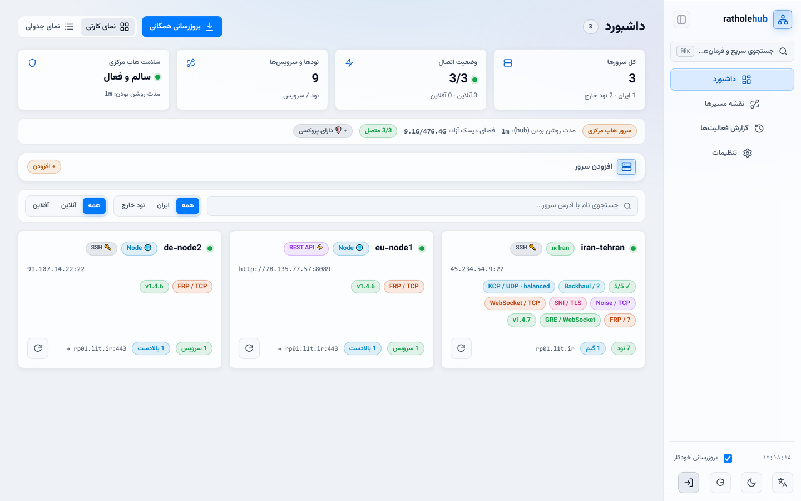
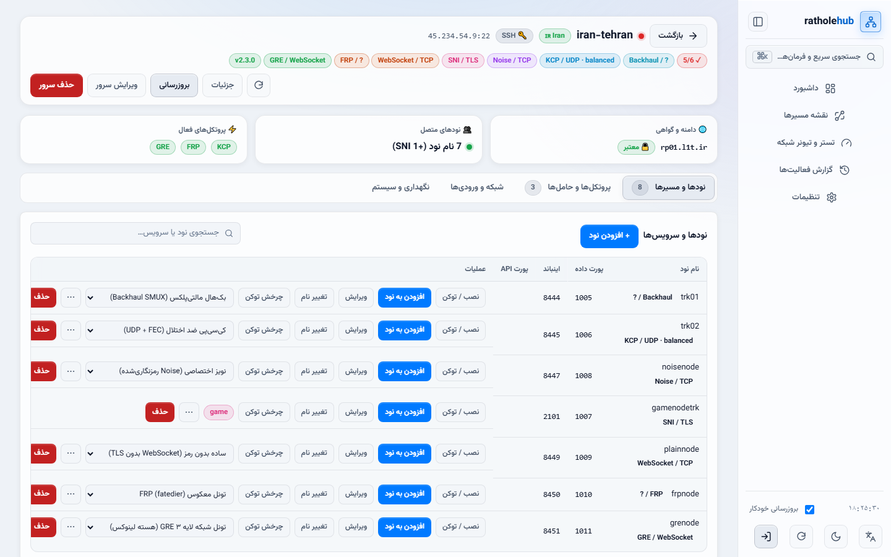
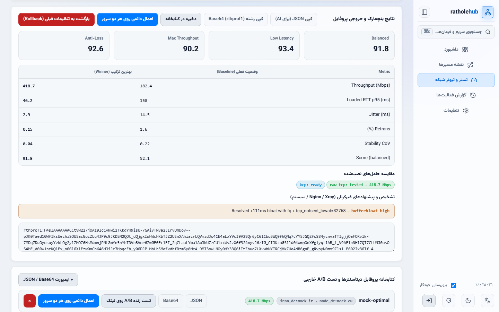
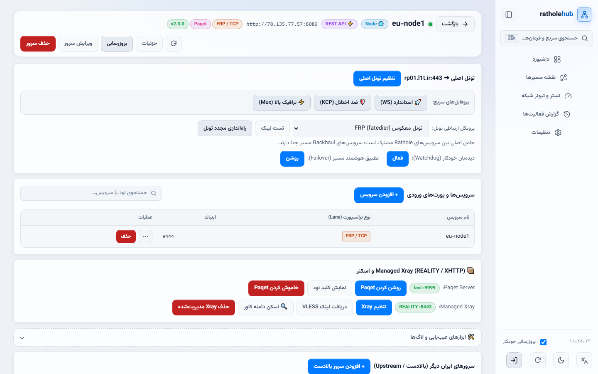
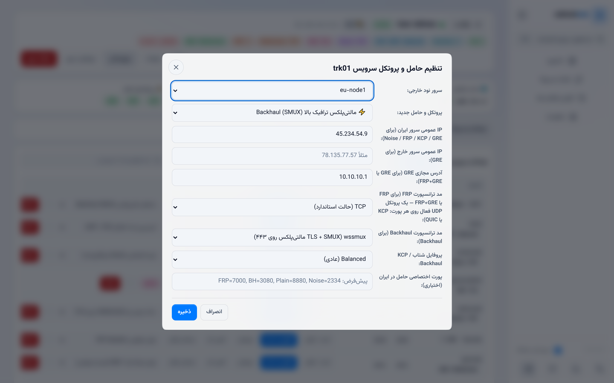
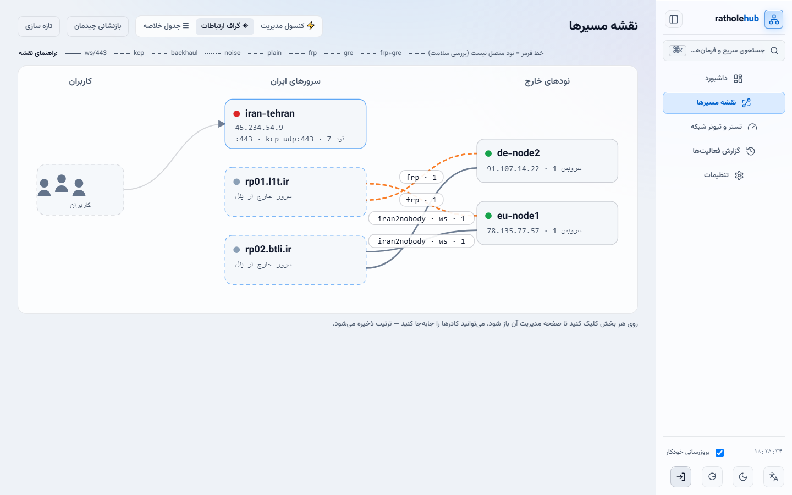
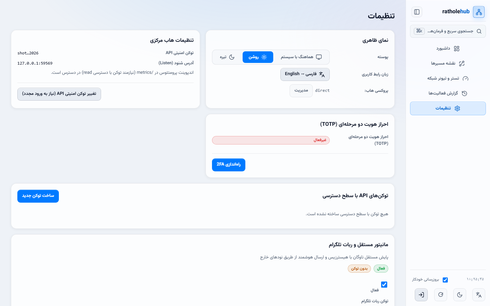
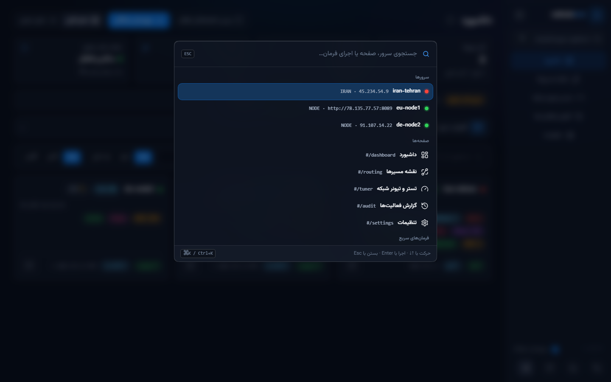

<div class="hero" markdown>

{ .hero-logo }

# RatholeEngine { .hero-title }

**یک دامنه، یک گواهی، یک پورت ۴۴۳.** تونل معکوس چند-موقعیتی روی **rathole + Nginx**؛
نودهای خارج با **path** به سرویس‌های داخلی وصل می‌شوند. ساخته‌شده برای عبور از فیلترینگ در ایران.

[شروع سریع](#شروع-سریع){ .md-button .md-button--primary }
[معماری](architecture.md){ .md-button }
[ویکی](wiki/Home.md){ .md-button }
[📢 کانال تلگرام](https://t.me/l8PY4NET){ .md-button }
[مخزن GitHub](https://github.com/l8PYGIT/RatholeEngine){ .md-button }

</div>

<figure class="hero-shot" markdown>

<figcaption>پنل هاب (RatholeHub v2.4.0) — رابط شیشه‌ای Apple Glass با کارت‌های KPI، فیلتر زنده، ایجنت WebSocket معکوس، تیونر شبکه و نوار کنترل سرورها (حالت mock)</figcaption>
</figure>

## چه چیزی دریافت می‌کنید

<div class="grid cards" markdown>

-   **⚡ تیونر بی‌رحمانه و پروفایل‌های AI (`rathole-tuner`)**

    ---

    بنچمارک دوطرفه ۶ مرحله‌ای برای **PMTU/MSS** (با تشخیص انسداد UDP و `TCP_INFO`)، **آف‌لودهای NIC**، **BBR/CAKE/FQ**، بافرهای ایمن TCP/UDP، تست **Bufferbloat** و ماتریس حامل‌ها با **محافظ دوفازه‌ای Watchdog** (`--confirm-ttl 45` + `bench confirm`)، کارت وضعیت زنده کرنل و خروجی **`rathole.netprofile.v1` / `rthprof1:`**.

-   **🚇 نه حامل و Xray مدیریت‌شده (`v2.4.0`)**

    ---

    مسیر رتهول (**WebSocket+TLS**، **KCP+FEC**، **Plain**، **Noise**) به‌علاوه هسته‌های مستقل **Backhaul (SMUX)**، **FRP**، **GRE لایه ۳**، **FRP+GRE** و **Paqet Direct PCK** ضد DPI به همراه **Managed Xray** (`REALITY` / `XHTTP`) و اسکنر سایت کاور TLS 1.3.

-   **🎛️ همگام‌سازی دوطرفه و کنترل سرویس‌ها**

    ---

    در صفحهٔ ایران، ردیف هر نود یک **سلکتور حامل** دارد: انتخاب حامل، یک‌کلیکی روی **هر دو سمت**
    (ایران + نود) با پیام وضعیت شفاف اعمال می‌شود و اگر سمت نود شکست بخورد برمی‌گردد. پنج اکشن دیگر — **تست دوطرفه لینک**،
    ساخت کانفیگ VLESS، مدیریت سمت مقابل و حذف هم‌زمان از دو سمت — زیر منوی **⋯** همان ردیف‌اند.

-   **🔐 REST و Reverse WS Agent + مانیتور تلگرام**

    ---

    `ratholeagent.py` (stdlib خالص، نسخه `2.0.0`) هم به‌صورت مستقیم (پورت ۸۰۸۹) و هم به‌صورت **Reverse WebSocket (`reverse_ws`، `wsutil.py`)** با اتصال خروجی به `/hub/ws/agent` (پشت پورت ۴۴۳ Nginx، بدون نیاز به پورت ورودی روی نودهای فیلترشده یا پشت NAT) کار می‌کند؛ به همراه **`ratholemonitor.service`** برای پایش ناوگان و ربات تلگرام.

-   **🖥️ هاب مرکزی شیشه‌ای و تیونر (`v2.4.0`)**

    ---

    رابط یکپارچه با تم **روشن/تاریک/سیستم**، فونت آفلاین **Vazirmatn**، **`Ctrl+K`**، تایید دومرحله‌ای **TOTP 2FA**، توکن‌های RBAC، گزارش زنجیره‌ای SHA-256، صفحه **`#/tuner`** با پروفایل‌های ماندگار، مودال اتصال سریع **`reverse_ws`** (تبدیل یک‌کلیکی سرورهای آفلاین) و رله آپدیت با امضای **Ed25519**.

-   **🚀 استقرار امن و برگشت‌پذیر**

    ---

    `update.sh` پیش از هر تغییر snapshot کامل می‌گیرد، health-check می‌کند و در صورت خطا خودکار rollback می‌کند (شامل ری‌استارت جداشدهٔ `rathole-agent.service`) — درست مثل Watchdog دوفازه‌ای بدون ریبوت در `rathole-tuner`.

</div>

## شروع سریع

**ساده‌ترین راه: یک دستور، بعد فقط به سؤال‌ها جواب بده.**

```bash
sudo bash -c "$(curl -fsSL https://raw.githubusercontent.com/l8PYGIT/RatholeEngine/main/install.sh)"
```

نصب‌کننده نسخه را می‌پرسد (Enter = آخرین نسخه)، سپس منوی نقش
(`1` پنل ایران · `2` نود خارج · `3` آپدیت · `7` حذف) و بعد مشخصات همان نقش
(دامنه و مسیر گواهی برای پنل؛ آدرس/نام/توکن/پورت برای نود).

[**راهنمای مرحله‌به‌مرحلهٔ نصب تعاملی →**](quickstart.md){ .md-button .md-button--primary }
[نصب دستی با فایل (آفلاین)](install-offline.md){ .md-button }
[راهنمای نصب دستی (کامل)](install-manual.fa.md){ .md-button }

??? example "همان سؤال‌ها، به‌صورت متنی (برای اینکه بدانی چه چیزی می‌آید)"

    ```text
    kodam noskhe nasb shavad?  →  Enter (latest)
    halat nasb ra entekhab kon:
      1) panel (server Iran)
      2) node (server kharej)
      3) update  4) fght amade-sazi  5) rollback  6) list-e backup-ha  7) hazf kamel
    entekhab [1/2/3/4/5/6/7]:  →  1

    damnh (masalan btli.ir):  panel.example.ir
    masir fullchain.pem [/root/cert/panel.example.ir/fullchain.pem]:  ← Enter
    masir privkey.pem   [/root/cert/panel.example.ir/privkey.pem]:    ← Enter
    ... بقیه: Enter
    ```

=== "نصب غیرتعاملی (پنل)"

    اگر نمی‌خواهی هیچ سؤالی پرسیده شود:

    ```bash
    curl -fsSL https://raw.githubusercontent.com/l8PYGIT/RatholeEngine/main/install.sh \
      | sudo bash -s -- --panel \
        --domain panel.example.ir \
        --fullchain /root/cert/panel.example.ir/fullchain.pem \
        --key       /root/cert/panel.example.ir/privkey.pem
    ```

=== "نصب غیرتعاملی (نود)"

    ```bash
    curl -fsSL https://raw.githubusercontent.com/l8PYGIT/RatholeEngine/main/install.sh \
      | sudo bash -s -- --node -- \
        --server panel.example.ir:443 --name trk01 --token <TOKEN> --inbound-port 2087
    ```

=== "هاب (Hub)"

    ```bash
    sudo ratholectl hub on          # نصب + روشن‌کردن پنل پشت nginx (پیش‌فرض 8088)
    sudo ratholectl hub auto-add    # ثبت همین سرور در inventory هاب
    sudo ratholectl hub status      # آدرس https و وضعیت سرویس
    ```

=== "آپدیت"

    ```bash
    # تشخیص خودکار پنل/نود/هاب + snapshot + health-check + rollback خودکار
    curl -fsSL https://raw.githubusercontent.com/l8PYGIT/RatholeEngine/main/install.sh \
      | sudo bash -s -- --update
    ```

=== "نصب دستی با فایل"

    برای سرورهای بدون دسترسی پایدار به گیتهاب: `rathole-manager.zip` و `bootstrap.sh` را از [**Releases**](https://github.com/l8PYGIT/RatholeEngine/releases/latest) گرفته و به `/root/` سرور منتقل کن:

    ```bash
    # تعاملی (پنل/نود/آپدیت):
    cd /root && sudo bash bootstrap.sh --local ./rathole-manager.zip

    # غیرتعاملی (پنل ایران):
    sudo bash bootstrap.sh --local ./rathole-manager.zip --panel \
      --domain panel.example.ir \
      --fullchain /root/cert/panel.example.ir/fullchain.pem \
      --key       /root/cert/panel.example.ir/privkey.pem
    ```

    [راهنمای کامل نصب دستی با فایل →](install-offline.md)

!!! tip "بدون pip، بدون build فرانت‌اند"
    کل سیستم bash + Python 3 stdlib است؛ هاب هیچ `node_modules` یا مرحلهٔ build ندارد.
    برای مستندات همین سایت هم فقط MkDocs Material لازم است (محیط `scratch/venv`).

## نماها

<figure class="hero-shot" markdown>

<figcaption>نمای سرور ایران — نودها، pathها، حامل و وضعیت هر سرویس</figcaption>
</figure>

<div class="grid cards shots" markdown>

-   **تستر و تیونر شبکه (`#/tuner`)**

    ---

    { loading=lazy }

    اجرای ۶ مرحله‌ای، امتیاز ۵بعدی، خروجی قابل‌تحلیل AI (`rthprof1:`) و تست A/B دیتاسنترها.

-   **صفحهٔ نود خارج**

    ---

    { loading=lazy }

    سرویس‌های نود، حامل فعال و ابزارهای مدیریت سمت نود.

-   **کنترل سرویس‌ها**

    ---

    { loading=lazy }

    تغییر حامل (سلکتور حامل در ردیف هر نود)، تست سلامت، VLESS و حذف دو‌سمتی از ردیف هر سرویس.

-   **نقشهٔ مسیرها**

    ---

    { loading=lazy }

    نمای فقط‌خواندنی توپولوژی: سرور → نود → سرویس و حامل هر مسیر.

-   **تنظیمات و تغییر تم**

    ---

    { loading=lazy }

    انتخاب تم سه‌حالته (روشن/تاریک/سیستم)، تغییر زبان، توکن API و تنظیمات امنیتی هاب.

-   **جستجوی سریع (`Ctrl+K`) و تم تاریک**

    ---

    { loading=lazy }

    پالت فرمان برای پرش فوری بین سرورها، صفحه‌ها و اجرای دستورها در نمای تاریک Apple Glass.

</div>

## مستندات

<div class="grid cards" markdown>

-   **📘 فارسی**

    ---

    - [شروع سریع (تعاملی)](quickstart.md)
    - [نصب دستی با فایل (آفلاین)](install-offline.md)
    - [راهنمای نصب دستی](install-manual.fa.md)
    - [مرجع کامل CLI](README.fa.md)
    - [معماری سیستم](architecture.md)
    - [حالت‌های Transport](transport-modes.md)
    - [مسیر ترافیک](traffic-flow.md)
    - [هاب و REST Agent](hub.md)
    - [پرفورمنس و تیونینگ](performance.md)
    - [دربارهٔ این سایت](website.md)

-   **🗂 ویکی**

    ---

    - [خانهٔ ویکی](wiki/Home.md)
    - [شروع سریع](wiki/Getting-Started.md)
    - [مرجع CLI ویکی](wiki/CLI-Reference.md)
    - [مدیریت هاب](wiki/Hub-Management.md)
    - [عیب‌یابی و rollback](wiki/Troubleshooting.md)
    - [راهنماهای عملی](wiki/Workflow-Guides.md)
    - [Adaptive Filtering](wiki/Adaptive-Filtering-Guide.md)

-   **📗 English**

    ---

    - [Quick start (interactive)](quickstart.en.md)
    - [Offline / File Install](install-offline.en.md)
    - [Install Manual](install-manual.md)
    - [Architecture](architecture.en.md)
    - [Transport Modes](transport-modes.en.md)
    - [Hub](hub.en.md)
    - [Traffic Flow](traffic-flow.en.md)
    - [Performance](performance.en.md)
    - [Website & Platforms](website.en.md)

</div>

---

## پشتیبانی و کانال تلگرام

!!! tip "📢 کانال تلگرام — [@l8PY4NET](https://t.me/l8PY4NET)"
    اعلان نسخه‌های جدید، نکته‌های راه‌اندازی و سریع‌ترین جای پرسیدن سؤال.
    برای گزارش باگ همراه لاگ، [Issues](https://github.com/l8PYGIT/RatholeEngine/issues) را بزن تا پیگیری شود.

!!! note "سایت کاملاً آفلاین است"
    هیچ فونت، آیکون یا اسکریپتی از CDN گرفته نمی‌شود (`theme.font: false`).
    همهٔ SVGها در `docs/assets/` و اسکرین‌شات‌ها در `docs/assets/screenshots/` هستند،
    تا سایت از داخل ایران هم سریع و قابل‌اتکا بماند.

پروژه تحت لایسنس **AGPL-3.0-or-later** منتشر شده است —
[متن لایسنس](https://github.com/l8PYGIT/RatholeEngine/blob/main/LICENSE) ·
[تغییرات](https://github.com/l8PYGIT/RatholeEngine/blob/main/CHANGELOG.md) ·
[کانال تلگرام](https://t.me/l8PY4NET)
