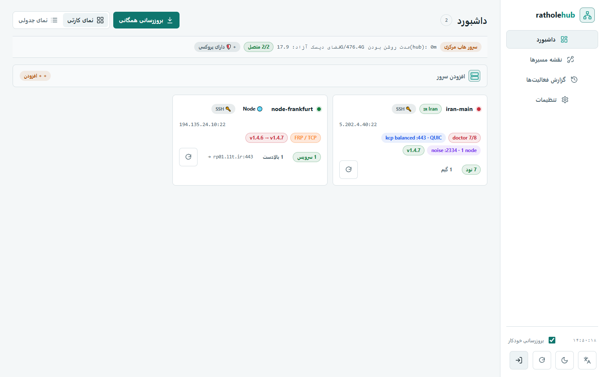
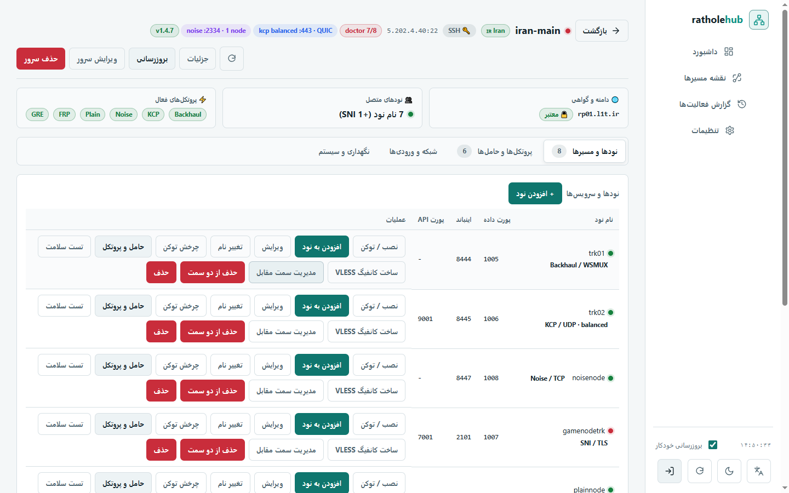
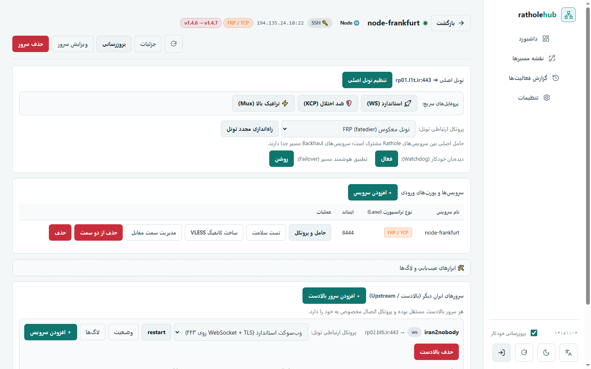
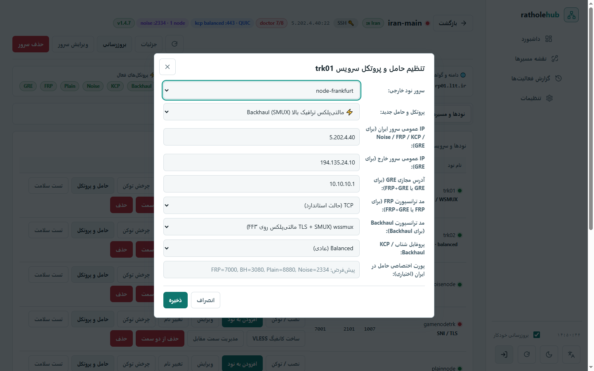
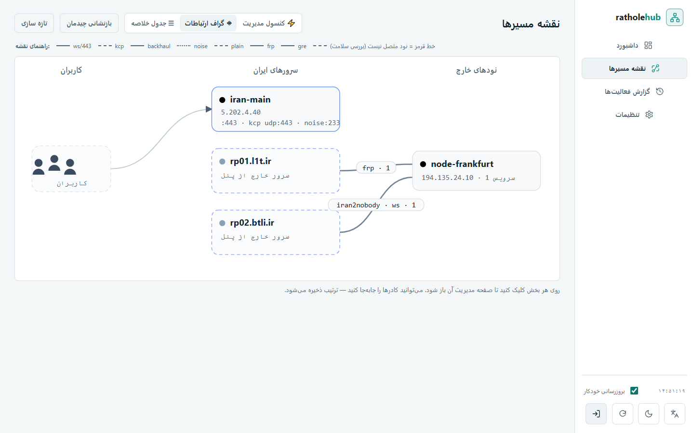
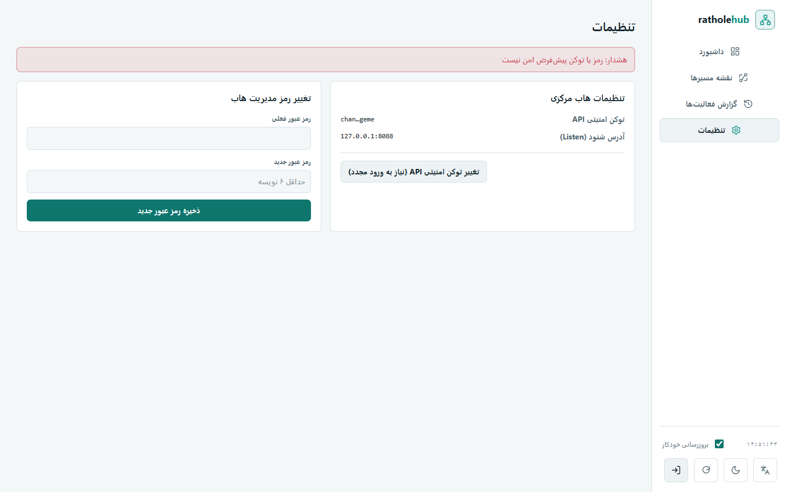

<div class="hero" markdown>

{ .hero-logo }

# RatholeEngine { .hero-title }

**یک دامنه، یک گواهی، یک پورت ۴۴۳.** تونل معکوس چند-موقعیتی روی **rathole + Nginx**؛
نودهای خارج با **path** به سرویس‌های داخلی وصل می‌شوند. ساخته‌شده برای عبور از فیلترینگ در ایران.

[شروع سریع](#شروع-سریع){ .md-button .md-button--primary }
[معماری](architecture.md){ .md-button }
[ویکی](wiki/Home.md){ .md-button }
[مخزن GitHub](https://github.com/l8PYGIT/RatholeEngine){ .md-button }

</div>

<figure class="hero-shot" markdown>

<figcaption>پنل هاب (RatholeHub) — نمای کلی سرورها، نودها و وضعیت سرویس‌ها در حالت mock</figcaption>
</figure>

## چه چیزی دریافت می‌کنید

<div class="grid cards" markdown>

-   **🚇 چهار حامل در lane رات‌هول**

    ---

    پیش‌فرض **WebSocket + TLS** روی ۴۴۳، و کنارش **KCP** (با FEC برای لینک پرافت)،
    **Plain** سبک و **Noise** برای پوشش بیشتر. تغییر حامل، path و پورت عمومی را عوض نمی‌کند.

-   **🧬 هسته‌های مستقل**

    ---

    **Backhaul (SMUX)** برای لینک‌های شلوغ/پرافت، **FRP** با ترانسپورت
    `tcp|kcp|quic|websocket`، تونل لایهٔ ۳ **GRE** و حالت ترکیبی **FRP + GRE** — هر کدام برای یک path.

-   **🎛️ کنترل سرویس‌ها در هاب**

    ---

    روی هر ردیف سرویس: تغییر حامل، **تست سلامت**، ساخت کانفیگ VLESS، مدیریت سمت مقابل
    و حذف هم‌زمان از دو سمت. برچسب‌ها پروتکل گزارش‌شدهٔ سرور را نشان می‌دهند.

-   **🔐 REST Agent بدون SSH**

    ---

    `ratholeagent.py` (stdlib خالص، پورت ۸۰۸۹) با احراز هویت Bearer و HTTPS اختیاری؛
    هاب با `transport: "api"` سرور را بدون کلید SSH مدیریت می‌کند.

-   **🖥️ هاب مرکزی چندسروره**

    ---

    یک پنل وب برای چند سرور ایران و ده‌ها نود: داشبورد، نمای سرور/نود، نقشهٔ مسیرها،
    audit و تنظیمات — با آپدیت گروهی و بک‌اپ.

-   **🚀 استقرار امن و برگشت‌پذیر**

    ---

    `update.sh` پیش از هر تغییر snapshot کامل می‌گیرد، health-check می‌کند و در صورت
    خطا خودکار rollback می‌کند. مناسب سرورهای واقعی، نه دمو.

</div>

## شروع سریع

=== "پنل ایران"

    نصب غیرتعاملی پنل روی سرور ایران (nginx + rathole server + `ratholectl`):

    ```bash
    curl -fsSL https://raw.githubusercontent.com/l8PYGIT/RatholeEngine/main/install.sh \
      | sudo bash -s -- --panel \
        --domain panel.example.ir \
        --fullchain /root/cert/panel.example.ir/fullchain.pem \
        --key       /root/cert/panel.example.ir/privkey.pem
    ```

    سپس نود تعریف کنید و دستور نصبش را بگیرید:

    ```bash
    sudo ratholectl add trk01 2087 --api-port 62050
    sudo ratholectl show trk01
    ```

=== "نود خارج"

    روی نود خارج از ایران، همان نصب‌کننده را با `--node` اجرا کنید
    (آرگومان‌های بعد از `--` به نصب‌کنندهٔ نود می‌رسند):

    ```bash
    curl -fsSL https://raw.githubusercontent.com/l8PYGIT/RatholeEngine/main/install.sh \
      | sudo bash -s -- --node -- \
        --server panel.example.ir:443 --name trk01 --token <TOKEN> --inbound-port 2087
    ```

    `TOKEN` را از خروجی `ratholectl show trk01` بردارید.

=== "هاب (Hub)"

    روی همان سرور ایران:

    ```bash
    sudo ratholectl hub on          # نصب + روشن‌کردن پنل پشت nginx (پیش‌فرض 8088)
    sudo ratholectl hub auto-add    # ثبت همین سرور در inventory هاب
    sudo ratholectl hub status      # آدرس https و وضعیت سرویس
    ```

=== "آپدیت"

    ```bash
    # تشخیص خودکار پنل/نود/هاب + snapshot + health-check + rollback خودکار
    curl -fsSL https://raw.githubusercontent.com/l8PYGIT/RatholeEngine/main/install.sh \
      | sudo bash -s -- --update
    ```

!!! tip "بدون pip، بدون build فرانت‌اند"
    کل سیستم bash + Python 3 stdlib است؛ هاب هیچ `node_modules` یا مرحلهٔ build ندارد.
    برای مستندات همین سایت هم فقط MkDocs Material لازم است (محیط `scratch/venv`).

## نماها

<figure class="hero-shot" markdown>

<figcaption>نمای سرور ایران — نودها، pathها، حامل و وضعیت هر سرویس</figcaption>
</figure>

<div class="grid cards shots" markdown>

-   **صفحهٔ نود خارج**

    ---

    { loading=lazy }

    سرویس‌های نود، حامل فعال و ابزارهای مدیریت سمت نود.

-   **کنترل سرویس‌ها**

    ---

    { loading=lazy }

    تغییر حامل، تست سلامت، VLESS و حذف دو‌سمتی از ردیف هر سرویس.

-   **نقشهٔ مسیرها**

    ---

    { loading=lazy }

    نمای فقط‌خواندنی توپولوژی: سرور → نود → سرویس و حامل هر مسیر.

-   **تنظیمات**

    ---

    { loading=lazy }

    مخزن، توکن، آپدیت گروهی و تنظیمات امنیتی هاب.

</div>

## مستندات

<div class="grid cards" markdown>

-   **📘 فارسی**

    ---

    - [راهنمای نصب دستی](install-manual.fa.md)
    - [مرجع کامل CLI](README.fa.md)
    - [معماری سیستم](architecture.md)
    - [حالت‌های Transport](transport-modes.md)
    - [مسیر ترافیک](traffic-flow.md)
    - [هاب و REST Agent](hub.md)
    - [پرفورمنس و تیونینگ](performance.md)
    - [دربارهٔ این سایت](website.md)

-   **🗂 ویکی**

    ---

    - [خانهٔ ویکی](wiki/Home.md)
    - [شروع سریع](wiki/Getting-Started.md)
    - [مرجع CLI ویکی](wiki/CLI-Reference.md)
    - [مدیریت هاب](wiki/Hub-Management.md)
    - [عیب‌یابی و rollback](wiki/Troubleshooting.md)
    - [راهنماهای عملی](wiki/Workflow-Guides.md)
    - [Adaptive Filtering](wiki/Adaptive-Filtering-Guide.md)

-   **📗 English**

    ---

    - [Install Manual](install-manual.md)
    - [Architecture](architecture.en.md)
    - [Transport Modes](transport-modes.en.md)
    - [Hub](hub.en.md)
    - [Traffic Flow](traffic-flow.en.md)
    - [Performance](performance.en.md)
    - [Website & Platforms](website.en.md)

</div>

---

!!! note "سایت کاملاً آفلاین است"
    هیچ فونت، آیکون یا اسکریپتی از CDN گرفته نمی‌شود (`theme.font: false`).
    همهٔ SVGها در `docs/assets/` و اسکرین‌شات‌ها در `docs/assets/screenshots/` هستند،
    تا سایت از داخل ایران هم سریع و قابل‌اتکا بماند.

پروژه تحت لایسنس **AGPL-3.0-or-later** منتشر شده است —
[متن لایسنس](https://github.com/l8PYGIT/RatholeEngine/blob/main/LICENSE) ·
[تغییرات](https://github.com/l8PYGIT/RatholeEngine/blob/main/CHANGELOG.md) ·
[کانال تلگرام](https://t.me/l8PY4NET)
