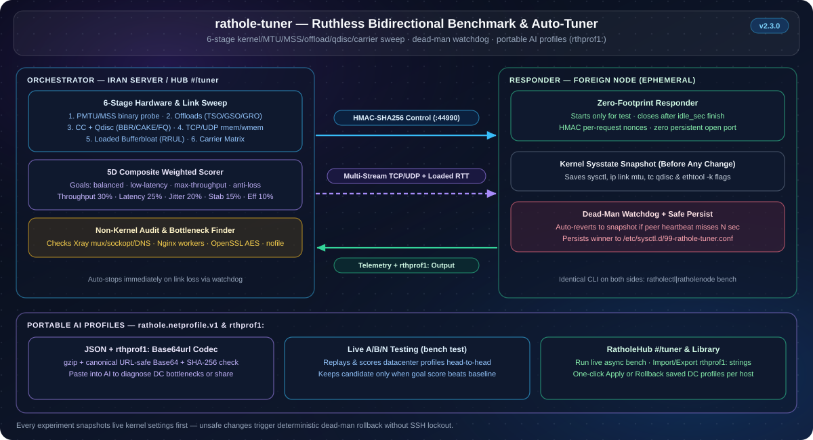

# Speed and Stability Guide — Beyond the Tunnel

This guide covers every place you can improve speed and stability after the tunnel (rathole + kcp) is working. Ordered from **highest impact** to lowest. Apply each change separately and test.

> Architecture reminder: User → TLS/443/domain → nginx (Iran) → rathole-server → tunnel (websocket or kcp, or the independent Backhaul/FRP/GRE/Paqet lanes) → node → Xray → internet.
> Four tunable points: **tunnel**, **kernel on both servers**, **Xray on node**, **user client**. nginx is just a lightweight proxy in the path.

---

## 0A) Automated Brutal Benchmark & Auto-Tuner (`rathole-tuner` / `bench`, `v2.3.0+` / `v2.4.0`)

Instead of guessing `sysctl` values or `MTU`, use **`rathole-tuner`** (via `ratholectl bench` / `ratholenode bench` or **`#/tuner`** in RatholeHub) to sweep the Iran↔node link across **6 stages**:



1. **Binary PMTU & TCP MSS probe** (detects UDP-blocked paths up front and falls back to `TCP_INFO` PMTU so blocked UDP never collapses MTU to `1200`)
2. **NIC Offloads** (`TSO` / `GSO` / `GRO` — ignores `[fixed]` capabilities reported by `ethtool -k`, skips no-op mutations, and avoids disabling `TSO`/`GSO`)
3. **Congestion Control & Qdisc** (`BBR`, `CAKE`, `FQ`, `CUBIC`, `hybla`, plus clean restoration of `mq`/`noqueue`/`default` qdiscs via `tc qdisc del dev <iface> root`)
4. **TCP/UDP Buffers & Socket Knobs** (8/16/32 MiB floors clamped to 10% RAM for `rmem_max`/`wmem_max`, safe `262144` KiB cap for `rmem_default`/`wmem_default`, proxy-safe `tcp_notsent_lowat`, and `src <IP>` / `onlink` preservation on default routes)
5. **Loaded Bufferbloat Stress Sweep** (throughput, loaded RTT p95, jitter, retransmissions, stability CoV, plus throughput non-regression guard so slower candidates cannot beat Baseline)
6. **Carrier Matrix & Non-Kernel Audit** (audits `Xray`, `Nginx`, `OpenSSL AES`, and `LimitNOFILE`) with **5D weighted scoring**, initial pre-tuner `snapshot_path` preservation, and **two-phase dead-man Watchdog confirmation**.

```bash
# On the foreign node: start ephemeral HMAC-authenticated responder
sudo ratholenode bench listen --port 44990 --token <SECRET> --idle-sec 300

# On the Iran server: run 6-stage sweep and emit JSON + portable rthprof1: string
sudo ratholectl bench run --peer <NODE_IP>:44990 --token <SECRET> \
  --mode brutal --goal balanced --iran-dc arvan --node-dc hetzner-fsn1 --out /tmp/dc.json

# Live A/B/N profile comparison (only keeps winner when goal score beats baseline)
sudo ratholectl bench test --peer <NODE_IP>:44990 --token <SECRET> --profile "rthprof1:..."

# Two-phase dead-man Watchdog persistent apply (/etc/sysctl.d/99-rathole-tuner.conf), confirm, inspect, or revert:
sudo ratholectl bench apply --profile /tmp/dc.json --confirm-ttl 45
sudo ratholectl bench confirm <CONFIRM_ID>
sudo ratholectl bench status --json
sudo ratholectl bench rollback

# Audit non-kernel stack (Xray / Nginx / OpenSSL / ulimit):
sudo ratholectl bench audit --json
```

> **Two-phase Watchdog confirmation (`v2.4.0`) & Portable AI Profiles (`rthprof1:`):** When Hub applies a profile with `--confirm-ttl 45`, an independent `bench confirm <id>` round-trip must succeed within 45s or the dead-man watchdog reverts `sysctl --system` + `restore_snapshot()` automatically (and Hub rolls back Iran immediately if Node fails confirmation). Every run emits structured `rathole.netprofile.v1` JSON plus `rthprof1:<base64url>` with live kernel verification (`GET /api/tuner/status`) and persistent job state (`GET /api/tuner/jobs`) in **`#/tuner`**.

---

## 0) Find the Bottleneck First

```bash
# Kernel: is BBR enabled? (both servers)
sysctl net.ipv4.tcp_congestion_control      # should be: bbr

# Realtime CPU/network usage
top -d1            # is xray, nginx, or kcptun pinning CPU?

# Packet loss / path stability server-to-server
mtr -rwc 30 <other-server-IP>
```

- High `mtr` loss → **path problem**; kcp/FEC (tunnel) helps, not Xray tuning.
- High CPU → **encryption/multiplex bottleneck**; go to the Xray section.
- Neither, still slow → likely **node IP throttled**.

---

## 1) Xray — Highest Impact on Gaming / Streaming

### 1-1) Disable mux (most important for real-time traffic)
mux combines multiple streams on one connection; a heavy stream blocks the rest (head-of-line blocking).
In the **client** config and in the outbound:
```json
"mux": { "enabled": false }
```

### 1-2) Avoid double encryption
The user↔Iran path already has TLS and the tunnel also encrypts. Keep Xray inbounds on the node lightweight:
- VLESS + WS with `"security": "none"` (TLS=off) on the node — rathole/nginx already terminate TLS.
- Extra TLS only where camouflage requires it (e.g., game services with a real cert).

### 1-3) sockopt on node outbound (exit to internet)
```json
"streamSettings": {
  "sockopt": {
    "tcpNoDelay": true,
    "tcpFastOpen": true,
    "tcpKeepAliveIdle": 30,
    "mark": 0
  }
}
```

### 1-4) Fast DNS on the node (prevent slow resolves)
In the Xray node config:
```json
"dns": { "servers": ["1.1.1.1", "8.8.8.8", "localhost"] }
```
And a sensible `domainStrategy` on the outbound. If sites are slow on IPv6, use `"domainStrategy": "UseIPv4"`.

### 1-5) Buffer and log level
```json
"policy": { "levels": { "0": { "bufferSize": 512 } } },
"log": { "loglevel": "warning" }
```
- `loglevel: warning` (not `debug`) — debug I/O log eats CPU.
- Larger `bufferSize` for better throughput on large files/video.

### 1-6) Keep Xray up to date
New versions have TCP/Vision optimisations. If very old, update.

---

## 2) Kernel on Both Servers — Automated with `tune`

```bash
ratholectl tune     # on Iran server
ratholenode tune    # on foreign node
```

Sets these without a reboot or tunnel interruption:
- **BBR + fq** (modern congestion control; biggest kernel win).
- **Large UDP/TCP max buffers with safe socket defaults** (`rmem_max/wmem_max=25 MB` required for high-throughput KCP/QUIC, paired with `rmem_default=262144` / `wmem_default=262144` — 256 KiB in `v2.4.0` — to avoid memory exhaustion under high connection counts).
- file-max / conntrack_max / somaxconn / backlog — eliminates 502s under burst.
- tcp_fastopen, mtu_probing, slow_start_after_idle=0.

Verify:
```bash
sysctl net.ipv4.tcp_congestion_control net.core.rmem_max
```

---

## 3) Tunnel and FEC Profile

```bash
# On Iran server:
ratholectl kcp on 443 balanced      # QUIC camouflage + ~30% redundancy (default)
ratholectl kcp on 443 lossy         # high loss on path → more parity
ratholectl kcp on 443 aggressive    # lowest latency (fast3 mode, large window)

# On node (same profile):
ratholenode kcp on <IRAN_IP>:443 <KEY> <profile>
```

- **balanced:** normal starting point.
- **lossy:** if you still buffer and `mtr` shows high loss (e.g., >8%).
- **aggressive:** if bandwidth is sufficient and you want only latency/stability (parity 4, aggressive mode).
- Disable and return to websocket/443: `ratholenode kcp off`.

Camouflage: **port 443 on UDP** looks like QUIC/HTTP3 to DPI; no conflict with nginx (TCP/443).
If the network throttles international UDP, either `kcp off` or go to the obfs layer (see below).

---

## 4) FRP — Transport Choice (tcp / kcp / quic / websocket)

When you use the FRP core instead of the rathole lane, the transport choice matters about as much as the carrier choice in rathole:

- **tcp:** simplest and most compatible; traverses every TCP firewall/proxy. On lossy links it suffers the same TCP-over-TCP problem and head-of-line blocking across concurrent streams.
- **kcp:** UDP + FEC (FRP's own implementation); better than tcp on lossy/jittery paths, but like any UDP it may be throttled. The large UDP buffers set by `tune` matter here too.
- **quic:** UDP + built-in TLS, native multiplexing with no head-of-line blocking between streams; good on high RTT. If the network limits international UDP it becomes worse than tcp/websocket.
- **websocket:** looks like HTTP(S) traffic and works through L7 proxies/CDNs; in exchange it pays HTTP/WS framing overhead and depends on one TLS path.

Suggested order: test `tcp` or `quic` on the real path first; if UDP is degraded use `websocket`; the Iran path/port and the shared token stay identical in every mode. The `frps`/`frpc` units are generated with `Restart=on-failure` and `LimitNOFILE=1048576`.

---

## 5) GRE — MTU 1476 and TCPMSS

- **Why 1476:** GRE overhead = GRE header (4 bytes) + outer IP header (20 bytes) = 24 bytes, so `1500 − 24 = 1476`. `gre_setup_interface` sets this MTU.
- **TCPMSS clamping:** the same function installs an iptables rule in `-t mangle POSTROUTING` for egress `SYN,RST SYN` packets on the GRE interface with `--clamp-mss-to-pmtu`, so an MSS larger than the path cannot get fragmented/black-holed. `tcp_mtu_probing=1` is already enabled by `tune`.
- **CPU overhead:** GRE is kernel encapsulation with no userspace daemon; its CPU cost is negligible next to Xray encryption.
- **Test:** an `UP` interface does not prove reachability; use `ratholenode gre probe <peer_ip> [gre_name]`. Some networks block protocol 47 — in that case drop GRE/FRP+GRE.

---

## 6) Backhaul — Matching the SMUX Profile

The mux profile (`common.sh:backhaul_mux_profile`) must be **identical on both ends**; mismatched SMUX parameters mean streams don't establish correctly.

| Profile | Values (`mux_con mux_version mux_framesize mux_recievebuffer mux_streambuffer connection_pool`) |
|---|---|
| `balanced` | `8 1 32768 4194304 65536 8` |
| `lossy` | `4 1 32768 4194304 65536 6` |
| `aggressive` | `16 2 65536 8388608 131072 12` |

- `mux_con` is meaningful on the server side only, and `connection_pool` on the client side only; each side writes its own field.
- **balanced:** starting point. **lossy:** lossy link (lower mux_con and pool). **aggressive:** severe interference / higher throughput (larger frame and buffers).
- The `wsmux` transport is multiplexed and `ws` is not; `wsmux` is the default. `tcpmux` is unsupported because it cannot traverse the L7 nginx.
- The patched backhaul core uses uTLS with a Chrome fingerprint (JA3/JA4) and pins ALPN to `http/1.1` so the WebSocket Upgrade is not broken.

---

## 7) Management Plane (REST Agent / Reverse WS Agent / HTTPS) — Negligible Overhead

- The agent (v`2.0.0`, running either direct REST on `:8089` or outbound **Reverse WebSocket (`reverse_ws`, `wsutil.py`)** to `/hub/ws/agent`) is a **control plane**, not a data path: no user traffic byte passes through it. Only management commands (`status`/`apply`/`restart`/…) are exchanged over `POST /api/exec` or RFC 6455 WebSocket frames.
- Direct REST (`ThreadingHTTPServer`) uses `request_queue_size = 64`, `TCP_NODELAY`, and TCP keepalive; `reverse_ws` maintains one persistent outbound WebSocket with Ping/Pong keepalive and `ThreadPoolExecutor(16)` command workers — zero impact on tunnel data throughput.
- HTTPS adds negligible TLS setup overhead (`reverse_ws` reuses one persistent TLS connection behind Nginx `:443`). Self-signed certs require `insecure_ssl: true` (or `RATHOLE_AGENT_INSECURE_SSL=1`) in `api` mode, or `--insecure-ssl` on the agent CLI in `reverse_ws` mode.
- Restrict/firewall port `8089` in direct `api` mode; in `reverse_ws` mode **zero inbound ports** are opened on the target (1 MiB HTTP payload cap, 4 MiB WS frame cap, and `ALLOWED_BINARIES` allow-list enforced).

---

## 8) nginx — Rarely the Bottleneck

Already configured: `proxy_buffering off`, `tcp_nodelay`, long timeouts, high `worker_connections` (from `tune`).
Notes:
- On the data path it is pure passthrough; not much to squeeze.
- If `nginx -t` passes and `doctor` is green, nginx is not a speed issue.
- Can disable access logging for high-traffic data locations to reduce I/O: `access_log off;` in the data `location`.

---

## 9) User Client (subscription config)

- **mux=off** (important).
- If the client has multiple configs, use the **kcp** one for real-time apps.
- In v2rayNG/Nekogram: enable `TCP no delay`, disable `Mux`, keep concurrency low.
- Mobile users switching between WiFi and cellular: `tcpKeepAlive` helps keep connections alive across switches.

---

## 10) Node IP

- If all the above is done and still slow, the **node IP is likely throttled/dirty**.
- Try a cleaner node/IP. With `upstream`, you can add a second node in parallel and split users between them.
- Run `mtr` from the node to the destination (e.g., instagram.com), not just node↔Iran.

---

## 11) Stronger Camouflage (optional, manual)

If UDP/443 isn't enough and the network interferes with kcp:
- Tool: `udp2raw` (on both servers) — wraps UDP to look like TCP with obfuscation.
- Not automated in the scripts yet (to avoid untested complexity). Ask if you want a `kcp obfs on` subcommand added and sandbox-tested.

---

## Summary: Order of Actions

1. `tune` on both servers + verify BBR is active.
2. `mux=off` and sockopt in Xray/client.
3. Tunnel: `kcp on 443 balanced` → test → switch to `lossy`/`aggressive` if needed.
4. On an independent lane, also tune the FRP transport, GRE MTU/TCPMSS, and matching Backhaul profile.
5. Fast DNS on node.
6. Still slow → cleaner node/IP, or obfs.

Apply each step separately so you know what actually helped. Agent/HTTPS settings do not affect the data path and are intentionally outside this list.

---

## See Also

- [`transport-modes.en.md`](transport-modes.en.md) — KCP profiles and all transport modes
- [`architecture.en.md`](architecture.en.md) — system architecture
- [CLI Reference (Wiki)](https://l8pygit.github.io/RatholeEngine/wiki/CLI-Reference/) — `ratholectl tune`, `kcp`, `ratholenode tune`
