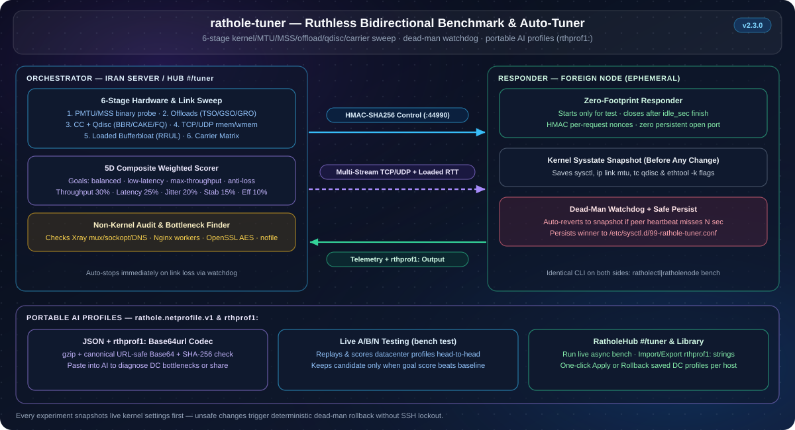

# راهنمای سرعت و پایداری — بخش‌های غیرتونل

این راهنما همه‌ی جاهایی که می‌توان بعد از تونل (rathole + kcp) سرعت و پایداری را بهتر کرد جمع کرده.
ترتیب از «بیشترین تأثیر» به «کمترین» است. هر تغییر را جدا اعمال کن و تست بگیر.

> یادآوری معماری: کاربر → TLS/۴۴۳/دامنه → nginx (روی rp01) → rathole-server → تونل (websocket یا kcp، یا laneهای مستقل Backhaul/FRP/GRE/Paqet) → نود → Xray → اینترنت.
> پس چهار نقطه‌ی قابل‌تنظیم داریم: **تونل**، **کرنل دو سرور**، **Xray نود**، **کلاینت کاربر**. nginx فقط یک پراکسی سبک در مسیر است.

---

## ۰-الف) تیونر خودکار بی‌رحمانه (`rathole-tuner` / `bench`) و پروفایل‌های AI (`v2.3.0+` / `v2.4.0`)

به‌جای حدس‌زدن `sysctl` یا `MTU`، از موتور **`rathole-tuner`** (قابل اجرا با `ratholectl bench` / `ratholenode bench` یا از صفحه **`#/tuner`** در RatholeHub) استفاده کن تا لینک ایران↔نود در **۶ مرحله** بررسی شود:



1. **PMTU و MSS باینری** (کشف سقف بسته بدون تکه‌تکه شدن + تشخیص پیش‌دستانهٔ مسدودبودن UDP با fallback روی `TCP_INFO` تا MTU اشتباهاً به ۱۲۰۰ سقوط نکند)
2. **آف‌لودهای کارت شبکه** (`TSO` / `GSO` / `GRO` با نادیده‌گرفتن ویژگی‌های `[fixed]` در `ethtool -k` و پرهیز از غیرفعالسازی مخرب TSO/GSO)
3. **کنترل ازدحام و Qdisc** (`BBR`، `CAKE`، `FQ`، `CUBIC`، `hybla` و بازگردانی ایمن qdiscهای `mq`/`noqueue`/`default` با `tc qdisc del root`)
4. **بافرهای کرنل و TCP Tuning** (کف‌های ۸/۱۶/۳۲ MiB برای `rmem_max`/`wmem_max` تا سقف ۱۰٪ RAM، پایین‌آوردن ایمن `rmem_default`/`wmem_default` به ۲۵۶ کیلوبایت، حذف `tcp_notsent_lowat` گلوگاه‌ساز برای پروکسی و حفظ `src <IP>`/`onlink` در route پیش‌فرض)
5. **تست استرس هم‌زمان و Bufferbloat** (اندازه‌گیری Throughput + Loaded RTT p95 + Jitter + Retrans + محافظ عدم افت پهنای‌باند تا هیچ کاندید کندتر از Baseline برنده نشود)
6. **ماتریس حامل‌ها + ممیزی غیرکرنلی** (بررسی `Xray`، `Nginx`، `OpenSSL AES`، `LimitNOFILE`) با امتیازدهی ۵بعدی، **محافظ دوفازه‌ای Watchdog (`--confirm-ttl`)** و نگهداری `snapshot_path` اولیه پیش از تیونر.

```bash
# روی نود خارج: راه‌اندازی موقت responder امن (HMAC-SHA256، بسته شدن خودکار)
sudo ratholenode bench listen --port 44990 --token <SECRET> --idle-sec 300

# روی سرور ایران: اجرای تست کامل (برجسب دیتاسنتر + خروجی JSON/rthprof1)
sudo ratholectl bench run --peer <NODE_IP>:44990 --token <SECRET> \
  --mode brutal --goal balanced --iran-dc arvan --node-dc hetzner-fsn1 --out /tmp/dc.json

# تست مقایسه زنده A/B/N با یک پروفایل اشتراکی (بدون اعمال دائمی تا تایید برنده)
sudo ratholectl bench test --peer <NODE_IP>:44990 --token <SECRET> --profile "rthprof1:..."

# اعمال دائمی دوفازه‌ای با Watchdog ددمن (/etc/sysctl.d/99-rathole-tuner.conf) + تأیید، وضعیت یا بازگشت:
sudo ratholectl bench apply --profile /tmp/dc.json --confirm-ttl 45
sudo ratholectl bench confirm <CONFIRM_ID>
sudo ratholectl bench status --json
sudo ratholectl bench rollback

# ممیزی تنظیمات غیرکرنلی (Xray / Nginx / ulimit / OpenSSL):
sudo ratholectl bench audit --json
```

> **محافظ دوفازه‌ای Watchdog (`v2.4.0`):** هنگام اعمال دائمی از طریق هاب (`--confirm-ttl 45`)، پس از تغییر کرنل حتماً باید فرمان `bench confirm <id>` برسد؛ اگر اتصال پس از اعمال قطع شود، تایمر ددمن ظرف ۴۵ ثانیه به‌طور خودکار `sysctl --system` و سپس `restore_snapshot()` را اجرا می‌کند (و در هاب با شکست تأیید نود، سمت ایران هم بلافاصله rollback می‌شود). همچنین خروجی `rathole.netprofile.v1` و رشته `rthprof1:` در صفحه `#/tuner` همراه با کارت وضعیت زنده کرنل و ماندگاری جاب‌ها نمایش داده می‌شود.

---

## ۰) قبل از هر چیز: گلوگاه را پیدا کن

```bash
# کرنل: BBR روشن است؟ (هر دو سرور)
sysctl net.ipv4.tcp_congestion_control      # باید: bbr

# مصرف CPU/شبکه‌ی لحظه‌ای
top -d1            # آیا xray یا nginx یا kcptun CPU را پر کرده؟
# پکت‌لاس/پایداری مسیر سرور-به-سرور
mtr -rwc 30 <IP-طرف-مقابل>
```
- اگر `mtr` لاس بالا داشت → مشکل **مسیر** است؛ kcp/FEC (تونل) جواب می‌دهد، نه تنظیم Xray.
- اگر CPU پر بود → مشکل **رمزگذاری/مالتی‌پلکس** است؛ سراغ بخش Xray برو.
- اگر هیچ‌کدام و باز هم کند → احتمال **throttle شدن IP نود**.

---

## ۱) Xray — بیشترین تأثیر روی لگ ریلز

### ۱-۱) mux را خاموش کن (مهم‌ترین تغییر برای ریلز)
mux چند استریم را روی یک کانکشن قاطی می‌کند؛ یک ریلز سنگین بقیه را بلاک می‌کند (head-of-line blocking).
در **کلاینت** (ساب کاربر) و در outbound:
```json
"mux": { "enabled": false }
```

### ۱-۲) از رمزگذاری دوبل پرهیز کن
مسیر کاربر↔ایران از قبل TLS دارد و تونل هم رمز دارد. پس اینباندهای تراکر روی نود را سبک نگه دار:
- VLESS + WS با `"security": "none"` (TLS=off) روی نود — چون rathole/nginx ترمینیت می‌کند.
- TLS اضافی فقط جایی که برای استتار لازم است (مثل سرویس game با گواهی واقعی).

### ۱-۳) sockopt روی outbound نود (خروج به اینترنت)
```json
"streamSettings": {
  "sockopt": {
    "tcpNoDelay": true,
    "tcpFastOpen": true,
    "tcpKeepAliveIdle": 30,
    "mark": 0
  }
}
```

### ۱-۴) DNS سریع روی نود (جلوگیری از کندیِ resolve)
در کانفیگ Xray نود:
```json
"dns": { "servers": ["1.1.1.1", "8.8.8.8", "localhost"] }
```
و outbound با `"domainStrategy"` معقول. اگر سایت‌ها IPv6 کند دارند، `"domainStrategy": "UseIPv4"`.

### ۱-۵) بافر و سطح لاگ
```json
"policy": { "levels": { "0": { "bufferSize": 512 } } },
"log": { "loglevel": "warning" }
```
- `loglevel: warning` (نه `debug`) تا I/O لاگ، CPU را نخورد.
- `bufferSize` بزرگ‌تر برای throughput بهتر در فایل‌های حجیم/ویدئو.

### ۱-۶) نسخه‌ی Xray را به‌روز نگه دار
نسخه‌های جدید بهینه‌سازی‌های TCP/Vision دارند. اگر خیلی قدیمی است، آپدیت کن.

---

## ۲) کرنل هر دو سرور — با `tune` خودکار می‌شود

```bash
ratholectl tune     # روی ایران
ratholenode tune    # روی نود
```
این‌ها را ست می‌کند (بدون ریبوت، بدون قطع تونل):
- **BBR + fq** (کنترل ازدحام مدرن؛ مهم‌ترین برد کرنل).
- **بافر بزرگ UDP با پیش‌فرض ایمن** (`rmem_max/wmem_max=25MB` برای throughput بالای KCP و QUIC، همراه با `rmem_default=262144` / `wmem_default=262144` یعنی ۲۵۶ کیلوبایت در `v2.4.0` تا در اتصالات هم‌زمان بالا حافظهٔ سرور اشغال نشود).
- file-max / conntrack_max / somaxconn / backlog بالا — رفع ۵۰۲ زیر برست.
- tcp_fastopen، mtu_probing، slow_start_after_idle=0.

تأیید:
```bash
sysctl net.ipv4.tcp_congestion_control net.core.rmem_max
```

---

## ۳) انتخاب تونل و پروفایل FEC

```bash
# روی ایران:
ratholectl kcp on 443 balanced      # استتار QUIC + افزونگی ~۳۰٪ (پیش‌فرض)
ratholectl kcp on 443 lossy         # loss زیاد روی مسیر → parity بیشتر
ratholectl kcp on 443 aggressive    # کم‌ترین لتنسی (mode fast3، پنجره بزرگ)
# روی نود (همان پروفایل):
ratholenode kcp on <IRAN_IP>:443 <KEY> <profile>
```
- **balanced**: حالت عادی. شروع از این.
- **lossy**: اگر هنوز بافر داری و `mtr` لاس بالا نشان می‌دهد (مثلاً >۸٪).
- **aggressive**: اگر پهنای‌باند کافی است و فقط لتنسی/پایداری می‌خواهی (parity ۴، mode تهاجمی).
- خاموش‌کردن و برگشت به websocket/۴۴۳: `ratholenode kcp off`.

استتار: پورت **۴۴۳ روی UDP** برای DPI شبیه QUIC/HTTP3 است و با nginx (TCP/443) تداخل ندارد.
اگر شبکه UDP بین‌المللی را throttle کرد، یا `kcp off` کن یا سراغ لایه‌ی obfs برو (پایین).

---

## ۴) FRP — انتخاب ترنسپورت (tcp / kcp / quic / websocket)

اگر به‌جای lane رتهول از هسته‌ی FRP استفاده می‌کنی، انتخاب ترنسپورت تقریباً همان اندازه‌ی انتخاب حامل در رتهول روی پایداری اثر دارد:

- **tcp:** ساده‌ترین و سازگارترین؛ از همه‌ی فایروال/پراکسی‌های TCP عبور می‌کند. روی لینک پرافت همان مشکل TCP-over-TCP را دارد و در چند استریم هم‌زمان، هد-آف-لاین می‌گیرد.
- **kcp:** UDP + FEC (پیاده‌سازی خود FRP)؛ روی لینک با افت/جیتر بهتر از tcp است، ولی مثل هر UDP دیگری ممکن است throttle شود. بافر بزرگ UDP که `tune` ست می‌کند اینجا هم لازم است.
- **quic:** UDP + TLS داخلی، مالتی‌پلکس بومی و بدون هد-آف-لاین بین استریم‌ها؛ روی RTT بالا خوب جواب می‌دهد. اگر شبکه UDP بین‌المللی را محدود کند، از tcp/websocket بدتر می‌شود.
- **websocket:** شبیه ترافیک HTTP(S) و سازگار با پراکسی/CDN لایه ۷؛ در عوض سربار فریم HTTP/WS و وابستگی به یک مسیر TLS دارد.

ترتیب پیشنهادی: اول `tcp` یا `quic` را با تست واقعی بسنج؛ اگر UDP افت داشت `websocket`؛ `path`/پورت ایران و توکن مشترک در همه‌ی حالت‌ها یکی می‌ماند. یونیت‌های `frps`/`frpc` با `Restart=on-failure` و `LimitNOFILE=1048576` ساخته می‌شوند.

---

## ۵) GRE — MTU ۱۴۷۶ و TCPMSS

- **چرا ۱۴۷۶:** سربار GRE = هدر GRE (۴ بایت) + هدر IP بیرونی (۲۰ بایت) = ۲۴ بایت؛ پس `1500 − 24 = 1476`. `gre_setup_interface` این MTU را ست می‌کند.
- **TCPMSS clamping:** همان تابع یک قاعده‌ی iptables در `-t mangle POSTROUTING` برای بسته‌های `SYN,RST SYN` خروجی اینترفیس GRE با `--clamp-mss-to-pmtu` می‌گذارد تا MSS بزرگ‌تر از مسیر تکه‌تکه/بلک‌هول نشود. `tcp_mtu_probing=1` هم از `tune` فعال است.
- **سربار CPU:** GRE کپسولاسیون کرنل است و دیمن userspace ندارد؛ سربار CPU آن در مقایسه با رمزگذاری Xray ناچیز است.
- **تست:** `UP` بودن اینترفیس دلیل رسیدن بسته نیست؛ از `ratholenode gre probe <peer_ip> [gre_name]` استفاده کن. در بعضی شبکه‌ها پروتکل ۴۷ مسدود است — در این حالت GRE/FRP+GRE را کنار بگذار.

---

## ۶) Backhaul — تطبیق پروفایل SMUX

پروفایل mux (`common.sh:backhaul_mux_profile`) باید **دو طرف یکی** باشد؛ اگر پارامترهای SMUX یکسان نباشند، استریم‌ها درست برقرار نمی‌شوند.

| پروفایل | مقادیر (`mux_con mux_version mux_framesize mux_recievebuffer mux_streambuffer connection_pool`) |
|---|---|
| `balanced` | `8 1 32768 4194304 65536 8` |
| `lossy` | `4 1 32768 4194304 65536 6` |
| `aggressive` | `16 2 65536 8388608 131072 12` |

- `mux_con` فقط سمت سرور معنا دارد و `connection_pool` فقط سمت کلاینت؛ هر طرف فیلد مربوط به خودش را می‌نویسد.
- **balanced:** نقطه‌ی شروع. **lossy:** لینک پرافت (mux_con و pool کمتر). **aggressive:** اختلال شدید/نیاز به throughput بیشتر (فریم و بافر بزرگ‌تر).
- ترنسپورت `wsmux` مالتی‌پلکس‌شده است و `ws` بدون mux؛ پیش‌فرض `wsmux`. `tcpmux` پشتیبانی نمی‌شود چون از nginx لایه ۷ عبور نمی‌کند.
- هسته‌ی patch‌شده‌ی backhaul از uTLS با اثر انگشت Chrome (JA3/JA4) استفاده می‌کند و ALPN را روی `http/1.1` نگه می‌دارد تا Upgrade وب‌سوکت خراب نشود.

---

## ۷) صفحه‌ی مدیریت (REST Agent / Reverse WS Agent / HTTPS) — سربارِ ناچیز

- Agent (نسخهٔ `2.0.0`، در حالت REST مستقیم روی `:8089` یا حالت **Reverse WebSocket (`reverse_ws`، `wsutil.py`)** روی `/hub/ws/agent`) یک **لایه‌ی مدیریت (control plane)** است، نه مسیر داده: هیچ بایتی از ترافیک کاربر از آن رد نمی‌شود. فقط دستورهای مدیریتی (`status`/`apply`/`restart`/…) به‌صورت یک درخواست کوتاه `POST /api/exec` یا پیام متنی RFC 6455 روی اتصال خروجی نود جابه‌جا می‌شوند.
- سرور REST (`ThreadingHTTPServer`) با `request_queue_size = 64`، `TCP_NODELAY` و TCP Keepalive کار می‌کند؛ در حالت `reverse_ws` نیز یک سوکت مداوم با Ping/Pong خودکار و اجرای هم‌زمان (`ThreadPoolExecutor(16)`) فعال است و سربار فریم روی ترافیک داده صفر است.
- HTTPS فقط یک TLS handshake اضافه می‌کند (در `reverse_ws` همان اتصال وب‌سوکت پشت Nginx `:443` را reuse می‌کند)؛ برای گواهی self-signed در `api` مقدار `insecure_ssl: true` روی رکورد هاب (یا `RATHOLE_AGENT_INSECURE_SSL=1`) و در `reverse_ws` فلگ `--insecure-ssl` روی کلاینت لازم است.
- پورت `8089` در حالت `api` فقط برای شبکهٔ مدیریتی باز بماند؛ در `reverse_ws` اصلاً پورت ورودی روی نود باز نمی‌شود (payload HTTP حداکثر ۱ MiB، سقف فریم WS برابر ۴ MiB و لیست سفید باینری `ALLOWED_BINARIES` اعمال می‌شود).

---

## ۸) nginx — معمولاً گلوگاه نیست

از قبل تنظیم شده: `proxy_buffering off`، `tcp_nodelay`، timeoutهای طولانی، `worker_connections` بالا (با `tune`).
نکته‌ها:
- روی مسیر داده فقط passthrough است؛ جای فشردنِ زیادی نمانده.
- اگر `nginx -t` خطا نداد و `doctor` سبز بود، nginx مشکل سرعت نیست.
- لاگ دسترسی را برای مسیرهای پرترافیک می‌توانی خاموش کنی تا I/O کم شود (`access_log off;` در location داده).

---

## ۹) کلاینت کاربر (ساب)

- **mux=off** (مهم).
- اگر کلاینت چند کانفیگ دارد، برای ریلز از کانفیگی استفاده کند که روی **kcp** است.
- در v2rayNG/نکوباکس: `TCP no delay` روشن، `Mux` خاموش، concurrency پایین.
- اگر کاربر موبایل است و وای‌فای/همراه قاطی می‌شود، `tcpKeepAlive` کمک می‌کند اتصال زود نمیرد.

---

## ۱۰) IP و نود

- اگر همه‌ی موارد بالا انجام شد و باز کند بود، احتمالاً **IP نود throttle/کثیف** است.
- یک نود/IP تمیزتر امتحان کن؛ با `upstream` می‌توانی نود دوم را موازی اضافه کنی و کاربران را تقسیم کنی.
- `mtr` از نود به مقصد (اینستاگرام) را هم ببین، نه فقط نود↔ایران.

---

## ۱۱) استتار قوی‌تر (اختیاری، دستی)

اگر UDP/443 کافی نبود و شبکه kcp را اذیت کرد، می‌توان UDP را پشت یک لایه‌ی **fake-TCP/obfs** برد:
- ابزار: `udp2raw` (روی هر دو سرور) که UDP را به‌شکل TCP درمی‌آورد و obfs دارد.
- این فعلاً در اسکریپت خودکار نشده (برای جلوگیری از پیچیدگی تست‌نشده). اگر خواستی بگو تا به‌صورت یک زیرفرمان افزودنی (`kcp obfs on`) اضافه و در سندباکس تست کنم.

---

## جمع‌بندی ترتیب اقدام
1. `tune` روی هر دو سرور + `BBR` را چک کن.
2. `mux=off` و sockopt روی Xray/کلاینت.
3. تونل: `kcp on 443 balanced` → تست ریلز → اگر لازم بود `lossy`/`aggressive`.
4. اگر روی lane مستقل هستی: ترنسپورت FRP، MTU/TCPMSS روی GRE و تطبیق پروفایل Backhaul را هم بسنج.
5. DNS سریع روی نود.
6. اگر باز کند بود → نود/IP تمیزتر، یا obfs.

هر مرحله را جدا تست کن تا بفهمی کدام واقعاً کمک کرد. تنظیمات Agent/HTTPS روی مسیر داده اثری ندارند و از این فهرست خارج‌اند.

---

## همچنین ببینید

- [`transport-modes.md`](transport-modes.md) — پروفایل‌های KCP و همه‌ی حالت‌های transport
- [`architecture.md`](architecture.md) — معماری کلی سیستم
- [مرجع CLI (ویکی)](https://l8pygit.github.io/RatholeEngine/wiki/CLI-Reference/) — `ratholectl tune`، `kcp`، `ratholenode tune`
