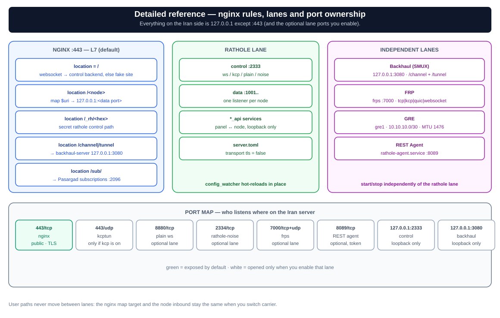
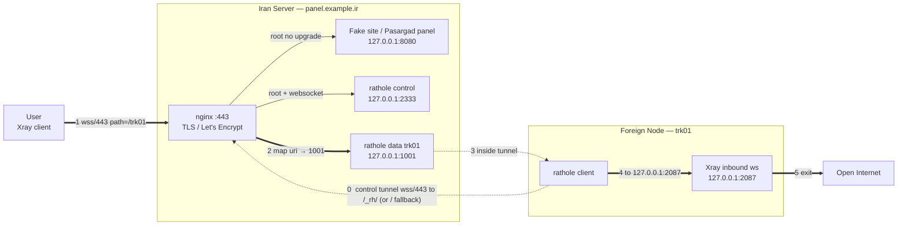
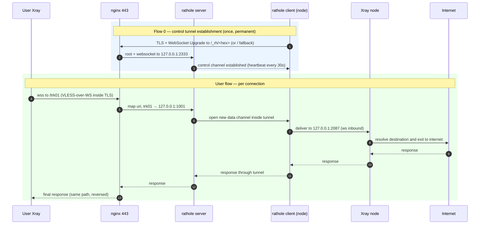

# Traffic Flow — Exact Packet Path (multi-lane)

This document shows exactly what happens to a packet from the moment a user clicks "Connect" to the time it reaches the open internet, and what each component does at each layer. The system is **multi-lane**: a node's service is carried by exactly one tunnel lane, while the public path/port and the user-side config stay the same when you move it.

> Assumptions for the examples: domain `panel.example.ir`, node `trk01`, Xray inbound on the node `2087`, rathole data port on the Iran server `1001`, rathole control port `2333`, fake site/panel `8080`. Other lanes have their own ports — see the [Lane Index](#lane-index--one-path--one-lane) and [Port Map](#port-map-who-listens-where).

---

## Component Overview

```
┌─────────┐   ┌────────────── Iran Server (panel.example.ir) ────────────────┐   ┌──── Foreign Node (trk01) ────┐
│  User   │   │                                                               │   │                              │
│ (Xray   │   │  nginx :443 (TLS / Let's Encrypt)                             │   │  rathole client              │
│ client) │   │    map $uri           → local port                            │   │  Xray inbound (ws, no TLS)   │
└────┬────┘   │    map $http_upgrade  (root: fake or control)                 │   │  → exit to internet          │
     │        │                                                               │   └────────────┬─────────────────┘
     │(1)wss  │  rathole server (control :2333, data :1001, ...)              │                │
     │  /443  │  fake site + Pasargad panel (:8080)                           │◄──(0) control──┘
     └───────►│  optional lanes: backhaul :3080, frps :7000, plain :8880,      │     tunnel
              │  noise :2334, kcptun UDP :443, agent :8089                     │   (node connects to Iran)
              └───────────────────────────────────────────────────────────────┘
```

Flows are multiplexed on **one public port 443 / one domain**:

- **Flow (0): tunnel establishment** — once when the node starts (per lane), stays up permanently.
- **Flow (1→8): user data** — for each user connection, flows inside whichever lane that service belongs to.

Wire-level separation is by **lane**, not by user path: the user path/port on Iran is stable, but the transport between Iran and the node differs per lane.

---

## Visual Diagrams

> Diagrams in `assets/` render as SVG:
> - `architecture.svg` — high-level architecture
> - `architecture-detailed.svg` — full reference: topology + nginx decision logic + port table + flows
> - `traffic-steps.svg` — step-by-step packet journey
> - `traffic-flow-flowchart.svg` / `traffic-flow-sequence.svg` — detailed flow

**Architecture:** 

**Full reference (all details):** 

**Step-by-step:** 

**Flowchart:** 

**Sequence:** 

---

### Flowchart (ws lane — the default)



---

### Sequence Diagram (ws lane)



---

## Flow 0: Control Tunnel Establishment (Node → Iran, ws lane)

This happens before any user traffic and is the foundation of the default lane.

1. **rathole client** on the node dials `panel.example.ir:443` with TLS.
2. nginx receives the connection. A WebSocket Upgrade to the control path is routed to `127.0.0.1:2333` (rathole server):
   - the control path is the secret `/_rh/<32 hex>` generated at init; the root fallback still routes an `Upgrade: websocket` on `/` to the control port for backward compatibility (and nodes that have not run `ratholenode control-path set`).
   - the user path (`/trk01`, …) is matched **before** the root fallback by `location /`, so user data never lands on the control channel.
3. rathole server accepts the control channel and validates each service token.
4. Heartbeat keeps the channel alive (**server** `heartbeat_interval = 30`, **client** `heartbeat_timeout = 40` — the client's timeout must stay greater than the server's interval). If it drops, rathole reconnects automatically.

> **Secret control path (v1.5.0+):** `ratholectl init` generates `control_path = /_rh/<32 hex>` (`ratholectl control-path show`), and nginx gets an exact `location` for it; the `map $http_upgrade` root fallback still sends an `Upgrade: websocket` on `/` to the control port for backward compatibility. A node keeps dialing `/` until you run `ratholenode control-path set <path>`. `ratholectl control-path rotate [--dry-run]` rolls a new secret path (with health-check + auto-rollback) and `clear` returns to `/`.

---

## User Data Flow (steps 1–8, ws lane)

1. **User Xray client** connects to `wss://panel.example.ir:443/trk01` (VLESS-over-WS inside TLS).
2. **nginx** terminates TLS and sees the path `/trk01`.
3. nginx routes by URI: `map $uri $backend_port` maps `~^/trk01` to `1001`; `proxy_pass http://127.0.0.1:1001` keeps the path (`/trk01`) and passes the Upgrade/Connection headers.
4. **rathole server** (local data listener `1001`) accepts it and signals the node over the control channel: "open a new data channel for service `trk01`".
5. **rathole client** on the node opens that data channel and connects it to its `local_addr`, e.g. `127.0.0.1:2087`.
6. **Xray inbound** on the node (WS, TLS off) receives VLESS-over-WS; the inner path is still `/trk01` and matches the inbound path.
7. **Xray** strips VLESS and resolves the real destination (e.g. `google.com:443`).
8. Xray exits via the node's IP to the open internet; the response comes back the same way in reverse.

### Path Consistency Rule

If these three don't match, the user "connects but has no internet":

```
User VLESS config  ==  nginx location/map  ==  Xray node ws inbound path
     /trk01               ~^/trk01                    /trk01
```

The node name in `ratholectl` is the path, so creating node `trk01` aligns all three automatically.

---

## Layer Encapsulation

At the peak point (user ↔ Iran), a packet is nested like this on the default lane:

```
┌─────────────────────────────────────────────────────────────┐
│ TLS (443, Let's Encrypt cert, terminated by nginx)           │
│ ┌─────────────────────────────────────────────────────────┐ │
│ │ WebSocket (path /trk01)                                 │ │
│ │ ┌─────────────────────────────────────────────────────┐ │ │
│ │ │ VLESS (real proxy protocol, opened by the node Xray)│ │ │
│ │ │ ┌─────────────────────────────────────────────────┐ │ │ │
│ │ │ │ actual user traffic (e.g. HTTPS to google.com)  │ │ │ │
│ │ │ └─────────────────────────────────────────────────┘ │ │ │
│ │ └─────────────────────────────────────────────────────┘ │ │
│ └─────────────────────────────────────────────────────────┘ │
└─────────────────────────────────────────────────────────────┘
```

- **nginx** sees only the outer TLS + WebSocket and decides by path; it never opens VLESS.
- **rathole** opens nothing; it is a byte-transparent pipe between the two ends.
- **Xray on the node** is the only place where VLESS is actually opened and the destination extracted.

On other lanes, the outer layers change (UDP/FEC, Noise, SMUX, FRP, GRE) but the invariant stays: **the node's Xray inbound is still reached at `127.0.0.1:<inbound>` and the path/identity stays the same**.

---

## Lane Index — one path = one lane

Each Iran node path belongs to **exactly one lane**. Moving a node between lanes keeps its public path and Iran-side local port stable; it changes only what carries that port to the node.

| Lane | Public entry on Iran | Tunnel core | Node side | TLS termination | Notes |
|---|---|---|---|---|---|
| **ws** (default) | TCP/443, nginx `map $uri` | rathole server (`server.toml`) | rathole client → Xray ws inbound | nginx | secret control path `/_rh/<32 hex>` generated at init; node uses `/` until `control-path set` |
| **kcp** | UDP/443 (default) | `kcptun-server` → `127.0.0.1:2333` + rathole server | `kcptun-client` (local `127.0.0.1:29900`) → rathole client | nginx (user TLS); none inside kcp | profiles `balanced/lossy/aggressive` must match on both ends; looks like QUIC |
| **plain** | TCP/8880 (nginx plain listener) | rathole server | rathole client | none | no TLS on the tunnel; adaptive uses it only with `ALLOW_INSECURE=1` |
| **noise** | TCP/2334 (public) | second rathole instance `rathole-noise` (`noise-server.toml`) | rathole client with Noise | Noise (X25519 + ChaChaPoly) | bypasses nginx/443; no cert needed |
| **backhaul** | TCP/443: user `map` plus hardcoded `/channel` + `/tunnel` → `127.0.0.1:3080` | `backhaul-server` (Go, SMUX) | `backhaul-client` → Xray inbound | nginx | separate `bh-services.conf`; server non-TLS (`ws`/`wsmux`), client TLS (`wss`/`wssmux`); mux profile must match |
| **frp** | TCP/443, nginx → `127.0.0.1:<node_port>` (frps proxy) | `frps` ⇄ `frpc` on port `7000` (TCP, or UDP for `kcp`/`quic`) | `frpc` → Xray inbound | nginx (user TLS) | shared token; transport `tcp/kcp/quic/websocket`; tunnel encryption depends on the transport |
| **gre** | — (L3 underlay) | Linux `ip tunnel`, protocol 47, /30 `10.10.10.0/30`, MTU `1476` | same interface (`10.10.10.2`) | n/a | no user-facing entry by itself; TCPMSS clamp to avoid fragmentation |
| **frp_gre** | TCP/443, nginx → `127.0.0.1:<node_port>` (frps proxy) | `frps` ⇄ `frpc` over the GRE peer IPs, inside GRE | `frpc` → Xray inbound | nginx (user TLS) | FRP multiplexing carried inside the GRE link |

> A `?` carrier label in the hub means the protocol was **not reported** by the server; the label alone does not prove connectivity — the health test does.

---

## Lane 1 — WebSocket + TLS (default)

Described above (Flow 0 + steps 1–8). Setup: `ratholectl add <name> <inbound>` on Iran; `install-node.sh` / `ratholenode apply` on the node. The control tunnel is `wss/443`; user traffic is `wss/443/<path>`.

---

## Lane 2 — KCP (parallel UDP + FEC path)

KCP (via kcptun) adds a parallel **UDP** path with Reed–Solomon FEC, aimed at lossy links; it is additive and does not touch nginx or TCP/443.

- Iran: `ratholectl kcp on [port] [profile]` (default port `443`; profile `balanced`). This starts `rathole-kcp-server` (kcptun) listening on **UDP/443** and forwarding to the rathole control port `127.0.0.1:2333`.
- Node: `ratholenode kcp on <iran_ip>:<udp_port> <key> [profile]`, which starts `rathole-kcp-client` on `127.0.0.1:29900` and switches the client to the kcp tunnel.
- Both ends must use the same profile (window/FEC parameters come from `common.sh:kcp_profile`). On UDP/443 the traffic looks like QUIC/HTTP3 to DPI and does not conflict with nginx on TCP/443.

```
User ──wss/443/trk01──► nginx ──map──► 127.0.0.1:1001 (rathole data)
                                           └── rathole control channel carried over:
                                               node kcptun-client ──UDP/443 + FEC──► kcptun-server ──► 127.0.0.1:2333
```

The user path and Xray inbound are unchanged; only the control-tunnel carrier changes.

---

## Lane 3 — Plain (WebSocket without TLS)

`ratholectl plain on [port]` (default `8880`) opens a **separate plain HTTP nginx server block** on that port; the node switches with `ratholenode plain on <iran_ip>:<port>` and talks `ws://` without TLS.

- The tunnel carrier loses TLS — lighter, but the tunnel itself is unencrypted (the user's VLESS still runs inside).
- `ALLOW_INSECURE=1` is required for adaptive mode to use the plain lane.
- The user-facing path on 443 is untouched; the plain listener is only the tunnel entry.

---

## Lane 4 — Noise (encrypted, no TLS/cert)

`ratholectl noise on [port]` (default `2334`) starts a **second rathole instance** (`rathole-noise`, `noise-server.toml`) bound to `0.0.0.0:2334`. Encryption is Noise (`Noise_NK_25519_ChaChaPoly_BLAKE2s` by default), so no nginx and no certificate are involved.

- Node: `ratholenode noise on <iran_ip>:<port> <server_pubkey> [pattern]`. The server's public key comes from `ratholectl noise show`; the private key stays on Iran.
- Services of noise nodes live in `noise-server.toml`, not `server.toml`; `ratholectl noise node <name> on` moves a service between the two.
- The user path (`nginx map → backend_port`) does not change; only the process carrying the service changes.

---

## Lane 5 — Backhaul (SMUX multiplexer behind the same nginx/443)

Backhaul is an independent Go core (`Musixal/Backhaul`) that multiplexes many user connections onto one SMUX session. Public domain/port stay the same.

- Iran: `ratholectl backhaul on [port] [ws|wsmux] [profile] [nginx_tls|direct_ip]` (default `127.0.0.1:3080`, `wsmux`, `balanced`, `nginx_tls`).
- nginx has **two jobs** for this lane:
  1. user paths: `map $uri` → `127.0.0.1:<iran_port>`; that port is opened by `backhaul-server` itself (from the `ports = ["127.0.0.1:<iran_port>=<node_inbound>"]` mapping) and forwarded over the SMUX session.
  2. transport: hardcoded `location = /channel` (control) and `location /tunnel` (data prefix) → `http://127.0.0.1:3080`.
- Node: `ratholenode backhaul on <domain|host:port> <token> [wss|wssmux|ws|wsmux] [profile]`; backhaul services live in `bh-services.conf`.

```
User ──wss/443/trk01──► nginx (:443)
                          ├── map $uri → 127.0.0.1:1001 (backhaul-server port-forward listener)
                          │                 └── SMUX streams over /channel + /tunnel (wss/443)
                          │                                        │
                          │                                        ▼
                          │                          backhaul-client on the node
                          │                                        │
                          └── hardcoded /channel,/tunnel → 127.0.0.1:3080      ▼
                                                              Xray inbound 127.0.0.1:2087
```

Invariants: server transport is always the non-TLS variant (`ws`/`wsmux`) and the client the TLS one (`wss`/`wssmux`) — nginx terminates TLS; `tcpmux` cannot traverse the L7 nginx; the mux profile must match (`mux_con` server-only, `connection_pool` client-only).

---

## Lane 6 — FRP core (`fatedier/frp`)

A standalone reverse-tunnel core beside rathole: `frps` on Iran, `frpc` on the node, shared token auth.

- Iran: `ratholectl frp on [port] [token] [tcp|kcp|quic|websocket]` (default port `7000`; `443` is reserved). The argument order is **token before transport**; if the token slot holds a transport name it is treated as the transport.
- The generated `frps.toml` keeps `proxyBindAddr = "127.0.0.1"`, so the node's Iran-side port is exposed on localhost only, exactly where nginx's `map` already points. That is why the user path/443 does not change.
- Node: `ratholenode frp on <iran_ip:port> <token> [transport] [remote_port]`; pass the node's Iran-side data port as `remote_port` (e.g. `1001`, shown by `ratholectl show`/`ratholectl frp show`) — it keeps the nginx `map` target stable, whereas omitting it falls back to the node inbound port. Run `ratholectl frp ready <name>` **on the Iran server** to verify the proxy registered on `127.0.0.1:<iran_port>`.

```
User ──wss/443/trk01──► nginx (:443, TLS)
                          └── map $uri → 127.0.0.1:1001 (frps proxy listener)
                                           │
                                           ▼
                              frps ⇄ frpc on :7000 (tcp|kcp|quic|websocket, shared token)
                                           │
                                           ▼
                              Xray inbound 127.0.0.1:2087 on the node
```

---

## Lane 7 — GRE (Linux L3 kernel tunnel)

GRE is a Layer-3 underlay, not a user-facing entry. `ratholectl gre on <remote_ip> [tunnel_ip] [gre_name]` and `ratholenode gre on <iran_ip> [tunnel_ip] [gre_name]` bring up `gre1` on a `/30` (`10.10.10.1` on Iran, `10.10.10.2` on the node), MTU `1476`, with an iptables TCPMSS clamp (`--clamp-mss-to-pmtu`) so TCP does not fragment across the path.

```
Iran (gre1: 10.10.10.1) ◄──[GRE-encapsulated packets, proto 47, MTU 1476]──► Node (gre1: 10.10.10.2)
        ▲                                                                          │
        └── iptables TCPMSS clamp (--clamp-mss-to-pmtu)                            ▼
                                                                    no user-facing port by itself
```

- No userspace proxy and no certificate on this leg; packets look like plain GRE to middleboxes.
- `ratholenode gre probe <peer_ip> [gre_name]` pings through the tunnel — an interface that is `UP` does not prove reachability (protocol 47/firewall).

---

## Lane 8 — FRP + GRE hybrid

The hybrid carries FRP's multiplexed streams **inside** the GRE link, so DPI sees only GRE between the two IPs.

- Setup is two steps: `gre on` on both ends (above), then FRP over the GRE peer IP: `ratholectl frp on 7000 <TOKEN> quic` on Iran and `ratholenode frp on 10.10.10.1:7000 <TOKEN> quic <IRAN_PORT>` on the node (`<IRAN_PORT>` is the node's Iran-side data port, exactly like the plain FRP lane).
- In the hub this is a service control: service row → "Carrier and protocol" → `FRP + GRE` (`gre_probe` first, then FRP pointed at the GRE virtual IP).
- `frps` still binds `proxyBindAddr = 127.0.0.1`, so the nginx `map` target is unchanged; only the frps⇄frpc leg runs over `10.10.10.0/30`.

```
User ──wss/443/trk01──► nginx → 127.0.0.1:1001 (frps proxy listener)
                                      │
                                      ▼
                         frps (Iran) ⇄ frpc (node) inside GRE:
                         frps over 10.10.10.1:7000  ◄── GRE 10.10.10.0/30 ──►  frpc at 10.10.10.2
                                      │
                                      ▼
                         Xray inbound 127.0.0.1:2087 → open internet
```

Why it is hard to block: the outer layer is ordinary GRE between two server IPs; the inner stream is FRP-multiplexed QUIC/KCP with no plain HTTP/TLS markers; jitter is absorbed by FRP buffers.

---

## Ingress Modes (NOT lanes)

Ingress modes decide **how users reach the panel**; independent of the lane carrying a node's service.

### game / SNI — L4 passthrough on 443

`ratholectl game add <name> <inbound> <sni>` registers a game service. As soon as any node has an `sni`, nginx on 443 switches to **stream/SNI** (`ssl_preread`) and the L7 path vhost moves to `127.0.0.1:<internal_port>` (default `8443`):

```
User (game client) ──TLS/443 with SNI=gmtrk.example.ir──► nginx stream (ssl_preread)
        ├── SNI matches a game node → 127.0.0.1:<node data port> → same tunnel lane → node
        │                                                        └── real TLS terminates on the node
        └── any other SNI/domain     → 127.0.0.1:8443 (L7 vhost; /trk01 etc. keep working)

User (VLESS-over-WS, other nodes) ──wss/domain:443──► (same stream block) ──► 127.0.0.1:8443 ──► path map
```

For game traffic TLS terminates **on the node** with the real `sni` certificate (VLESS+TLS+Vision); Iran never sees plaintext. `ratholectl game show <name>` prints the node-side steps.

### direct-IP — header-based routing, no domain/TLS

`ratholectl direct on [--port 8081] [--header X-Cdn-Id]`. A plain HTTP listener appears on that port; by header value (= node name) nginx maps to the same rathole/backhaul/frp local port; unknown/empty header falls through to the fake site.

```
User ──HTTP/8081──► nginx (:8081, no TLS)
                      ├── X-Cdn-Id: trk01  → map header → 1001 → lane → node
                      ├── X-Cdn-Id: nld01  → map header → 1002 → lane → node
                      └── unknown/no header → fake site
```

Differences: no TLS on this entry (identity lives in VLESS UUID), and the map key is `$http_<header>` instead of `$uri`; the local port and lane underneath are identical.

### proxy — non-tunnel reverse proxy on the same 443

`ratholectl proxy add mysvc http://127.0.0.1:9000` creates `location /mysvc/` → `proxy_pass http://127.0.0.1:9000`. No tunnel and no node are involved — suitable for services that already expose their own endpoint.

### fakeweb — decoy site (fallback)

`ratholectl fakeweb start|stop|rm|status [port]` serves a fake site on the fake port (default `8080`). nginx sends root requests **without** the Upgrade header there, and it is the fallback when no path/header matches. It is cover traffic, not a lane.

---

## Management Plane (separate from user data)

Management traffic is never user data: it manages the servers, not the tunnel.

### Hub → Iran/node: SSH (default) or REST Agent (optional)

- The hub (`ratholehub`, `127.0.0.1:8088`, behind nginx `/hub/`) never runs raw shell strings. It maps an allow-listed action + regex-validated args to an **argv list** and executes it either over **SSH with a key** or through the **REST Agent**.
- **REST Agent** (`ratholeagent.py`, systemd `rathole-agent.service`, default `:8089`):
  - `GET /api/ping` → `{ok, role, version, hostname}` (no auth),
  - `POST /api/exec` with `Authorization: Bearer <token>` and body `{"cmd": ["ratholectl","status","--json"], "timeout": 120}` → `{ok, rc, out, err}`,
  - JSON body 1 B–1 MiB, `cmd` non-empty list of strings, timeout 1–3600 s; a `["timeout",N,...]` wrapper is clamped; binaries are allow-listed,
  - token from `--token` / `RATHOLE_AGENT_TOKEN` / `/etc/rathole-agent/token` (auto-generated hex, chmod 600),
  - optional HTTPS via `--tls-cert`/`--tls-key`, env, or default `/etc/rathole-agent/cert.pem` + `key.pem`; the hub accepts a self-signed cert only when that server record has `insecure_ssl: true` (or the hub runs with `RATHOLE_AGENT_INSECURE_SSL=1`).
- The hub applies its configured proxy to agent requests too and audit-logs write actions exactly like SSH.

```
Hub (127.0.0.1:8088)
  ├── SSH key ─────────────────────────────► sshd on the Iran server / node ──► ratholectl/ratholenode (argv)
  └── HTTPS + Bearer ──► :8089 agent ──► POST /api/exec {cmd:[...]} ──► argv (allow-list) ──► ratholectl/ratholenode
```

Neither path carries user traffic; the public portal is still only nginx/443.

### Panel ↔ node management channel (`_api`)

If a node was added with `--api-port` (or `ratholectl edit <name> --api-port N`), a second rathole service `<name>_api` is created on `127.0.0.1:<api_local_port>` of Iran and forwarded through the **same tunnel lane** to the node's management API port. It is for the Pasargad panel↔node management, not the hub, and it never traverses the public nginx/443 path.

```
Pasargad panel (Iran) → 127.0.0.1:<api_local_port> → tunnel lane → node 127.0.0.1:<api_inbound_port>
```

---

## Port Map (who listens where)

| Where | Port | Listener | Public? | Purpose |
|---|---|---|---|---|
| Iran | `443/tcp` | nginx | yes | the only default public entry; TLS + path routing (or stream/SNI mode) |
| Iran | `127.0.0.1:2333` | rathole server (control) | no | `/` (or `/_rh/<hex>`) + Upgrade |
| Iran | `127.0.0.1:1001..` | rathole data / backhaul port-forward / frps proxy | no | `/<node>` target from the nginx map |
| Iran | `127.0.0.1:7001..` | rathole/backhaul `_api` service | no | Pasargad panel ↔ node management |
| Iran | `127.0.0.1:8080` | fake site / Pasargad panel | no | root without upgrade |
| Iran | `127.0.0.1:8088` | ratholehub | no | hub UI/API behind nginx `/hub/` |
| Iran | `127.0.0.1:3080` | `backhaul-server` | no | `/channel` + `/tunnel` (SMUX transport) |
| Iran | `443/udp` | `kcptun-server` (optional) | yes | kcp lane; looks like QUIC |
| Iran | `8880/tcp` | nginx plain listener (optional) | yes | plain lane (no TLS) |
| Iran | `2334/tcp` | `rathole-noise` (optional) | yes | noise lane (Noise encryption) |
| Iran | `7000/tcp` or `/udp` | `frps` (optional) | yes | frp lane / frp+gre hybrid |
| Iran ↔ Node | proto `47`, MTU `1476` | GRE `gre1` (optional) | — | `10.10.10.0/30` L3 underlay |
| Iran | `8081/tcp` | direct-IP listener (optional) | yes | header-based ingress (no TLS) |
| Node | `127.0.0.1:2087` | Xray inbound (ws) | no | tunnel data destination |
| Node | `127.0.0.1:62050` | Pasargad-node API | no | `_api` destination |
| Node | `127.0.0.1:29900` | `kcptun-client` local (optional) | no | kcp lane client endpoint |
| Node | `127.0.0.1:8081` | `rathole-fakeweb` (optional) | no | game fallback for TLS inbound |
| Iran/node | `8089/tcp` | `rathole-agent` (optional) | depends | REST management (hub); firewall-restrict it |

> Local ports are bound to `127.0.0.1`. By default only **443 on the Iran server** is public; each optional lane explicitly opens its own port. The node never exposes a tunnel port — the rathole/backhaul/frp clients only dial out.

---

## Why This Design?

- **One port, one domain, one cert (by default):** everything is multiplexed behind nginx on 443, so the operator keeps one cert and one user config.
- **Reverse topology:** foreign nodes connect to Iran (not the other way); the Iran server has a clean public domain/IP.
- **Camouflage:** the tunnel and data look like normal HTTPS/WSS to a legitimate domain; a fake site on root adds cover.
- **Scalability:** adding a node = one line in `map` + one service; `ratholectl add` automates it.
- **Lane flexibility:** heavy/lossy links can move a service to kcp/backhaul/frp/gre without touching the user's config — the path stays the same.

For carrier details see [`transport-modes.en.md`](transport-modes.en.md); for install and management details see [`install-manual.md`](install-manual.md); for the original design/troubleshooting see [`rathole-multilocation-pasargad.md`](../rathole-multilocation-pasargad.md) (Persian).
