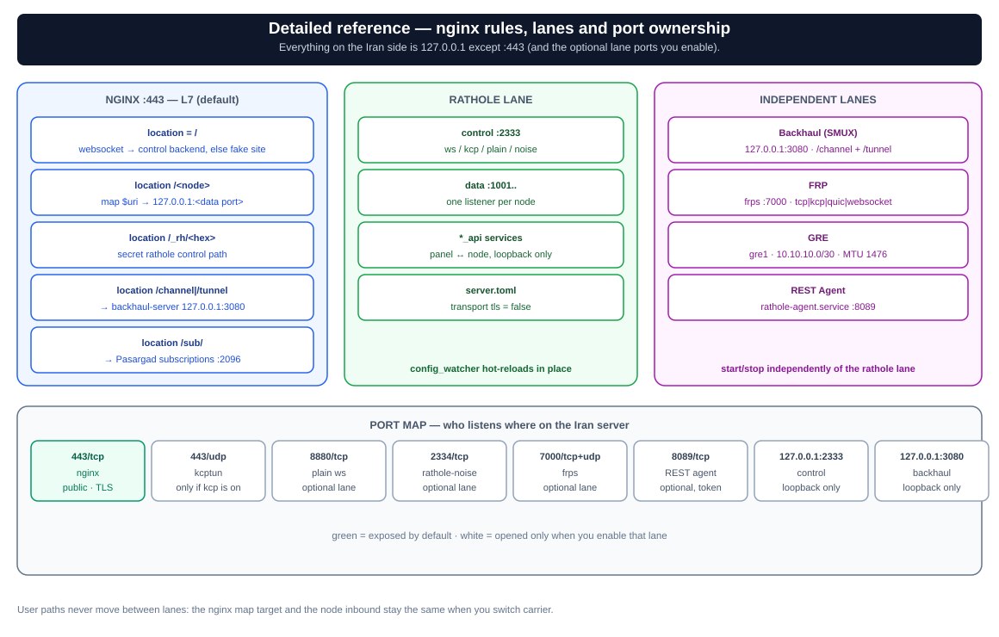
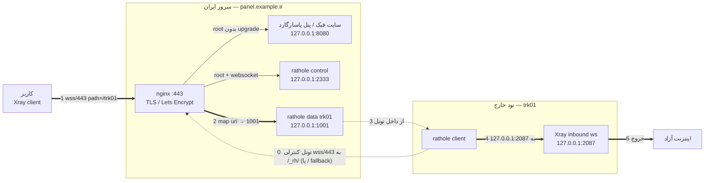
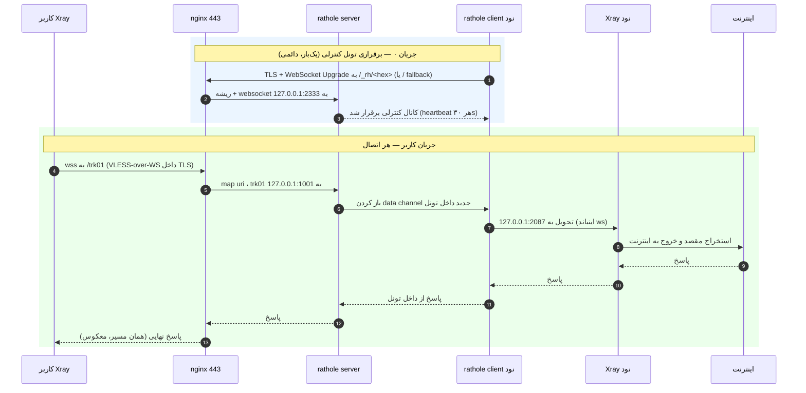

# مسیر دقیق ترافیک — تونل ریورس مولتی‌لوکیشن (چند-لاین)

این سند دقیقاً نشان می‌دهد یک بسته از لحظه‌ای که کاربر دکمه «اتصال» را می‌زند تا رسیدن به اینترنت آزاد، از چه لایه‌هایی عبور می‌کند و هر جزء چه‌کار می‌کند. سیستم **چند-لاین** است: سرویس هر نود دقیقاً روی **یک لاین** حمل می‌شود، ولی مسیر/پورت عمومی و کانفیگ سمت کاربر هنگام جابه‌جایی بین لاین‌ها عوض نمی‌شود.

> فرض‌ها برای مثال: دامنه `panel.example.ir`، نود `trk01`، پورت اینباند Xray روی نود `2087`، پورت دیتای لوکال rathole روی سرور ایران `1001`، پورت کنترلی `2333`، سایت فیک/پنل `8080`. بقیهٔ لاین‌ها پورت خودشان را دارند — [فهرست لاین‌ها](#فهرست-لاینها--هر-مسیر-دقیقاً-یک-لاین) و [نقشهٔ پورت‌ها](#نقشهٔ-پورتها-چه-چیزی-کجا-گوش-میدهد).

---

## نمای کلی اجزاء

```
┌─────────┐   ┌────────────── سرور ایران (panel.example.ir) ────────────────┐   ┌──── نود خارج (trk01) ────┐
│  کاربر  │   │                                                               │   │                          │
│ (Xray   │   │  nginx :443 (TLS / Let's Encrypt)                             │   │  rathole client          │
│ client) │   │    map $uri           → پورت لوکال                            │   │  Xray inbound (ws, no TLS)│
└────┬────┘   │    map $http_upgrade  (ریشه: فیک یا کنترل)                    │   │  → خروج به اینترنت        │
     │        │                                                               │   └────────────┬─────────────┘
     │(1)wss  │  rathole server (control :2333, data :1001, ...)              │                │
     │  /443  │  پنل پاسارگارد + سایت فیک (:8080)                              │◄──(0) تونل کنترلی──┘
     └───────►│  لاین‌های اختیاری: backhaul :3080، frps :7000، plain :8880،    │     (نود به ایران وصل می‌شود)
              │  noise :2334، kcptun UDP :443، agent :8089                    │
              └───────────────────────────────────────────────────────────────┘
```

جریان‌ها روی **یک پورت عمومی ۴۴۳ / یک دامنه** مالتی‌پلکس می‌شوند:

- **جریان (0): برقراری تونل** — یک‌بار هنگام بالا آمدن نود (به‌ازای هر لاین)، و دائمی باقی می‌ماند.
- **جریان کاربر (۱→۸): دیتای واقعی** — هر بار که کاربر وصل می‌شود، داخل همان لاینی که سرویس به آن تعلق دارد جریان می‌یابد.

تفکیک در سطح سیم بر اساس **لاین** است، نه مسیر کاربر: مسیر/پورت کاربر روی ایران ثابت می‌ماند، ولی حامل بین ایران و نود برای هر لاین فرق می‌کند.

---

## نمودار تصویری مسیر (Mermaid)

> این نمودارها روی GitHub و در VS Code با افزونهٔ Mermaid به‌صورت گرافیکی رندر می‌شوند.
> نسخهٔ **تصویری** (SVG) هم در پوشهٔ `assets/` موجود است:
> - `architecture.svg` — نمای معماری کلی (مناسب ارائه)
> - `architecture-detailed.svg` — مرجع کامل: توپولوژی + منطق nginx + جدول پورت‌ها + جریان‌ها
> - `traffic-steps.svg` — سفر بسته گام‌به‌گام
> - `traffic-flow-flowchart.svg` / `traffic-flow-sequence.svg` — جزئیات دقیق مسیر

**نمای معماری:** 

**📋 مرجع کامل و دقیق — همه‌چیز یک‌جا:** 

**سفر بسته گام‌به‌گام:** 

**فلوچارت کلی:** 

**نمودار ترتیبی:** 

### فلوچارت کلی (لاین ws — پیش‌فرض)



### نمودار ترتیبی (Sequence، لاین ws)



---

## جریان ۰: برقراری تونل کنترلی (نود → ایران، لاین ws)

این قبل از هر ترافیک کاربری اتفاق می‌افتد و پایهٔ لاین پیش‌فرض است.

1. **rathole client** روی نود با TLS به `panel.example.ir:443` وصل می‌شود.
2. nginx اتصال را می‌گیرد. WebSocket Upgrade روی مسیر کنترلی به `127.0.0.1:2333` (rathole server) می‌رود:
   - مسیر کنترلی همان مسیر مخفی `/_rh/<32 hex>` است که هنگام init ساخته می‌شود؛ برای سازگاری، Upgrade روی ریشهٔ `/` هم به همان پورت کنترل می‌رود (و نودهایی که `ratholenode control-path set` را اجرا نکرده‌اند از `/` استفاده می‌کنند)؛ مسیر کاربر (`/trk01` و…) با `location /` **قبل از** fallback ریشه match می‌شود و هرگز روی کانال کنترل نمی‌افتد.
3. rathole server کانال کنترلی را می‌پذیرد و توکن هر سرویس را اعتبارسنجی می‌کند.
4. heartbeat کانال را زنده نگه می‌دارد (**سرور** `heartbeat_interval = 30`، **کلاینت** `heartbeat_timeout = 40` — تایم‌اوت کلاینت باید بزرگ‌تر از interval سرور بماند). اگر قطع شود، rathole خودکار وصل می‌شود.

> **مسیر مخفی کنترل (v1.5.0+):** `ratholectl init` مقدار `control_path = /_rh/<32 hex>` را می‌سازد (`ratholectl control-path show`)، و nginx یک `location` دقیق برایش می‌سازد؛ `map $http_upgrade` روی ریشهٔ `/` هم Upgrade را برای سازگاری به پورت کنترل می‌فرستد. نود تا وقتی `ratholenode control-path set <path>` اجرا نشود از `/` استفاده می‌کند. `ratholectl control-path rotate [--dry-run]` مسیر مخفی جدید می‌سازد (با health-check + rollback خودکار) و `clear` به `/` برمی‌گردد.

---

## جریان کاربر: گام‌به‌گام (۱ تا ۸، لاین ws)

1. **کلاینت Xray کاربر** به `wss://panel.example.ir:443/trk01` وصل می‌شود (VLESS-over-WS داخل TLS).
2. **nginx** گواهی را ارائه و TLS را ترمینیت می‌کند و مسیر `/trk01` را می‌بیند.
3. nginx مسیریابی می‌کند: `map $uri $backend_port` الگوی `~^/trk01` را به `1001` می‌نگارد؛ `proxy_pass http://127.0.0.1:1001` مسیر (`/trk01`) را حفظ و هدرهای Upgrade/Connection را پاس می‌دهد.
4. **rathole server** (شنوندهٔ دیتای لوکال `1001`) کانکشن را می‌گیرد و از داخل کانال کنترل به نود سیگنال می‌دهد: «یک data channel جدید برای سرویس `trk01` باز کن».
5. **rathole client** روی نود آن data channel را باز می‌کند و به `local_addr` خودش، مثلاً `127.0.0.1:2087`، وصل می‌کند.
6. **اینباند Xray** روی نود (ws، TLS خاموش) بستهٔ VLESS-over-WS را می‌بیند؛ path داخل درخواست هنوز `/trk01` است و با path اینباند مطابقت دارد.
7. **Xray** محتوای VLESS را باز و مقصد واقعی کاربر را استخراج می‌کند (مثلاً `google.com:443`).
8. Xray از روی IP نود خارج به اینترنت آزاد می‌رود و پاسخ از همین مسیر برعکس برمی‌گردد.

### قانون هم‌ترازی path

اگر این سه با هم نخوانند، کاربر «وصل می‌شود ولی نت ندارد»:

```
کانفیگ VLESS کاربر  ==  location/map در nginx  ==  path اینباند Xray روی نود
      /trk01                  ~^/trk01                      /trk01
```

نام نود در `ratholectl` همان path است، پس با ساختن نود `trk01` هر سه به‌صورت پیش‌فرض هماهنگ می‌شوند.

---

## لایه‌های کپسوله‌سازی (مهم برای فهم «چرا کار می‌کند»)

در نقطهٔ اوج (بین کاربر و سرور ایران)، یک بسته در لاین پیش‌فرض این‌طور تو‌در‌تو است:

```
┌─────────────────────────────────────────────────────────────┐
│ TLS (443، گواهی Let's Encrypt، توسط nginx ترمینیت می‌شود)      │
│ ┌─────────────────────────────────────────────────────────┐ │
│ │ WebSocket (مسیر /trk01)                                  │ │
│ │ ┌─────────────────────────────────────────────────────┐ │ │
│ │ │ VLESS (پروتکل واقعی پراکسی، توسط Xray نود باز می‌شود)  │ │ │
│ │ │ ┌─────────────────────────────────────────────────┐ │ │ │
│ │ │ │ ترافیک واقعی کاربر (مثلاً HTTPS به google.com)    │ │ │ │
│ │ │ └─────────────────────────────────────────────────┘ │ │ │
│ │ └─────────────────────────────────────────────────────┘ │ │
│ └─────────────────────────────────────────────────────────┘ │
└─────────────────────────────────────────────────────────────┘
```

- **nginx** فقط لایهٔ بیرونی TLS و WebSocket را می‌بیند و بر اساس `path` تصمیم می‌گیرد؛ محتوای VLESS را **نمی‌بیند و باز نمی‌کند**.
- **rathole** هیچ لایه‌ای را باز نمی‌کند؛ یک لولهٔ شفاف بایتی بین دو سر است.
- **Xray روی نود** تنها جایی است که VLESS واقعاً باز می‌شود و مقصد استخراج می‌گردد.

در بقیهٔ لاین‌ها لایه‌های بیرونی عوض می‌شوند (UDP/FEC، Noise، SMUX، FRP، GRE)، ولی قاعده ثابت می‌ماند: **اینباند Xray نود همیشه در `127.0.0.1:<inbound>` مقصد است و path/هویت کاربر تغییر نمی‌کند**.

---

## فهرست لاین‌ها — هر مسیر دقیقاً یک لاین

هر مسیر (path) نود روی ایران دقیقاً به **یک لاین** تعلق دارد. جابه‌جایی نود بین لاین‌ها، مسیر عمومی و پورت لوکال سمت ایران را ثابت نگه می‌دارد و فقط حاملی که آن پورت را به نود می‌رساند عوض می‌شود.

| لاین | ورودی عمومی روی ایران | هستهٔ تونل | سمت نود | ترمینیشن TLS | نکته |
|---|---|---|---|---|---|
| **ws** (پیش‌فرض) | TCP/443، `map $uri` در nginx | rathole server (`server.toml`) | rathole client → اینباند ws ایکس‌ری | nginx | مسیر مخفی کنترل `/_rh/<32 hex>` هنگام init ساخته می‌شود؛ نود تا `control-path set` از `/` استفاده می‌کند |
| **kcp** | UDP/443 (پیش‌فرض) | `kcptun-server` → `127.0.0.1:2333` + rathole server | `kcptun-client` (لوکال `127.0.0.1:29900`) → rathole client | nginx (TLS کاربر)؛ داخل kcp خیر | profileهای `balanced/lossy/aggressive` باید دو طرف یکی باشد؛ شبیه QUIC |
| **plain** | TCP/8880 (listener سادهٔ nginx) | rathole server | rathole client | ندارد | تونل بدون TLS؛ حالت adaptive فقط با `ALLOW_INSECURE=1` از آن استفاده می‌کند |
| **noise** | TCP/2334 (عمومی) | نمونهٔ دوم rathole با نام `rathole-noise` (`noise-server.toml`) | rathole client با Noise | Noise (X25519 + ChaChaPoly) | از nginx/443 عبور نمی‌کند؛ گواهی لازم نیست |
| **backhaul** | TCP/443: `map` کاربر + مسیرهای هاردکد `/channel` و `/tunnel` → `127.0.0.1:3080` | `backhaul-server` (Go، SMUX) | `backhaul-client` → اینباند Xray | nginx | رجیستری جدا `bh-services.conf`؛ سرور بدون TLS (`ws`/`wsmux`)، کلاینت TLS (`wss`/`wssmux`)؛ profile باید یکی باشد |
| **frp** | TCP/443، nginx → `127.0.0.1:<node_port>` (پروکسی frps) | `frps` ⇄ `frpc` روی پورت `7000` (TCP یا UDP برای `kcp`/`quic`) | `frpc` → اینباند Xray | nginx (TLS کاربر) | توکن مشترک؛ ترنسپورت `tcp/kcp/quic/websocket`؛ رمزنگاری تونل به ترنسپورت بسته است |
| **gre** | — (زیرساخت L3) | `ip tunnel` لینوکس، پروتکل ۴۷، /30 `10.10.10.0/30`، MTU `1476` | همان اینترفیس (`10.10.10.2`) | ندارد | به‌تنهایی ورودی کاربر ندارد؛ TCPMSS clamp برای جلوگیری از تکه‌تکه شدن |
| **frp_gre** | TCP/443، nginx → `127.0.0.1:<node_port>` (پروکسی frps) | `frps` ⇄ `frpc` روی IPهای GRE، داخل GRE | `frpc` → اینباند Xray | nginx (TLS کاربر) | مالتی‌پلکسینگ FRP داخل لینک GRE |

> برچسب حاملی که در هاب `?` نشان داده می‌شود یعنی پروتکل توسط سرور **گزارش نشده**؛ خود برچسب اثبات اتصال نیست — تست سلامت (doctor) اثبات می‌کند.

---

## لاین ۱ — websocket + TLS (پیش‌فرض)

بالا توضیح داده شد (جریان ۰ + گام‌های ۱ تا ۸). راه‌اندازی: روی ایران `ratholectl add <name> <inbound>`؛ روی نود `install-node.sh` یا `ratholenode apply`. تونل کنترل `wss/443` است و ترافیک کاربر `wss/443/<path>`.

---

## لاین ۲ — kcp (مسیر موازی UDP + FEC)

kcp (با kcptun) یک مسیر موازی **UDP** با FEC (Reed–Solomon) اضافه می‌کند؛ برای لینک‌های پرافت مناسب است و به nginx یا TCP/443 دست نمی‌زند.

- ایران: `ratholectl kcp on [port] [profile]` (پورت پیش‌فرض `443`؛ profile `balanced`). این دستور `rathole-kcp-server` (kcptun) را روی **UDP/443** بالا می‌آورد و به پورت کنترل rathole (`127.0.0.1:2333`) فوروارد می‌کند.
- نود: `ratholenode kcp on <iran_ip>:<udp_port> <key> [profile]` که `rathole-kcp-client` را روی `127.0.0.1:29900` بالا می‌آورد و کلاینت را به تونل kcp سوییچ می‌کند.
- profile باید دو طرف یکی باشد (پارامترهای پنجره/FEC از `common.sh:kcp_profile` می‌آید). روی UDP/443 ترافیک برای DPI شبیه QUIC/HTTP3 است و با nginx روی TCP/443 تضاد ندارد.

```
کاربر ──wss/443/trk01──► nginx ──map──► 127.0.0.1:1001 (دیتای rathole)
                                            └── کانال کنترل rathole حمل‌شده روی:
                                                kcptun-client نود ──UDP/443 + FEC──► kcptun-server ──► 127.0.0.1:2333
```

مسیر کاربر و اینباند Xray عوض نمی‌شود؛ فقط حامل تونل کنترل تغییر می‌کند.

---

## لاین ۳ — plain (websocket بدون TLS)

`ratholectl plain on [port]` (پیش‌فرض `8880`) یک **server block سادهٔ HTTP** در nginx روی همان پورت باز می‌کند؛ نود با `ratholenode plain on <iran_ip>:<port>` سوییچ می‌شود و `ws://` بدون TLS حرف می‌زند.

- حامل تونل TLS خود را از دست می‌دهد — سبک‌تر، ولی خود تونل رمزنگاری‌نشده است (VLESS کاربر همچنان داخلش اجرا می‌شود).
- برای استفادهٔ حالت adaptive از لاین plain، `ALLOW_INSECURE=1` لازم است.
- مسیر کاربر روی ۴۴۳ دست‌نخورده می‌ماند؛ listener ساده فقط ورودی تونل است.

---

## لاین ۴ — noise (رمزنگاری‌شده، بدون TLS/گواهی)

`ratholectl noise on [port]` (پیش‌فرض `2334`) یک **نمونهٔ دوم rathole** با نام `rathole-noise` (`noise-server.toml`) روی `0.0.0.0:2334` بالا می‌آورد. رمزنگاری را خودِ Noise انجام می‌دهد (`Noise_NK_25519_ChaChaPoly_BLAKE2s` به‌صورت پیش‌فرض)، پس نه nginx در مسیر است و نه گواهی.

- نود: `ratholenode noise on <iran_ip>:<port> <server_pubkey> [pattern]`. کلید عمومی سرور از `ratholectl noise show` گرفته می‌شود؛ کلید خصوصی روی ایران می‌ماند.
- سرویس نودهای noise در `noise-server.toml` است، نه `server.toml`؛ `ratholectl noise node <name> on` سرویس را بین این دو جابه‌جا می‌کند.
- مسیر کاربر (nginx `map` → `backend_port`) عوض نمی‌شود؛ فقط پروسه‌ای که سرویس را حمل می‌کند تغییر می‌کند.

---

## لاین ۵ — backhaul (مالتی‌پلکسر SMUX پشت همان nginx/443)

Backhaul یک هستهٔ مستقل Go (`Musixal/Backhaul`) است که خیلی از کانکشن‌های کاربر را در یک نشست SMUX ادغام می‌کند. دامنه/پورت عمومی ثابت می‌مانند.

- ایران: `ratholectl backhaul on [port] [ws|wsmux] [profile] [nginx_tls|direct_ip]` (پیش‌فرض `127.0.0.1:3080`، `wsmux`، `balanced`، `nginx_tls`).
- nginx در این لاین **دو نقش** دارد:
  1. مسیر کاربر: `map $uri` → `127.0.0.1:<iran_port>`؛ این پورت را خودِ `backhaul-server` (از نگاشت `ports = ["127.0.0.1:<iran_port>=<node_inbound>"]`) باز می‌کند و روی نشست SMUX فوروارد می‌کند.
  2. حمل تونل: `location = /channel` (کنترل) و `location /tunnel` (دیتا) → `http://127.0.0.1:3080`.
- نود: `ratholenode backhaul on <domain|host:port> <token> [wss|wssmux|ws|wsmux] [profile]`؛ سرویس‌های backhaul در `bh-services.conf` هستند.

```
کاربر ──wss/443/trk01──► nginx (:443)
                          ├── map $uri → 127.0.0.1:1001 (listener فوروارد backhaul-server)
                          │                 └── استریم‌های SMUX روی /channel + /tunnel (wss/443)
                          │                                        │
                          │                                        ▼
                          │                          backhaul-client روی نود
                          │                                        │
                          └── مسیرهای هاردکد /channel,/tunnel → 127.0.0.1:3080   ▼
                                                              اینباند Xray 127.0.0.1:2087
```

قاعده‌ها: ترنسپورت سرور همیشه نسخهٔ بدون TLS (`ws`/`wsmux`) و کلاینت نسخهٔ TLS (`wss`/`wssmux`) است — TLS را nginx ترمینیت می‌کند؛ `tcpmux` از nginx لایه ۷ عبور نمی‌کند؛ profile باید دو طرف یکی باشد (`mux_con` فقط سرور، `connection_pool` فقط کلاینت).

---

## لاین ۶ — هستهٔ FRP (`fatedier/frp`)

یک هستهٔ ریورس‌تونل مستقل beside rathole: `frps` روی ایران، `frpc` روی نود، با توکن مشترک.

- ایران: `ratholectl frp on [port] [token] [tcp|kcp|quic|websocket]` (پورت پیش‌فرض `7000`؛ `443` رزرو است). ترتیب آرگومان **توکن قبل از ترنسپورت** است؛ اگر جای توکن یکی از نام‌های ترنسپورت باشد، به‌عنوان ترنسپورت تفسیر می‌شود.
- فایل تولیدی `frps.toml` مقدار `proxyBindAddr = "127.0.0.1"` دارد، پس پورت سمت ایرانِ نود فقط روی لوکال‌هاست باز می‌شود — همان جایی که `map` نginx از قبل به آن اشاره می‌کند. به همین دلیل مسیر/۴۴۳ کاربر عوض نمی‌شود.
- نود: `ratholenode frp on <iran_ip:port> <token> [transport] [remote_port]`؛ پورت دیتای سمت ایرانِ نود را به‌عنوان `remote_port` بده (مثلاً `1001`، از `ratholectl show`/`ratholectl frp show`) — مقصد `map` در nginx را ثابت نگه می‌دارد، در حالی که اگر ندهی به پورت inbound نود برمی‌گردد. برای بررسی ثبت پروکسی روی `127.0.0.1:<iran_port>`، دستور `ratholectl frp ready <name>` را روی **سرور ایران** اجرا کن (فرمان `ready` فقط در ratholectl وجود دارد).

```
کاربر ──wss/443/trk01──► nginx (:443، TLS)
                          └── map $uri → 127.0.0.1:1001 (listener پروکسی frps)
                                           │
                                           ▼
                              frps ⇄ frpc روی :7000 (tcp|kcp|quic|websocket، توکن مشترک)
                                           │
                                           ▼
                              اینباند Xray 127.0.0.1:2087 روی نود
```

---

## لاین ۷ — GRE (تونل لایه ۳ کرنل لینوکس)

GRE یک **زیرساخت L3** است، نه ورودی کاربر. `ratholectl gre on <remote_ip> [tunnel_ip] [gre_name]` و `ratholenode gre on <iran_ip> [tunnel_ip] [gre_name]` اینترفیس `gre1` را روی یک `/30` (`10.10.10.1` روی ایران، `10.10.10.2` روی نود)، با MTU `1476` و TCPMSS clamp (`--clamp-mss-to-pmtu`) بالا می‌آورند تا TCP در مسیر ایران تکه‌تکه نشود.

```
ایران (gre1: 10.10.10.1) ◄──[بسته‌های GRE، پروتکل ۴۷، MTU 1476]──► نود (gre1: 10.10.10.2)
        ▲                                                                  │
        └── iptables TCPMSS clamp (--clamp-mss-to-pmtu)                    ▼
                                                            به‌تنهایی پورت کاربر ندارد
```

- در این مسیر پروسهٔ پروکسی و گواهی وجود ندارد؛ بسته‌ها برای میانی‌ها GRE استاندارد دیده می‌شوند.
- `ratholenode gre probe <peer_ip> [gre_name]` از داخل تونل ping می‌زند — `UP` بودن اینترفیس اثبات دسترسی نیست (پروتکل ۴۷/فایروال).

---

## لاین ۸ — ترکیبی FRP + GRE

حالت هیبرید استریم‌های مالتی‌پلکس FRP را **داخل** لینک GRE حمل می‌کند، پس DPI بیرونی فقط GRE بین دو IP می‌بیند.

- راه‌اندازی دو مرحله است: `gre on` در هر دو سمت (بالا)، سپس FRP روی IP همتای GRE: روی ایران `ratholectl frp on 7000 <TOKEN> quic` و روی نود `ratholenode frp on 10.10.10.1:7000 <TOKEN> quic <IRAN_PORT>` (`<IRAN_PORT>` همان پورت دیتای سمت ایرانِ نود است، مثل لاین FRP ساده).
- در هاب این یک سرویس‌کنترل است: ردیف سرویس → «حامل و پروتکل» → `FRP + GRE` (اول `gre_probe`، سپس FRP روی IP مجازی GRE).
- `frps` همان `proxyBindAddr = 127.0.0.1` را دارد، پس مقصد `map` در nginx عوض نمی‌شود؛ فقط پای فرستنده/گیرندهٔ frps⇄frpc روی `10.10.10.0/30` می‌رود.

```
کاربر ──wss/443/trk01──► nginx → 127.0.0.1:1001 (listener پروکسی frps)
                                      │
                                      ▼
                         frps (ایران) ⇄ frpc (نود) داخل GRE:
                         frps روی 10.10.10.1:7000  ◄── GRE 10.10.10.0/30 ──►  frpc روی 10.10.10.2
                                      │
                                      ▼
                         اینباند Xray 127.0.0.1:2087 → اینترنت آزاد
```

چرا ضد فیلترینگ‌ترین حالت است؟ ۱) لایهٔ بیرونی GRE عادی بین دو IP سرور است. ۲) بسته‌های درون GRE استریم‌های مالتی‌پلکس QUIC/KCP بدون نشانگر HTTP/TLS ساده‌اند. ۳) نوسان شبکه با بافرینگ FRP جذب می‌شود.

---

## حالت‌های ورودی (Ingress، نه لاین)

حالت‌های ورودی تعیین می‌کنند **کاربر چطور به پنل برسد**؛ مستقل از لاینی که سرویس نود را حمل می‌کند.

### game / SNI — passthrough لایه ۴ روی ۴۴۳

`ratholectl game add <name> <inbound> <sni>` یک سرویس game ثبت می‌کند. به‌محض وجود هر نود با `sni`، nginx روی ۴۴۳ به حالت **stream/SNI** (`ssl_preread`) می‌رود و vhost مسیرمحور لایه ۷ به `127.0.0.1:<internal_port>` (پیش‌فرض `8443`) منتقل می‌شود:

```
کاربر (کلاینت game) ──TLS/443 با SNI=gmtrk.example.ir──► nginx stream (ssl_preread)
        ├── SNI با یک نود game می‌خواند → 127.0.0.1:<data port نود> → همان لاین تونل → نود
        │                                                         └── TLS واقعی روی نود ترمینیت می‌شود
        └── هر SNI/دامنهٔ دیگر         → 127.0.0.1:8443 (vhost لایه ۷؛ /trk01 و… کار می‌کنند)

کاربر (VLESS-over-WS نودهای دیگر) ──wss/domain:443──► (همان stream) ──► 127.0.0.1:8443 ──► map مسیر
```

برای ترافیک game، TLS **روی نود** با گواهی واقعی `sni` ترمینیت می‌شود (VLESS+TLS+Vision)؛ ایران متن ساده نمی‌بیند. `ratholectl game show <name>` گام‌های سمت نود را چاپ می‌کند.

### direct-IP — مسیریابی با header، بدون دامنه/TLS

`ratholectl direct on [--port 8081] [--header X-Cdn-Id]`. یک listener سادهٔ HTTP روی آن پورت باز می‌شود؛ nginx با مقدار header (= نام نود) به همان پورت لوکال rathole/backhaul/frp نگاشت می‌کند؛ header ناشناس/خالی به سایت فیک می‌رود.

```
کاربر ──HTTP/8081──► nginx (:8081، بدون TLS)
                      ├── X-Cdn-Id: trk01  → map header → 1001 → لاین → نود
                      ├── X-Cdn-Id: nld01  → map header → 1002 → لاین → نود
                      └── header ناشناس/خالی → سایت فیک
```

تفاوت‌ها: این ورودی TLS ندارد (هویت داخل VLESS UUID است) و کلید `map` به‌جای `$uri` همان `$http_<header>` است؛ پورت لوکال و لاین زیرین دقیقاً یکی است.

### proxy — ریورس‌پروکسی غیرتونلی روی همان ۴۴۳

`ratholectl proxy add mysvc http://127.0.0.1:9000` یک `location /mysvc/` می‌سازد که به `proxy_pass http://127.0.0.1:9000` می‌رود. نه تونلی در کار است و نه نودی — مناسب سرویس‌هایی که خودشان endpoint دارند.

### fakeweb — سایت فیک (fallback)

`ratholectl fakeweb start|stop|rm|status [port]` یک سایت فیک روی پورت فیک (پیش‌فرض `8080`) سرو می‌کند. nginx درخواست ریشهٔ **بدون** هدر Upgrade را به آنجا می‌فرستد و وقتی هیچ path/headerی match نشود، fallback همین است. ترافیک پوششی است، نه لاین.

---

## کانال مدیریت پنل ↔ نود (جریان مدیریتی، جدا از دیتا)

ترافیک مدیریتی هرگز دیتای کاربر نیست: سرورها را مدیریت می‌کند، نه تونل را.

### هاب → ایران/نود: SSH (پیش‌فرض) یا REST Agent (اختیاری)

- هاب (`ratholehub`، `127.0.0.1:8088`، پشت nginx `/hub/`) هیچ‌وقت رشتهٔ شل خام اجرا نمی‌کند. action مجاز + آرگومان‌های regex-اعتبارسنجی‌شده را به یک **argv list** تبدیل می‌کند و یا از راه **SSH کلیدی** یا از راه **REST Agent** اجرا می‌کند.
- **REST Agent** (`ratholeagent.py`، سرویس systemd `rathole-agent.service`، پیش‌فرض `:8089`):
  - `GET /api/ping` → `{ok, role, version, hostname}` (بدون احراز هویت)،
  - `POST /api/exec` با هدر `Authorization: Bearer <token>` و بدنهٔ `{"cmd": ["ratholectl","status","--json"], "timeout": 120}` → `{ok, rc, out, err}`،
  - بدنهٔ JSON بین ۱ بایت تا ۱ مگابایت، `cmd` لیست غیرخالی از رشته‌ها، timeout بین ۱ تا ۳۶۰۰ ثانیه؛ wrapper `["timeout",N,...]` پذیرفته و clamp می‌شود؛ باینری‌ها allow-list دارند،
  - توکن از `--token` / `RATHOLE_AGENT_TOKEN` / `/etc/rathole-agent/token` (هگز خودکار، chmod 600)،
  - HTTPS اختیاری با `--tls-cert`/`--tls-key`، متغیر محیطی، یا مسیر پیش‌فرض `/etc/rathole-agent/cert.pem` + `key.pem`؛ هاب گواهی self-signed را فقط وقتی می‌پذیرد که رکورد آن سرور `insecure_ssl: true` داشته باشد (یا هاب با `RATHOLE_AGENT_INSECURE_SSL=1` اجرا شود).
- هاب پروکسی پیکربندی‌شده را روی درخواست‌های agent هم اعمال می‌کند و actionهای نوشتاری را مثل SSH در audit ثبت می‌کند.

```
هاب (127.0.0.1:8088)
  ├── کلید SSH ────────────────────────────► sshd روی سرور ایران/نود ──► ratholectl/ratholenode (argv)
  └── HTTPS + Bearer ──► agent :8089 ──► POST /api/exec {cmd:[...]} ──► argv (allow-list) ──► ratholectl/ratholenode
```

هیچ‌کدام دیتای کاربر را حمل نمی‌کنند؛ درگاه عمومی همچنان فقط nginx/443 است.

### کانال مدیریت پنل ↔ نود (`_api`)

اگر نود با `--api-port` ساخته شود (یا `ratholectl edit <name> --api-port N`)، سرویس دوم `<name>_api` روی `127.0.0.1:<api_local_port>` سرور ایران ساخته می‌شود و از **همان لاین تونل** به پورت API مدیریتی نود می‌رسد. این کانال برای مدیریت پنل پاسارگارد↔نود است نه هاب، و هرگز از مسیر عمومی nginx/443 عبور نمی‌کند.

```
پنل پاسارگارد (ایران) → 127.0.0.1:<api_local_port> → لاین تونل → نود 127.0.0.1:<api_inbound_port>
```

---

## نقشهٔ پورت‌ها (چه چیزی کجا گوش می‌دهد)

| محل | پورت | شنونده | عمومی؟ | توضیح |
|-----|------|--------|--------|-------|
| سرور ایران | `443/tcp` | nginx | بله | تنها درگاه پیش‌فرض عمومی؛ TLS + مسیریابی path (یا stream/SNI) |
| سرور ایران | `127.0.0.1:2333` | rathole server (control) | خیر | `/` (یا `/_rh/<hex>`) + Upgrade |
| سرور ایران | `127.0.0.1:1001..` | دیتای rathole / فوروارد backhaul / پروکسی frps | خیر | مقصد `/<node>` در map |
| سرور ایران | `127.0.0.1:7001..` | سرویس `_api` (rathole/backhaul) | خیر | مدیریت پنل↔نود |
| سرور ایران | `127.0.0.1:8080` | سایت فیک / پنل پاسارگارد | خیر | ریشهٔ بدون upgrade |
| سرور ایران | `127.0.0.1:8088` | ratholehub | خیر | پنل/API هاب پشت nginx `/hub/` |
| سرور ایران | `127.0.0.1:3080` | `backhaul-server` | خیر | `/channel` + `/tunnel` (ترنسپورت SMUX) |
| سرور ایران | `443/udp` | `kcptun-server` (اختیاری) | بله | لاین kcp؛ شبیه QUIC |
| سرور ایران | `8880/tcp` | listener سادهٔ nginx (اختیاری) | بله | لاین plain (بدون TLS) |
| سرور ایران | `2334/tcp` | `rathole-noise` (اختیاری) | بله | لاین noise (رمزنگاری Noise) |
| سرور ایران | `7000/tcp` یا `/udp` | `frps` (اختیاری) | بله | لاین frp / هیبرید frp+gre |
| ایران ↔ نود | پروتکل `47`، MTU `1476` | GRE `gre1` (اختیاری) | — | زیرساخت L3 با `10.10.10.0/30` |
| سرور ایران | `8081/tcp` | listener direct-IP (اختیاری) | بله | ورودی هدرمحور (بدون TLS) |
| نود خارج | `127.0.0.1:2087` | اینباند Xray (ws) | خیر | مقصد دیتای تونل |
| نود خارج | `127.0.0.1:62050` | API پاسارگارد‑نود | خیر | مقصد `_api` |
| نود خارج | `127.0.0.1:29900` | `kcptun-client` لوکال (اختیاری) | خیر | سمت نود لاین kcp |
| نود خارج | `127.0.0.1:8081` | `rathole-fakeweb` (اختیاری) | خیر | fallback برای اینباند TLS سرویس game |
| ایران/نود | `8089/tcp` | `rathole-agent` (اختیاری) | بسته به فایروال | مدیریت REST هاب؛ آن را محدود کنید |

> پورت‌های لوکال روی `127.0.0.1` هستند. به‌صورت پیش‌فرض فقط **۴۴۳ روی سرور ایران** عمومی است؛ هر لاین اختیاری پورت خودش را صریحاً باز می‌کند. نود هیچ پورت تونلی عمومی نمی‌کند — کلاینت‌های rathole/backhaul/frp فقط اتصال خروجی می‌زنند.

---

## چرا این طراحی؟ (خلاصهٔ منطق)

- **یک پورت، یک دامنه، یک گواهی (پیش‌فرض):** همه‌چیز پشت nginx روی ۴۴۳ مالتی‌پلکس می‌شود؛ ادمین یک گواهی و یک کانفیگ کاربر نگه می‌دارد.
- **ریورس بودن:** نودهای خارج به ایران وصل می‌شوند (نه برعکس)؛ سرور ایران IP/دامنهٔ عمومی و تمیز داخلی دارد.
- **استتار:** ترافیک تونل و دیتا شبیه HTTPS/WSS عادی به یک دامنهٔ معتبر است؛ سایت فیک روی ریشه هم پوشش می‌دهد.
- **مقیاس‌پذیری:** افزودن نود = یک خط در `map` + یک سرویس rathole؛ همه با `ratholectl add` خودکار.
- **انعطاف لاین:** لینک‌های پرترافیک/پرافت می‌توانند سرویس را به kcp/backhaul/frp/gre منتقل کنند بدون دست‌زدن به کانفیگ کاربر — مسیر همان می‌ماند.

برای جزئیات حامل‌ها: [`transport-modes.md`](transport-modes.md). برای نصب و مدیریت: [`install-manual.fa.md`](install-manual.fa.md). برای طراحی اولیه و عیب‌یابی عمیق: [`rathole-multilocation-pasargad.md`](../rathole-multilocation-pasargad.md).
