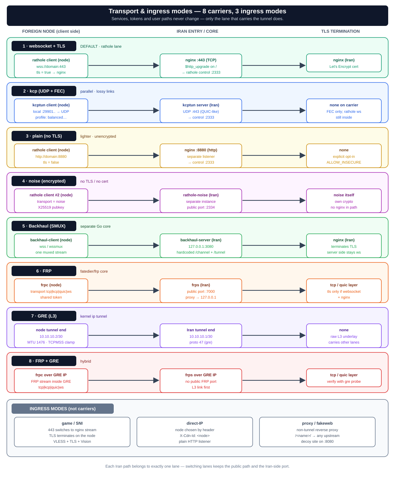

# Transport Modes — one tunnel, many carriers

The rathole lane has **four carriers**: WebSocket/TLS, KCP, plain WebSocket, and Noise. Backhaul is a separate SMUX lane that can run beside rathole on the same foreign node. Game/SNI, direct-IP, and proxy are ingress modes rather than tunnel carriers.

> **Ownership rule:** `services.conf` belongs to the rathole lane and `bh-services.conf` belongs to the Backhaul lane. A service/path on an Iran server must be assigned to exactly one lane, while both client processes may stay active for different services.



> **Core invariant:** TLS is terminated only by nginx. The rathole-server transport is always `tls = false`; the default client uses `tls = true` over WebSocket to nginx/443.

---

## 1) WebSocket + TLS (default)

- Client connects to `wss://domain:443`.
- nginx sends the configured secret WebSocket control path (`/_rh/<32 hex>`) to rathole and leaves unrelated requests on the fake/data routes.
- TLS terminates on nginx (Let's Encrypt cert). The patched bundled core supports the configured control path; `/` remains a compatibility fallback during rotations.

---

## 2) KCP — parallel UDP+FEC path

- An additive **parallel path** via kcptun over UDP+FEC for lossy links (mitigates TCP-over-TCP).
- Does **not** touch the server/nginx/443 stack — adds a second ingress path.
- Profiles (`balanced`/`lossy`/`aggressive`) must match on both ends (defined in `common.sh:kcp_profile`).
- Multi-Iran: each upstream gets its own independent kcp instance (`rathole-kcp-up-<id>`, local ports from 29901).
- Camouflage: UDP/443 looks like QUIC/HTTP3 to DPI; no conflict with TCP/443.

```bash
# Iran server
ratholectl kcp on [port] [profile]   # default: 443, balanced
ratholectl kcp off | status | show

# Foreign node
ratholenode kcp on <ip:port> <key> [profile]
ratholenode kcp off | status
```

---

## 3) Plain — WebSocket without TLS

- A separate HTTP listener (default port 8880) for unencrypted WebSocket.
- Lighter than the default path, but no nginx TLS on this path.

```bash
ratholectl plain on [port]   # Iran
ratholectl plain off | status

ratholenode plain on <ip:port>   # Node
ratholenode plain off | status
```

---

## 4) Noise — encrypted, no TLS/cert

- A **second rathole instance** (`rathole-noise`) on a separate public TCP port (default 2334).
- Transport: Noise protocol (X25519 + ChaChaPoly — the same crypto as WireGuard).
- Private key stays on the Iran server; the public key is distributed to nodes.
- Noise nodes are moved from `server.toml` to `noise-server.toml` — the two rathole processes cannot share the same `bind_addr`.

```bash
# Iran server
ratholectl noise on [port]             # generates keypair, prints node command
ratholectl noise node <name> on        # move this node to noise transport
ratholectl noise node <name> off       # move back to default transport
ratholectl noise off | status

# Foreign node
ratholenode noise on <ip:port> <pubkey> [pattern]
ratholenode noise off | status
```

---

## 5) Backhaul — SMUX multiplexer (same nginx/443)

A **separate Go binary** (`Musixal/Backhaul`, patched with uTLS Chrome fingerprint since v1.8) alongside rathole. Multiplexes many user connections onto one stream via **SMUX** — for busy/lossy links where rathole has no mux.

**Single-port/single-domain is preserved:** `backhaul-server` listens on `127.0.0.1:<port>` (default 3080) and nginx proxies the **hardcoded** `/channel` (control) and `/tunnel` (data) paths to it on the same 443.

**Key invariants:**
- Server transport is always the non-TLS variant (`ws`/`wsmux`); client always TLS (`wss`/`wssmux`). `backhaul_client_transport` in `common.sh` maps between them; both sides reject the wrong variant.
- `tcpmux` is **not supported** — it's raw TCP and cannot traverse the L7 nginx.
- On the Iran server, assigning a node with `ratholectl backhaul node <name> on` removes that service from `server.toml` and puts its port mapping in Backhaul. The two servers must never bind the same local port.
- On the foreign node, `rathole-client` and `backhaul-client` can run together. Register Backhaul services in `/etc/rathole/bh-services.conf`; the normal `/etc/rathole/services.conf` remains owned by rathole.
- Port mapping: `"127.0.0.1:<iran_port>=<node_inbound_port>"` — keeps the port that `map $uri` points at unchanged, so user routing never moves.
- The mux profile (`balanced`/`lossy`/`aggressive`) must match on both ends. `mux_con` is server-only; `connection_pool` is client-only.
- **uTLS (v1.8+):** the patched binary sends a Chrome JA3/JA4 TLS fingerprint instead of the Go stdlib fingerprint. ALPN is forced to `http/1.1` — the Chrome profile also advertises `h2` which would cause nginx to negotiate HTTP/2, breaking the HTTP/1.1 WebSocket Upgrade.

```bash
# Iran server
ratholectl backhaul on [port] [transport] [profile]
# default mode: nginx_tls; server transport: wsmux (default) | ws
# direct-IP: ratholectl backhaul on <port> <ws|wsmux|wss|wssmux> <profile> direct_ip
ratholectl backhaul node <name> on    # move this node to backhaul
ratholectl backhaul node <name> off
ratholectl backhaul off | status | show   # show prints the ready ratholenode command

# Foreign node (use the line from `ratholectl backhaul show`)
ratholenode backhaul on <domain> <token> [transport] [profile]
ratholenode backhaul add-svc <name> <token> <inbound_port>
ratholenode backhaul rm-svc <name> | ls
ratholenode backhaul off | status
```

---

## 6) Game / SNI — L4 passthrough

When any node has an `sni`, port 443 switches to nginx **stream/SNI** mode (L4 passthrough) and the L7 path/WS vhost moves to an internal port (`internal_port`, default 8443).

- TLS for game traffic terminates on the **node** (real cert, VLESS+TLS+Vision) — Iran just passes bytes.
- Regular path-routed users see no change; they still reach `https://domain/nodename`.

```bash
ratholectl game add <name> <node_tls_port> <sni>
ratholectl game rm <name> | ls
ratholectl game cert <sni>    # fetch Let's Encrypt cert + print transfer command
```

---

## 7) Direct-IP — header-based routing (ingress, not a tunnel carrier)

> This is a **user ingress mode**, not a tunnel transport. The tunnel between Iran↔node is unchanged; this just opens an alternative user entry point.

- A separate **plain HTTP port** (default 8081) where users connect **directly to the Iran server IP** — no domain, no nginx TLS.
- Routing decision comes from a **hidden header** (default `X-Cdn-Id`) whose value is the node name. The `Host` header is only a decoy and has no routing role.
- nginx uses two `map` directives (header→local rathole port, then port-or-fallback→backend) and a `proxy_pass`. Requests without a known header fall through to the **fake site**.
- **Port sharing with plain:** if `direct_port == plain_port`, only one server block is built; a recognized header wins and an unknown/empty header falls to `$backend_port`.
- SNI nodes are excluded (they are L4 passthrough on 443 and have no local L7 listener for plain HTTP).

```bash
ratholectl direct on [--port P] [--header H]   # default: 8081, X-Cdn-Id
ratholectl direct off | status
ratholectl direct show [name]    # prints ready client config (Xray/V2Ray WS without TLS)
```

⚠ **Security:** this listener has no TLS, no auth, and is public. Confidentiality and auth are handled by the proxy inside the tunnel (VLESS/VMess UUID etc.). The header is a **routing hint + camouflage**, not a secret credential — anyone who knows a node name can reach its inbound (which applies its own auth). Opening `direct_port` on a public interface is flagged explicitly to the operator.

---

## 8) Proxy — non-tunnel reverse proxy on the same 443

For an independent tunnel or service that rathole does not manage, `proxy` creates a `/<name>/` path on the same 443 that `proxy_pass`es to any upstream — without going through rathole.

- Upstream must be `http(s)://host:port` — no path, no query, strict regex (it goes directly into nginx config).
- **Shared namespace with nodes:** both live in `map $uri`; `proxy add` is rejected if the name matches an existing node, and vice versa. Names `sub`/`hub`/`channel`/`tunnel` are reserved.

```bash
ratholectl proxy add <name> <http(s)://host:port>
ratholectl proxy rm <name> | ls
```

---

## 9) Secret WebSocket Control Path (v1.5.0+)

The rathole control channel moved from `/` to `/_rh/<32 hex>` so DPI cannot distinguish it from the fake site.

- **nginx:** only `location = /_rh/<secret>` with `$http_upgrade` routes to the control port; all other paths keep their fake/data behavior.
- **Management:** `ratholectl control-path show` (masked) / `rotate` (generates new path, grace period for nodes to update).
- **Node:** `CONTROL_PATH` in `node.env`, inserted as `path = "/_rh/..."` in `client.toml`.

```bash
ratholectl control-path show
ratholectl control-path rotate
```

---

## 10) FRP Core — reverse tunnel via fatedier/frp

A standalone reverse tunnel core (`fatedier/frp`) operating alongside rathole and Backhaul. Designed for advanced connection multiplexing over TCP, KCP, QUIC, or WebSocket with shared token authentication.

- **Architecture:** `frps` runs on Iran and `frpc` on the Foreign Node.
- **Supported Transports:** `tcp`, `kcp`, `quic`, `websocket`.
- **Port Mapping:** Binds Iran local port directly to foreign inbound proxy port.

```bash
# Iran server
ratholectl frp on [bind_port] [transport] [token]   # default: 7000, tcp
ratholectl frp off | status | show

# Foreign node
ratholenode frp on <remote_ip:port> <token> [transport]
ratholenode frp off | status
```

---

## 11) GRE Tunnel — Linux L3 point-to-point network

A kernel-level Layer 3 Generic Routing Encapsulation (GRE) point-to-point tunnel interface (`ip tunnel`) providing direct IP communication without intermediate proxies.

- **Interface:** Configures `gre1` interface with `/30` point-to-point addressing (`10.10.10.1/30` on Iran, `10.10.10.2/30` on Node).
- **Network Optimization:** Automatically configures `MTU 1476` and iptables `TCPMSS clamping` to prevent fragmentation across domestic networks.

```bash
# Iran server
ratholectl gre on <remote_ip> [tunnel_ip] [gre_name]   # default tunnel_ip: 10.10.10.1/30
ratholectl gre off [gre_name] | status [gre_name]

# Foreign node
ratholenode gre on <remote_ip> [tunnel_ip] [gre_name]   # default tunnel_ip: 10.10.10.2/30
ratholenode gre off [gre_name] | status [gre_name]
```

---

## 12) FRP + GRE Hybrid (L3 Network with FRP Multiplexing)

> The most resilient anti-censorship combo: A Linux kernel Layer 3 GRE tunnel (`10.10.10.0/30`) is established between Iran and the foreign node. Then, the FRP reverse tunnel binds and operates exclusively over this internal virtual interface, multiplexing local traffic over QUIC or KCP streams.

- **Advantages:** Censors inspect only GRE-encapsulated packets with standard headers, while user connections are densely multiplexed and buffered inside the tunnel.
- **Transport Selection:** QUIC (over UDP) or KCP with Reed-Solomon FEC over GRE.
- **One-Click Patch Panel Wiring:** In the Hub Web Panel (`#/wiring`), select `FRP+GRE (Hybrid)` to automatically configure both GRE interfaces and the nested FRP reverse tunnel.

---

## 13) Adaptive Mode (Automatic L7 Probing & Dynamic Failover)

> An **autonomous control layer** operating on the tunnel carriers. It continuously assesses link health via active L7 probes and dynamically switches the active transport without operator intervention when censorship or packet loss is detected.

- **Bounded probes:** Every `ADAPTIVE_INTERVAL` seconds (default 30), sends an RFC 6455 WebSocket probe to `CONTROL_PATH`. Failure classification:
  `dns_failed` → `tcp_timeout` → `tls_failed` → `ws_rejected` → `ws_timeout` → `healthy`.
- **Threshold/hysteresis:** Switches carrier after `ADAPTIVE_FAILURES` (default 3) consecutive failures; returns after `ADAPTIVE_RECOVERIES` (default 5) consecutive successes + cooldown.
- **Cooldown:** `ADAPTIVE_COOLDOWN` (default 300 s) between consecutive switches.
- **Priority order:** `ws` → `kcp` (and `plain` if `ALLOW_INSECURE=1` is set).
- **Auto-rollback:** If the probe fails after switching carrier, the previous configuration is automatically restored.
- **State sanitization:** `/etc/rathole/adaptive-state.json` (mode 0600) only stores `time`, `current`, `classification`, `latency_ms`, `consecutive_failures` — zero tokens, credentials, or secrets in the state file.

```bash
ratholenode adaptive on [--interval N] [--failures N] [--recoveries N]
ratholenode adaptive off | status
ratholenode adaptive test [--json]
```

---

**Key rule:** In all tunnel modes, user paths, tokens, and inbound configs remain untouched; only the underlying tunnel carrier changes. For packet-level traffic flow details, see [`traffic-flow.md`](traffic-flow.md).

---

## See also

- [CLI Reference (Wiki)](https://github.com/loopy-iri/tunnelplus/wiki/CLI-Reference) — full command signatures
- [Workflow Guides (Wiki)](https://github.com/loopy-iri/tunnelplus/wiki/Workflow-Guides) — step-by-step: direct-IP setup, backhaul migration, multi-domain, multi-upstream
- [`transport-modes.md`](transport-modes.md) — Persian version of this document
- [`architecture.md`](architecture.md) — overall system architecture
- [`hub.md`](hub.md) / [`hub.en.md`](hub.en.md) — Hub Web Panel and Visual Wiring Board
