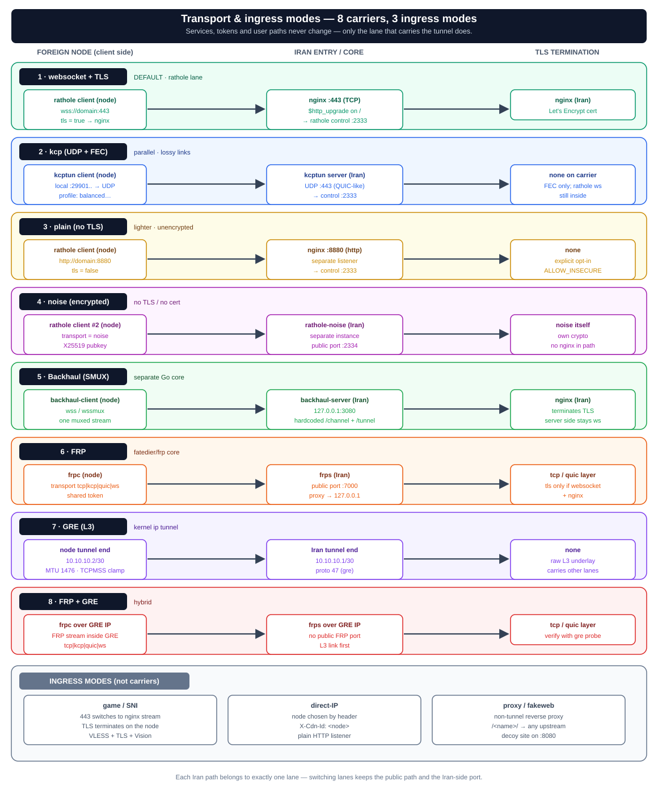

# حالت‌های Transport — یک تونل، چند حامل

lane اصلی rathole چهار حامل دارد: websocket/TLS، KCP، plain و Noise. کنار آن **لاین‌ها/هسته‌های مستقل** هم اجرا می‌شوند: Backhaul (SMUX)، FRP، GRE (لایه ۳) و ترکیب FRP+GRE. game/SNI، direct-IP، proxy و fakeweb ورودی کاربر هستند، نه حامل تونل.

> **قانون مالکیت:** `services.conf` برای lane رتهول و `bh-services.conf` برای lane بک‌هال است. هر سرویس/مسیر روی یک سرور ایران باید فقط در یکی از laneها باشد (رتهول، بک‌هال، FRP، GRE)، ولی چند lane می‌توانند برای سرویس‌های متفاوت هم‌زمان روشن بمانند.

> **اصل ثابت (invariant):** TLS فقط توسط nginx خاتمه می‌یابد؛ transport سمت rathole-server همیشه `tls = false` است. کلاینت پیش‌فرض با `tls = true` روی websocket به nginx/۴۴۳ وصل می‌شود.

## ماتریس حامل‌ها (خلاصه)

| حامل | دستور ایران | دستور نود | نکته |
|---|---|---|---|
| **ws** (پیش‌فرض) | — (پیش‌فرض) | — (پیش‌فرض) | `wss://domain:443`؛ TLS روی nginx |
| **kcp** | `ratholectl kcp on <port> <profile>` | `ratholenode kcp on <iran_ip:udp_port> <key> <profile>` | UDP+FEC با kcptun؛ پیش‌فرض پورت ۴۴۳ |
| **plain** | `ratholectl plain on <port>` | `ratholenode plain on <iran_ip:port>` | websocket بدون TLS؛ پیش‌فرض ۸۸۸۰ |
| **noise** | `ratholectl noise on <port>` + `ratholectl noise node <name> on` | `ratholenode noise on <iran_ip:port> <pubkey> [pattern]` | اینستنس دوم rathole؛ پیش‌فرض ۲۳۳۴ |
| **backhaul** | `ratholectl backhaul on <port> [ws\|wsmux] <profile> nginx_tls` | `ratholenode backhaul on <domain> <token> [wss\|wssmux] <profile>` | SMUX پشت nginx/۴۴۳؛ پیش‌فرض ۳۰۸۰ |
| **frp** | `ratholectl frp on <port> [token] [tcp\|kcp\|quic\|websocket]` | `ratholenode frp on <iran_ip:port> <token> [transport] [remote_port]` | هسته‌ی `fatedier/frp`؛ پیش‌فرض ۷۰۰۰ |
| **gre** | `ratholectl gre on <remote_ip> [tunnel_ip] [gre_name]` | `ratholenode gre on <iran_ip> [tunnel_ip] [gre_name]` | `ip tunnel` لایه ۳؛ پیش‌فرض `gre1` و /30 |
| **frp_gre** | از سرویس‌کنترل‌های هاب (یا `gre on` + `frp on` روی IP مجازی) | همان دو مرحله در سمت نود | FRP مالتی‌پلکس‌شده داخل GRE |

## گزارش پروتکل حامل و جابه‌جایی از سرویس‌کنترل‌ها

هاب در هر ردیف سرویس (هم صفحه‌ی سرور ایران و هم صفحه‌ی نود) پروتکل واقعی حامل را نشان می‌دهد، نه فقط نام lane را:

- `FRP / TCP`، `FRP / KCP`، `FRP / QUIC`، `FRP / WEBSOCKET` (حروف بزرگ از ترنسپورت گزارش‌شده)
- `Backhaul / WS`، `Backhaul / WSMUX`، `Backhaul / WSS`، `Backhaul / WSSMUX`
- `KCP / UDP · balanced` (یا `lossy`/`aggressive`)
- `Noise / TCP`، `WebSocket / TLS` (ws)، `WebSocket / TCP` (plain)، `GRE / WebSocket`، `SNI / TLS` (game)
- `FRP + GRE / <transport>` برای حالت هیبرید — توجه: در پیاده‌سازی فعلی خودِ حالت هیبرید روی lane `FRP` ثبت می‌شود، پس برچسب گزارش‌شدهٔ سرویس `FRP / <transport>` است و GRE را باید جداگانه با `gre probe` تأیید کرد.

اگر سرور پروتکل را گزارش نکند، برچسب `?` نشان داده می‌شود — **برچسب به‌تنهایی اثبات اتصال نیست**؛ برای اطمینان «تست سلامت» را بزنید.

**جابه‌جایی حامل از سرویس‌کنترل‌ها انجام می‌شود، نه از یک صفحه‌ی جدا:** دکمه‌ی «حامل و پروتکل» روی ردیف سرویس، مودال انتخاب حامل/پروتکل را باز می‌کند (ws, kcp, plain, noise, backhaul, frp, gre, frp+gre) و بعد از اعمال، path و پورت ایران دست‌نخورده می‌مانند. بقیه‌ی دکمه‌های همان ردیف: «تست سلامت» (doctor روی ایران)، «ساخت کانفیگ VLESS»، «مدیریت سمت مقابل» و «حذف از دو سمت». صفحه‌ی مسیریابی فقط نمای توپولوژی/کنسول است؛ از نسخه‌ی ۲.۰.۲ صفحه‌ی جداگانه‌ی سیم‌کشی حذف شده و لینک‌های قدیمی‌اش به داشبورد می‌افتند.

## ۱) websocket + TLS (پیش‌فرض)
- کلاینت به `wss://domain:443` وصل می‌شود.
- nginx مسیر مخفی کانال کنترل (`/_rh/<32 hex>`) را به rathole می‌دهد و درخواست‌های دیگر را روی مسیرهای فیک/دیتا نگه می‌دارد؛ `/` هنگام rotate برای سازگاری موقت باقی می‌ماند.
- TLS روی nginx خاتمه می‌یابد (گواهی Let's Encrypt).

## ۲) kcp (UDP+FEC)
- مسیر **موازی** UDP+FEC از طریق kcptun برای لینک‌های پرافت (mitigation برای TCP-over-TCP).
- **افزودنی است** — به server/nginx/۴۴۳ دست نمی‌زند؛ یک مسیر ورودی دوم اضافه می‌کند.
- پروفایل‌ها (`balanced`/`lossy`/`aggressive`) باید دو طرف یکی باشند (در `common.sh:kcp_profile`).
- چند-ایران: هر upstream kcp مستقل دارد (`rathole-kcp-up-<id>`، پورت لوکال از ۲۹۹۰۱).
- استتار: UDP/۴۴۳ برای DPI شبیه QUIC/HTTP3 دیده می‌شود و با nginx روی TCP/۴۴۳ تداخل ندارد.
- روشن‌کردن: `ratholectl kcp on [port] [profile]` (ایران) و `ratholenode kcp on <ip:port> <key> [profile]` (نود).

## ۳) plain (بدون TLS)
- websocket بدون TLS به یک listener جداگانه‌ی HTTP (پیش‌فرض ۸۸۸۰).
- سبک‌تر، ولی مسیر تونل بدون رمز nginx است.
- روشن‌کردن: `ratholectl plain on [port]` و `ratholenode plain on <ip:port>`.

## ۴) noise (رمزنگاری‌شده، بدون TLS/گواهی)
- یک **اینستنس دوم rathole** (`rathole-noise`) روی یک پورت TCP عمومی (پیش‌فرض ۲۳۳۴).
- transport از نوع Noise (X25519)؛ کلید خصوصی روی ایران می‌ماند، کلید عمومی منتشر می‌شود.
- سرویس نودهای noise از `server.toml` به `noise-server.toml` جابه‌جا می‌شود.
- روشن‌کردن: `ratholectl noise on [port]` سپس `ratholectl noise node <name> on`؛ نود: `ratholenode noise on <ip:port> <pubkey> [pattern]`.

## ۵) backhaul (هسته‌ی SMUX، پشت همان nginx/۴۴۳)

> یک **هسته‌ی جدا (باینری Go از `Musixal/Backhaul`)** کنار rathole — نه یک transport داخل rathole. برای لینک‌های شلوغ/پرافت که rathole در آن‌ها mux ندارد و هر connection کاربر یک stream مجزاست.

- **چرا:** backhaul با **SMUX** چند connection را روی یک stream مالتی‌پلکس می‌کند؛ روی لینک‌های پرافت بهتر از یک-stream-به-ازای-هر-connection عمل می‌کند.
- **تک‌پورت/تک‌دامنه حفظ می‌شود:** `backhaul-server` روی `127.0.0.1:<backhaul_port>` (پیش‌فرض ۳۰۸۰) گوش می‌دهد و nginx مسیرهای `/channel` (کانال کنترلی) و `/tunnel` (دیتا) را روی همان ۴۴۳ به آن proxy می‌کند. این دو مسیر **در خود backhaul هاردکد شده‌اند** و قابل تنظیم نیستند؛ چون کاربران به `/` (فیک) و `/<node>` (دیتا) می‌روند، تداخلی ندارند.
- **transport دو طرف عمداً یکی نیست:** TLS فقط روی nginx خاتمه می‌یابد، پس سرور همیشه variant **بدون TLS** است (`ws`/`wsmux`) و کلاینت variant **TLS‌دار** (`wss`/`wssmux`) — دقیقاً همان invariant بند بالا. `common.sh:backhaul_client_transport` این نگاشت را انجام می‌دهد و هر دو سمت ورودی اشتباه را رد می‌کنند.
- **`tcpmux` پشتیبانی نمی‌شود:** TCP خام است و از nginx لایه ۷ عبور نمی‌کند.
- **dual-core lane:** رتهول و backhaul می‌توانند روی یک نود هم‌زمان باشند. `services.conf` فقط lane رتهول و `bh-services.conf` فقط lane backhaul را نگه می‌دارند؛ هر مسیر ایران باید فقط در یکی از این دو lane باشد. فرمان‌های `ratholenode backhaul add-svc|rm-svc|ls` registry بک‌هال را مدیریت می‌کنند.
- **نگاشت پورت:** `"127.0.0.1:<port_ایران>=<inbound_port_نود>"` — یعنی همان پورتی که `map $uri` در nginx به آن اشاره می‌کند دست‌نخورده می‌ماند، پس **مسیر کاربران عوض نمی‌شود**. سرویس `<name>_api` هم اگر باشد اضافه می‌شود.
- **پروفایل mux** (`balanced`/`lossy`/`aggressive` در `common.sh:backhaul_mux_profile`) باید **دو طرف یکی** باشد. `mux_con` فقط سمت سرور و `connection_pool` فقط سمت کلاینت معنا دارد.
- **توکن مشترک** (`openssl rand -hex 20`) جای گواهی را می‌گیرد؛ secret است و فقط به نودهای backhaul داده می‌شود.
- روشن‌کردن پشت nginx: `ratholectl backhaul on [port] [ws|wsmux] [profile] nginx_tls` سپس `ratholectl backhaul node <name> on`؛ نود: `ratholenode backhaul on <domain> <token> [wss|wssmux] [profile]`. برای dual-core سرویس‌ها را با `ratholenode backhaul add-svc <name> <token> <inbound>` در registry بک‌هال ثبت کنید. خروجی `ratholectl backhaul show` پارامترهای آماده را می‌دهد و Hub آن‌ها را خودکار پر می‌کند.

## ۶) game / SNI (لایه ۴ passthrough)
- وقتی هر نودی `sni` داشته باشد، پورت ۴۴۳ به حالت **stream/SNI** در nginx (passthrough لایه ۴) می‌رود و vhost لایه ۷ (path/WS) به یک پورت داخلی (`internal_port`، پیش‌فرض ۸۴۴۳) منتقل می‌شود.
- TLSِ ترافیک game روی **نود** خاتمه می‌یابد (گواهی واقعی، VLESS+TLS+Vision) — ایران فقط بایت‌ها را رد می‌کند.
- روشن‌کردن: `ratholectl game add <name> <node_tls_inbound_port> <sni>`.

---

## ۷) direct-IP (masiryabi ba header — ورودیِ کاربری، نه حاملِ تونل)

> این یک **حالتِ ورودی (ingress)** است، نه یک حاملِ transport مثل حامل‌های تونل (بندهای ۱ تا ۵ و ۱۰ تا ۱۲). مسیر تونل عوض نمی‌شود؛ فقط یک **درگاهِ ورودیِ دیگر** برای کاربر باز می‌شود که به‌جای path، از یک **هدرِ استتارشده** برای انتخاب نود استفاده می‌کند.

- یک **پورت HTTP سادهٔ جداگانه** (پیش‌فرض ۸۰۸۱) که کاربر **مستقیم به IP سرور ایران** وصل می‌شود — نه دامنه، نه TLSِ nginx.
- تصمیمِ مسیریابی از یک **هدرِ استتارشده** (پیش‌فرض `X-Cdn-Id`) می‌آید که مقدارش = **نام نود** است. `Host` فقط یک **decoy** (مثلاً `myket.ir`) است و در مسیریابی نقشی ندارد.
- nginx با دو `map` (هدر → پورتِ لوکالِ rathole، سپس پورت-یا-fallback → backend) و یک `proxy_pass` مقصد را تعیین می‌کند. درخواست **بدون** هدرِ شناخته‌شده به **سایتِ فیک** می‌افتد (روی این پورت هیچ path-routing نیست).
- **تفاوت با حالت plain (بند ۳):** `plain` یک تعویضِ *حاملِ تونل* بین نود↔ایران است؛ ولی direct-IP یک *ورودیِ کاربری* است که انتخابِ نود را در یک هدر پنهان می‌کند تا دسترسی از راهِ IP خام (سبکِ domain-fronting) بهتر استتار شود. با path-routing معمولِ ۴۴۳ به‌صورت موازی هم‌زیستی دارد.
- **اشتراکِ پورت با plain:** اگر `direct_port == plain_port` باشد، فقط **یک** server block روی آن پورت ساخته می‌شود؛ هدرِ شناخته‌شده برنده است و هدرِ خالی/ناشناس به path-routing (`$backend_port`) می‌افتد.
- **نودهای SNI مستثنا هستند** (روی ۴۴۳ passthroughِ لایه ۴ هستند و پورتِ لایه ۷ لوکال برای HTTP ساده ندارند).
- روشن‌کردن: `ratholectl direct on [--port P] [--header H]`، و `off` / `status` / `show [name]`.

**⚠ امنیت (باید به اپراتور گفته شود):** این listener **بدون TLS، بدون احراز هویت و عمومی** است. محرمانگی و احراز هویت **در لایهٔ پروکسیِ داخلِ تونل** (VLESS/VMess UUID و…) انجام می‌شود، نه این لایه. هدر یک **راهنمای مسیریابی + استتار** است، **نه یک اعتبارنامهٔ محرمانه** — هرکس نامِ یک نود را بداند به inboundِ آن نود می‌رسد (که خودش احراز هویت خودش را اعمال می‌کند). نامِ هدر و نامِ نودها پیش از رسیدن به `map` به‌شدت اعتبارسنجی می‌شوند، پس هیچ ورودیِ اپراتور بدون escape داخل کانفیگ درج نمی‌شود. باز کردن `direct_port` روی اینترفیسِ عمومی یک تغییرِ فایروال است که صریحاً به اپراتور اطلاع داده می‌شود (`warn` + تلاشِ best-effort برای `ufw allow`).

---

## ۸) proxy (ریورس‌پروکسی غیرتونلی — مسیر به upstream دلخواه)

> این هم **حاملِ تونل نیست**؛ یک مسیر `/<name>/` روی همان ۴۴۳ است که **بدون عبور از rathole** به یک upstream دلخواه proxy می‌شود — برای تونل‌ها یا سرویس‌های مستقلی که rathole مدیریتشان نمی‌کند.

- state در `.proxies[]` با `{name, upstream}` نگه داشته می‌شود و در `gen_nginx_conf` یک `location /<name>/` با `proxy_pass` ساخته می‌شود.
- **upstream فقط `http(s)://host:port`** — بدون مسیر/query/متاکاراکتر، با regex سخت؛ چون مستقیم به کانفیگ nginx می‌رود.
- **فضای‌نام مشترک با نودها:** هر دو در `map $uri` می‌نشینند؛ `proxy add` با نامِ یک نودِ موجود رد می‌شود و برعکس. نام‌های `sub`/`hub`/`channel`/`tunnel` رزرواند.
- **امنیت:** upstream **اعتمادشده** فرض می‌شود — اپراتور می‌تواند nginx را به میزبان دلخواه اشاره دهد.
- دستورها: `ratholectl proxy add <name> <http(s)://host:port>` / `proxy rm <name>` / `proxy ls`؛ از هاب هم با اکشن‌های `proxy_add`/`proxy_rm`/`proxy_ls`.

---

## ۹) secret WebSocket control path (v1.5.0+)

> مسیر WebSocket کنترلی rathole از `/` به `/_rh/<32 hex>` منتقل شد تا DPI نتواند آن را از سایت فیک تشخیص دهد.

- **nginx:** فقط `location = /_rh/<secret>` از `$http_upgrade` به control port می‌رود؛ همه‌ی مسیرهای دیگر رفتار fake/data خود را حفظ می‌کنند.
- **مدیریت:** `ratholectl control-path show` نشان‌دهنده، `rotate` مسیر جدید می‌سازد و grace period برای به‌روزرسانی نودها فراهم می‌کند.
- **نود:** `CONTROL_PATH` در `node.env` ذخیره می‌شود و در `client.toml` به‌عنوان `path = "/_rh/..."` درج می‌شود (patch‌ی از core روی `WebsocketConfig.path`).
- **نمایش:** `cmd_show` مقدار `CONTROL_PATH=<masked>` چاپ می‌کند — هیچ secret کامل در لاگ پدیدار نمی‌شود.

## ۱۰) FRP (هسته‌ی ریورس تونل مستقل fatedier/frp)

> یک **هسته‌ی مجزا و بالغ (`fatedier/frp`)** کنار rathole و backhaul. مناسب برای شرایطی که نیاز به مالتی‌پلکسینگ پیشرفته TCP/QUIC/KCP/WebSocket با قابلیت‌های احراز هویت توکن مشترک و نگاشت مستقیم پورت‌های لوکال است.

- **ساختار:** روی ایران سرویس `frps` و روی نود سرویس `frpc` فعال می‌شود (`/etc/frp/frps.toml` و `frpc.toml`).
- **پروتکل‌های ارتباطی:** پشتیبانی از ۴ حامل `tcp`, `kcp`, `quic`, `websocket`.
- **نگاشت پورت:** نگاشت مستقیم پورت لوکال ایران (مانند پورت‌های رتهول) به سرویس اینباند نود خارجی. **مسیر کاربران (path/443) دست‌نخورده می‌ماند.**
- **ترتیب آرگومان‌ها:** توکن قبل از ترنسپورت است؛ اگر به‌جای توکن یکی از `tcp|kcp|quic|websocket` داده شود، به‌عنوان ترنسپورت تفسیر می‌شود و توکن ذخیره‌شده/تصادفی استفاده می‌شود.
- **دستورات ایران:**
  - `ratholectl frp on [port] [token] [tcp|kcp|quic|websocket]` (پیش‌فرض پورت ۷۰۰۰ و ترنسپورت tcp؛ پورت ۴۴۳ رزرو است)
  - `ratholectl frp node <name> on|off` (جابه‌جایی یک نود به/از lane FRP)
  - `ratholectl frp off` / `ratholectl frp status` / `ratholectl frp show`
  - `ratholectl frp ready <name>` (بررسی ثبت پروکسی روی `127.0.0.1:<iran_port>`)
- **دستورات نود:**
  - `ratholenode frp on <iran_ip:port> <token> [transport] [remote_port]` (اگر پورت ندهید، ۷۰۰۰ فرض می‌شود)
  - `ratholenode frp off` / `ratholenode frp status`

---

## ۱۱) GRE (تونل لایه ۳ کرنل لینوکس — ip tunnel)

> تونل **شبکه لایه ۳ نقطه به نقطه (Generic Routing Encapsulation)** مبتنی بر کرنل لینوکس، مناسب برای شبکه‌سازی مستقیم IP بین سرور ایران و سرور خارج بدون نیاز به هیچ باینری واسط.

- **ویژگی‌ها:** راه‌اندازی اینترفیس مجازی `gre1` با ساب‌نت `/30` (مثلاً `10.10.10.1/30` ایران و `10.10.10.2/30` خارج). ماژول `ip_gre` در کرنل بارگذاری می‌شود و اگر IP عمومی روی اینترفیس نباشد، local IP از route به remote تشخیص داده می‌شود.
- **بهینه‌سازی شبکه:** تنظیم خودکار `MTU 1476` و اعمال قانون `TCPMSS clamping` در iptables (`-t mangle POSTROUTING ... TCPMSS --clamp-mss-to-pmtu`) جهت جلوگیری از تکه‌تکه شدن (fragmentation) بسته‌های TCP بر بستر اینترنت ایران.
- **دستورات ایران:**
  - `ratholectl gre on <remote_ip> [tunnel_ip] [gre_name]` (پیش‌فرض tunnel_ip: `10.10.10.1`، نام: `gre1`)
  - `ratholectl gre off [gre_name]`
  - `ratholectl gre status`
- **دستورات نود:**
  - `ratholenode gre on <iran_ip> [tunnel_ip] [gre_name]` (پیش‌فرض tunnel_ip: `10.10.10.2`، نام: `gre1`)
  - `ratholenode gre off [gre_name]`
  - `ratholenode gre status`
  - `ratholenode gre probe <peer_ip> [gre_name]` (بررسی رسیدن بسته از تونل با ping؛ UP بودن اینترفیس دلیل رسیدن بسته نیست)

---

## ۱۲) ترکیبی FRP + GRE (حالت هیبرید لایه ۳ با مالتی‌پلکسینگ)

> قدرتمندترین ترکیب ضد اختلال: یک تونل شبکه لایه ۳ GRE بین سرور ایران و خارج برپا می‌شود (`10.10.10.1/30`)، سپس هسته ریورس تونل FRP بر روی این اینترفیس داخلی لود شده و پورت‌های لوکال را از طریق استریم‌های مالتی‌پلکس‌شده (QUIC یا KCP) جابه‌جا می‌کند.

- **مزایا:** فایروال اینترنت ایران فقط بسته‌های کپسوله‌شده GRE را مشاهده می‌کند، در حالی که در داخل تونل، جریان‌های کاربری به صورت مالتی‌پلکس فشرده و بازتولید می‌شوند.
- **انتخاب ترنسپورت:** مد QUIC با UDP یا KCP همراه با تصحیح خطای FEC روی GRE.
- **پیکربندی:** این حالت یک اکشن یکجا در CLI ندارد؛ از **سرویس‌کنترل‌های هاب** انتخاب کنید: ردیف سرویس ← «حامل و پروتکل» ← `FRP + GRE` (هاب اول GRE را روی /30 برقرار و با `gre_probe` چک می‌کند، سپس FRP را طوری تنظیم می‌کند که به IP مجازی GRE وصل شود). معادل دستی آن دو مرحله است: `gre on` روی هر دو سمت، سپس `frp on` روی ایران و `ratholenode frp on <iran_gre_ip>:<port> ...` روی نود تا استریم FRP داخل GRE حمل شود.

---

## ۱۳) adaptive mode (حالت انطباقی خودکار و پروب L7)

> یک لایه‌ی **خودکار** بالای حامل‌های تونل که سلامت ارتباط را دائماً می‌سنجد و حاملِ فعال را در صورت بروز اختلال بدون دخالت اپراتور عوض می‌کند.

- **probe‌های bounded:** هر بازه (پیش‌فرض ۳۰ ثانیه) یک پروب واقعی WebSocket RFC 6455 به `CONTROL_PATH` می‌فرستد؛ طبقه‌بندی مستقیم:
  `dns_failed` → `tcp_timeout` → `tls_failed` → `ws_rejected` → `ws_timeout` → `healthy`
- **threshold/hysteresis:** پس از `ADAPTIVE_FAILURES` (پیش‌فرض ۳) شکست متوالی سوییچ؛ پس از `ADAPTIVE_RECOVERIES` (پیش‌فرض ۵) بازگشت سالم + اتمام cooldown.
- **cooldown:** `ADAPTIVE_COOLDOWN` (پیش‌فرض ۳۰۰ ثانیه) بین سوییچ‌های متوالی.
- **حامل‌های اولویت‌دار:** `ws` → `kcp` (و در صورت `ALLOW_INSECURE=1`: `plain`).
- **rollback خودکار:** اگر probe پس از سوییچ هم fail باشد، config قبلی بازیابی می‌شود.
- **دستورات:** `ratholenode adaptive on [--interval N] [--failures N] [--recoveries N]`، خاموش: `off`، وضعیت: `status`، تست: `test [--json]`.

---

## ۱۴) fakeweb (سایت فیک پیش‌فرض — fallback، نه حاملِ تونل)

> یک وب‌سرور سبک (python3) روی `fake_port` (پیش‌فرض ۸۰۸۰) که فقط برای ``/`` سرو می‌شود، تا سرورهایی که پنل واقعی ندارند به‌جای ۵۰۲ یک صفحه‌ی معمولی نشان دهند. ربطی به carrier ندارد.

- سرویس systemd: `rathole-panel-fakeweb`؛ ریشه‌ی فایل‌ها: `/var/www/rathole-fake`.
- فقط روی `127.0.0.1` گوش می‌دهد؛ nginx آن را به‌عنوان upstream فیک روی `/` استفاده می‌کند.
- دستورها: `ratholectl fakeweb start|stop|rm|status [port]` (پورت پیش‌فرض از `fake_port` خوانده می‌شود).

---

**نکته‌ی کلیدی:** در تمامی حالت‌های تونلی، سرویس‌ها/توکن‌ها/مسیر کاربران دست‌نخورده می‌مانند؛ فقط حاملِ تونل عوض می‌شود. برای جزئیات مسیر بسته لایه‌به‌لایه: [`traffic-flow.md`](traffic-flow.md).

---

## همچنین ببینید

- [مرجع کامل دستورات CLI (ویکی)](https://github.com/loopy-iri/tunnelplus/wiki/CLI-Reference) — syntax کامل همه دستورات
- [راهنماهای عملی (ویکی)](https://github.com/loopy-iri/tunnelplus/wiki/Workflow-Guides) — راه‌اندازی direct-IP، مهاجرت به backhaul، چند دامنه، multi-upstream
- [`transport-modes.en.md`](transport-modes.en.md) — نسخه انگلیسی همین سند
- [`architecture.md`](architecture.md) — معماری کلی سیستم
- [`hub.md`](hub.md) — پنل وب، سرویس‌کنترل‌ها، REST Agent و مدل امنیتی

