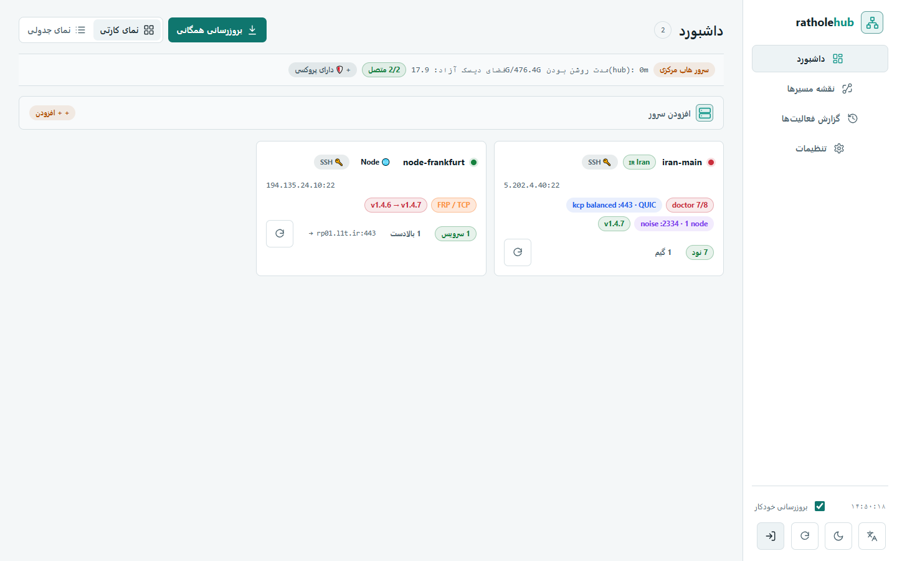

# راهنمای شروع سریع (Getting Started)

این راهنما روش‌های نصب و راه‌اندازی **RatholeEngine** (نسخه‌ی **v2.0.2**) را به همراه معماری لایه‌ای، نمای حامل‌ها و قدم‌های بعدی توضیح می‌دهد.



---

## 🚀 نصب یک‌خطی از گیت‌هاب (پیشنهادی)

شما می‌توانید کل پروژه (شامل سرور ایران، نود خارج، یا پنل هاب) را با یک دستور ساده نصب یا آپدیت کنید:

```bash
curl -fsSL https://raw.githubusercontent.com/loopy-iri/tunnelplus/main/install.sh | sudo bash
```

این دستور آخرین نسخه‌ی انتشاریافته را به همراه فایل‌های باینری بهینه‌شده برای معماری سرور شما (x86_64 یا aarch64) دانلود و اجرا می‌کند. اسکریپت `install.sh` فقط چند پرچم مخصوص خودش را می‌گیرد و بقیه‌ی آرگومان‌ها را دست‌نخورده به `bootstrap.sh` می‌دهد.

> **نکته‌ی مهم (جداکننده‌ی `--`):** در نصب نود خارج، پرچم `--token` را **بعد از** جداکننده‌ی `--` بگذارید. `install.sh` هر `--token` قبل از `--` را به‌عنوان توکن GitHub (برای مخزن خصوصی) می‌خواند و آن را از آرگومان‌های نصب نود حذف می‌کند؛ این باگ در نسخه‌ی بعد از ۲.۰.۲ در `install.sh` اصلاح شد و الگوی امن همین است.

---

## ⚙️ گزینه‌های نصب خودکار (Non-interactive Flags)

### ۱. نصب سرور ایران (Iran Panel):
```bash
curl -fsSL https://raw.githubusercontent.com/loopy-iri/tunnelplus/main/install.sh | sudo bash -s -- \
  --panel \
  --domain mydomain.com \
  --fullchain /etc/letsencrypt/live/mydomain.com/fullchain.pem \
  --key /etc/letsencrypt/live/mydomain.com/privkey.pem
```

### ۲. نصب نود خارج (Foreign Node):
```bash
curl -fsSL https://raw.githubusercontent.com/loopy-iri/tunnelplus/main/install.sh | sudo bash -s -- \
  --node -- \
  --server mydomain.com:443 \
  --name node-germany \
  --token <YOUR_32_HEX_TOKEN> \
  --inbound-port 10080
```

`install-node.sh` علاوه بر این‌ها `--tls-hostname`، `--tls-trusted-root`، `--api-token`، `--api-inbound-port`، `--restore <file>` و `--version` را هم می‌پذیرد.

### ۳. نصب پنل وب مدیریت مرکزی (RatholeHub):
```bash
# روش پیشنهادی — از روی سرور ایران؛ بار اول hub را خودکار نصب می‌کند و رمز مدیر را می‌پرسد
sudo ratholectl hub on 8088   # → https://<domain>/hub/

# یا نصب مستقیم (پورت با متغیر HUB_PORT، رمز مدیر به‌صورت تعاملی پرسیده می‌شود)
sudo HUB_PORT=8088 bash rathole-manager/ratholehub/install-hub.sh
```

> `install.sh` خودش فقط `--release`، `--token`، `--beta` و `--stable` را parse می‌کند؛ `--panel`/`--node` دست‌نخورده به `bootstrap.sh` می‌رسند و کار می‌کنند، اما **`--hub` وجود ندارد** — نصب هاب فقط از طریق `ratholectl hub on` یا `install-hub.sh` انجام می‌شود. جزئیات: **[Hub Management](Hub-Management)**.

---

## 🎛️ نمای کلی حامل‌ها (Carrier Overview)

مسیر عمومی کاربر همیشه یکی است (دامنه/۴۴۳ و `map $uri` در nginx)؛ چیزی که عوض می‌شود **حاملی** است که نود را به ایران وصل می‌کند. تغییر حامل، پورت inbound و path کاربر را تغییر نمی‌دهد.

| لایه | حامل‌ها | توضیح کوتاه |
|------|---------|--------------|
| **lane رتهول** | `ws` (پیش‌فرض)، `kcp`، `plain`، `noise` | TLS فقط در nginx تمام می‌شود؛ سرور `tls=false` و کلاینت `tls=true` روی wss/443. |
| **لین Backhaul (SMUX)** | `backhaul` | هسته‌ی Go جدا (`Musixal/Backhaul`)، پشت همان nginx/443 با مسیرهای ثابت `/channel` و `/tunnel`؛ رجیستری سرویس جدا (`bh-services.conf`). |
| **هسته‌ی FRP** | `frp` | ریورس‌تونل مستقل `fatedier/frp` با ترانسپورت‌های `tcp\|kcp\|quic\|websocket` و توکن مشترک (پورت پیش‌فرض ۷۰۰۰). |
| **تونل L3 GRE** | `gre` | اینترفیس `ip tunnel` کرنل لینوکس روی ساب‌نت `/30` (پیش‌فرض `10.10.10.0/30`)، MTU 1476؛ بدون دیمن userspace. |
| **ترکیبی** | `frp_gre` | استریم مالتی‌پلکس FRP که روی لینک L3 GRE حمل می‌شود (از کنترل سرویس هاب). |

حالت‌های ورود کاربر (**game/SNI**، **direct-IP**، **proxy**، **fakeweb**) «حامل تونل» نیستند و مسیر تونل نود↔ایران را عوض نمی‌کنند.

---

## 🔄 آپدیت یک‌خطی (Update)

برای ارتقا به آخرین نسخه (همراه با snapshot کامل، health-check و رول‌بک خودکار در صورت خطا):
```bash
curl -fsSL https://raw.githubusercontent.com/loopy-iri/tunnelplus/main/install.sh | sudo bash -s -- --update
```

اگر از قبل نصب دارید، ساده‌تر است مستقیم از خود سرور بزنید:
```bash
sudo ratholectl update      # روی سرور ایران
sudo ratholenode update     # روی نود خارج
```

### 🧪 کانال بتا (نسخه‌های آزمایشی)

برای تست قابلیت‌های جدید پیش از انتشار پایدار:
```bash
ratholectl update beta
ratholenode update beta
```

یا با نصب یک‌خطی:
```bash
curl -fsSL https://raw.githubusercontent.com/loopy-iri/tunnelplus/main/install.sh | sudo bash -s -- --beta --update
```

برگشت به کانال پایدار با `ratholectl update` (بدون آرگومان) یا `ratholectl update stable` انجام می‌شود؛ در نصب یک‌خطی معادلش `--stable` است.

برای pin کردن نسخه‌ی مشخص:
```bash
curl -fsSL https://raw.githubusercontent.com/loopy-iri/tunnelplus/main/install.sh | sudo bash -s -- --release v2.0.2 --update
```

### 🔒 نصب/آپدیت از مخزن خصوصی

اگر مخزن را fork کرده‌اید و خصوصی است، دو نکته لازم است: (۱) خود `install.sh` را با هدر توکن بگیرید (مسیر raw بدون توکن برای مخزن خصوصی ۴۰۴ می‌دهد)، و (۲) به `install.sh` هم `--token` بدهید تا دانلود `bootstrap.sh`/bundle از مسیر private انجام شود. برای مخزن خصوصی mirrorهای عمومی ghproxy استفاده نمی‌شوند:

```bash
curl -fsSL -H "Authorization: Bearer <GITHUB_PAT>" \
  https://raw.githubusercontent.com/<owner>/<repo>/main/install.sh -o /tmp/install.sh
sudo RATHOLE_GH=owner/repo bash /tmp/install.sh --token <GITHUB_PAT> --release v2.0.2 --update
```

توکن از طریق متغیرهای `RATHOLE_GH_TOKEN` / `GH_TOKEN` / `GITHUB_TOKEN` هم پذیرفته می‌شود و به‌صورت `RATHOLE_GH_TOKEN` به `bootstrap.sh` پاس داده می‌شود. برای آپدیت سروری که از قبل نصب شده، `tools/update-private.sh` همین مسیر را (از release assets یا سورس `main`) انجام می‌دهد:

```bash
sudo RATHOLE_GH=owner/repo bash tools/update-private.sh   # توکن را مخفی می‌پرسد
```

⚠️ نسخه‌ی بتا آزمایشی است. چون آپدیت پیش از هر تغییر snapshot کامل می‌گیرد، در صورت مشکل با `update.sh --rollback` برمی‌گردید. جزئیات رول‌بک: **[Troubleshooting](Troubleshooting)**.

---

## 🤖 راه‌اندازی سریع REST Agent (اختیاری)

REST Agent به هاب اجازه می‌دهد سرور را بدون SSH و از طریق HTTP(S) توکن‌دار مدیریت کند. روی هر سروری که `install-panel.sh`/`install-node.sh` روی آن اجرا شده، فایل‌ها از قبل نصب‌اند:

```bash
# روی سرور ایران
sudo install-agent.sh --role iran --port 8089
# روی نود خارج
sudo install-agent.sh --role node --port 8089

# یا از داخل خود CLIها (پورت پیش‌فرض 8089، توکن خودکار ساخته می‌شود)
sudo ratholectl agent on
sudo ratholenode agent on
```

خروجی دستور `API URL` و `Token` را چاپ می‌کند؛ همین دو مقدار را در هاب به‌عنوان اتصال **REST Agent** ثبت کنید. توکن در `/etc/rathole-agent/token` (chmod 600) نگه داشته می‌شود و واحد systemd آن `rathole-agent.service` است. برای HTTPS، `--tls-cert`/`--tls-key` (یا `/etc/rathole-agent/cert.pem` و `key.pem`) بدهید؛ برای گواهی self-signed در سمت هاب `RATHOLE_AGENT_INSECURE_SSL=1` بگذارید یا `insecure_ssl: true` را در رکورد آن سرور داخل `inventory.json` ست کنید.

---

## 🔧 قدم‌های بعدی (Optional)

### ۱. فعال‌سازی هاب مدیریتی
```bash
sudo ratholectl hub on 8088   # → https://<domain>/hub/
```
برای مدیریت چند سرور ایران و نود از یک پنل وب. جزئیات: **[Hub Management](Hub-Management)**.

### ۲. دسترسی مستقیم از طریق IP (بدون دامنه)
```bash
sudo ratholectl direct on --port 8081 --header X-Cdn-Id
```
برای کاربرانی که دامنه برایشان کار نمی‌کند — از طریق IP سرور با هدر استتارشده.

### ۳. Watchdog (راه‌اندازی مجدد خودکار)
```bash
sudo ratholenode watchdog on   # روی نود خارج
```
یک timer که تانل‌های گیرکرده را خودکار restart می‌کند.

### ۴. سوئیچ هوشمند حامل (Adaptive Failover)
```bash
sudo ratholenode adaptive on
```
نود خارج را روشن می‌کند تا در صورت فیلتر شدن WebSocket، خودکار به KCP سوئیچ کند. جزئیات: **[Adaptive Filtering](Adaptive-Filtering-Guide)**.

### ۵. اتصال به چند سرور ایران (چند-موقعیتی)
```bash
sudo ratholenode upstream add iran2 <server2:443>
sudo ratholenode upstream add-svc iran2 <name> <token> <inbound>
```

### ۶. حامل‌های دیگر
```bash
sudo ratholectl kcp on            # KCP (UDP+FEC) روی ایران
sudo ratholectl backhaul on       # لین Backhaul (SMUX)
sudo ratholectl frp on 7000       # هسته‌ی FRP
sudo ratholectl gre on <node_ip>  # تونل L3 GRE
```

### ۷. مرجع کامل دستورات
برای همه دستورات از جمله domain management، ip-cert، noise، backhaul، frp، gre، agent و بیشتر: **[CLI Reference](CLI-Reference)**.

برای عیب‌یابی: **[Troubleshooting](Troubleshooting)**.
