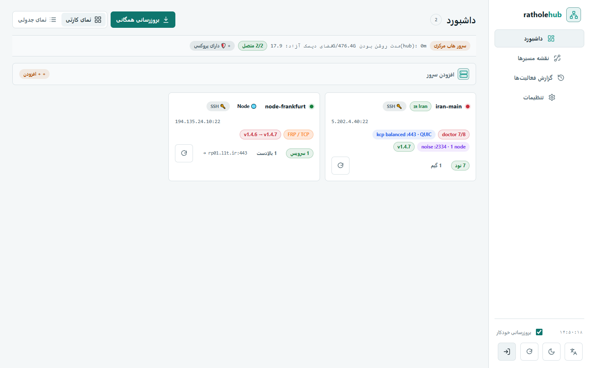

# RatholeEngine Wiki

خوش آمدید به مستندات جامع و ویکی پروژه **RatholeEngine**.

این سیستم یک راهکار **معکوس‌تونل (Reverse Tunnel)** پیشرفته و چندموقعیتی بر پایه‌ی **rathole + Nginx** برای عبور از فیلترینگ شدید است. در نسخه‌های اخیر، کنار lane رتهول چند **هسته‌ی مستقل** هم اضافه شده است: **Backhaul (SMUX)**، **FRP**، تونل لایه‌۳ **GRE** و حالت ترکیبی **FRP + GRE**؛ به‌علاوه‌ی **REST Agent** که اجازه می‌دهد هاب سرورها را بدون SSH و از طریق یک API توکن‌دار مدیریت کند.

> نسخه‌ی فعلی: **v2.0.2** — در این نسخه «بورد سیم‌کشی» (Wiring Board) از پنل هاب حذف شد و جای آن **کنترل‌های سرویس** در ردیف هر سرویس آمد؛ برچسب حامل‌ها هم حالا **پروتکل گزارش‌شده از سرور** را نشان می‌دهند (مثل `FRP / QUIC` و `Backhaul / WSMUX`). علامت `?` یعنی پروتکل گزارش نشده است.

> 🌐 **نسخهٔ وب مستندات:** همین محتوا به‌صورت یک **وب‌سایت استاتیک** هم قابل ساخت است. راهنمای ساخت/انتشار و مقایسهٔ پلتفرم‌های ویکی وب (MkDocs Material، VitePress — که مرزبان استفاده می‌کند —، Docusaurus و Docsify) در [`docs/website.md`](https://github.com/loopy-iri/tunnelplus/blob/main/docs/website.md) آمده است.

---

## 📚 فهرست صفحات ویکی (Wiki Index)

1. 🚀 **[راهنمای شروع سریع (Getting Started)](Getting-Started)**
   - نصب خودکار یک‌خطی و گزینه‌های نصب (Panel / Node / Hub)
   - پرچم‌های جدید: pin کردن نسخه (`--release`) و مخزن خصوصی (`--token`)
   - جداکننده‌ی `--` برای آرگومان‌های نصب نود
   - راه‌اندازی سریع REST Agent و نمای کلی حامل‌ها

2. ⚡ **[راهنمای Adaptive Filtering (سوئیچ خودکار)](Adaptive-Filtering-Guide)**
   - منطق سوئیچینگ هوشمند بین WebSocket و KCP
   - پروب لایه‌ای برای هر حامل (ws / plain / kcp / backhaul / frp)
   - تنظیم فواصل، آستانه (Threshold) و Cooldown
   - چرا انتخاب دستی حامل بر Adaptive اولویت دارد

3. 📖 **[مرجع کامل دستورات CLI (CLI Reference)](CLI-Reference)**
   - دستورات سرور ایران (`ratholectl`) و نود خارج (`ratholenode`)
   - مدیریت REST Agent (`agent on|off|status|token`)
   - حامل‌ها: WS، KCP، Plain، Noise، **Backhaul (SMUX)**، **FRP**، **GRE** و **FRP + GRE**
   - مسیر مخفی کنترلی (`control-path`)، upstream چندسروره، `migrate` و `set-main`
   - آپدیت، بک‌آپ و رول‌بک

4. 🖥️ **[مدیریت مرکزی با Hub (Hub Management)](Hub-Management)**
   - نصب و کانفیگ پنل وب Hub (`hub.py`)
   - کنترل‌های سرویس (نسخه‌ی ۲.۰.۲) و برچسب پروتکل حامل‌ها
   - اتصال REST Agent (بدون SSH) در برابر اتصال SSH
   - REST API، مدل امنیتی و آپدیت گروهی

5. 🛠️ **[عیب‌یابی، بک‌آپ و رول‌بک (Troubleshooting)](Troubleshooting)**
   - عیب‌یابی اتصالات و لاگ‌ها
   - خطاهای REST Agent (401/403، توکن، HTTPS self-signed)
   - ناسازگاری حامل‌ها (پروتکل `?`، توکن/profile بک‌هال، MTU و probe در GRE، transport در FRP)
   - آپدیت از مخزن خصوصی و رول‌بک

6. 📋 **[راهنماهای عملی (Workflow Guides)](Workflow-Guides)**
   - راه‌اندازی REST Agent برای یک سرور
   - تغییر حامل یک سرویس با کنترل‌های سرویس (همگام‌سازی دو سمت)
   - مهاجرت Backhaul ↔ Noise و مهاجرت به Backhaul (SMUX)
   - راه‌اندازی دسترسی direct-IP، دامنه دوم و multi-upstream
   - آپدیت از مخزن خصوصی

---

## 🆕 تازه در نسخه‌های ۲.۰.۱ و ۲.۰.۲

| موضوع | خلاصه |
|-------|-------|
| **کنترل‌های سرویس** | جای بورد سیم‌کشی را گرفت: «حامل و پروتکل»، «تست سلامت»، «ساخت کانفیگ VLESS»، «مدیریت سمت مقابل» و «حذف از دو سمت» در ردیف هر سرویس (صفحه‌ی ایران و نود). لینک قدیمی `#/wiring` به داشبورد برمی‌گردد. |
| **گزارش پروتکل حامل** | برچسب‌ها پروتکل واقعی گزارش‌شده از سرور را نشان می‌دهند؛ `?` = گزارش نشده. |
| **REST Agent** | `ratholeagent.py` + `install-agent.sh` (systemd: `rathole-agent.service`، پیش‌فرض پورت ۸۰۸۹) با احراز هویت Bearer و امکان HTTPS؛ هاب با `transport: "api"` از آن استفاده می‌کند. |
| **هسته‌های FRP و GRE** | `ratholectl frp\|gre` و `ratholenode frp\|gre`؛ FRP با ترانسپورت‌های `tcp\|kcp\|quic\|websocket` و GRE به‌صورت تونل L3 کرنل؛ حالت ترکیبی FRP + GRE از کنترل سرویس هاب. |
| **مخزن خصوصی** | `install.sh --token/-t` (یا `RATHOLE_GH_TOKEN`/`GH_TOKEN`/`GITHUB_TOKEN`) و به‌روزرسانی با `tools/update-private.sh`. |
| **رفع اشکال نصب/چرخه‌عمر** | حفظ توکن نود بعد از جداکننده‌ی `--`، جلوگیری از تصادم فایل agent هنگام آپدیت، حفظ توکن agent و ری‌استارت واحد آن در `update.sh`. |

---

## 📜 لایسنس (License)

پروژه تحت لایسنس **[AGPL-3.0-or-later](https://github.com/loopy-iri/tunnelplus/blob/main/LICENSE)** به‌صورت متن‌باز منتشر شده است.

نسخه‌های تا v1.7.0 تحت MIT منتشر شده بودند و همچنان تحت MIT در دسترس‌اند؛ از آن پس پروژه AGPL-3.0 است.
نکته‌ی عملی (بند ۱۳ AGPL): اگر RatholeEngine را تغییر دهید و دیگران از طریق شبکه با نسخه‌ی تغییریافته‌ی شما
کار کنند (مثلاً پنل وب `ratholehub` را برایشان اجرا کنید)، باید سورس نسخه‌ی خود را به آن‌ها ارائه دهید.
جزئیات در [NOTICE](https://github.com/loopy-iri/tunnelplus/blob/main/NOTICE).
