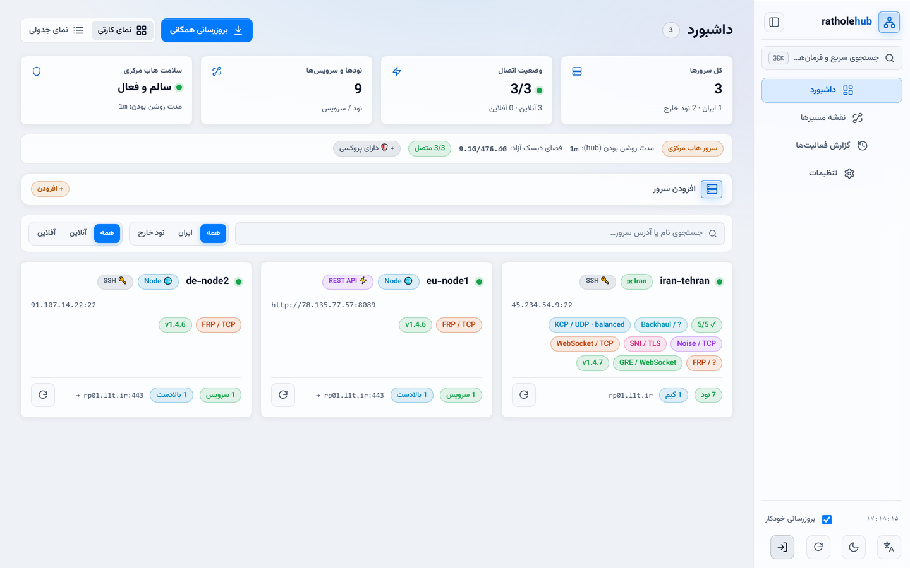

# RatholeEngine Wiki

خوش آمدید به مستندات جامع و ویکی پروژه **RatholeEngine**.

این سیستم یک راهکار **معکوس‌تونل (Reverse Tunnel)** پیشرفته و چندموقعیتی بر پایه‌ی **rathole + Nginx** برای عبور از فیلترینگ شدید است. در نسخه‌های اخیر، کنار lane رتهول چند **هسته‌ی مستقل** هم اضافه شده است: **Backhaul (SMUX)**، **FRP**، تونل لایه‌۳ **GRE** و حالت ترکیبی **FRP + GRE**؛ به‌علاوه‌ی **REST Agent** که اجازه می‌دهد هاب سرورها را بدون SSH و از طریق یک API توکن‌دار مدیریت کند.

> نسخه‌ی فعلی: **v2.1.1** — رابط وب هاب به سبک شیشه‌ای **Apple Glass** بازطراحی شد (تم روشن/تاریک/سیستم، فونت آفلاین Vazirmatn، پالت فرمان `⌘K / Ctrl+K`، کارت‌های KPI، فیلتر زنده و بارگذاری موازی سریع‌تر)، همراه با ربات سرورلس اعلان تلگرام، بنرها و نمودارهای بازطراحی‌شده. همچنین سلکتور حامل در ردیف هر نود یک‌کلیکی با همگام‌سازی صریح دوطرفه و منوی `⋯` عمل می‌کند، و برچسب حامل‌ها پروتکل واقعی سرور را نشان می‌دهند (`FRP / QUIC`، `Backhaul / WSMUX` و …).

> 🌐 **نسخهٔ وب مستندات:** همین محتوا به‌صورت یک **وب‌سایت استاتیک** هم قابل ساخت است. راهنمای ساخت/انتشار و مقایسهٔ پلتفرم‌های ویکی وب (MkDocs Material، VitePress — که مرزبان استفاده می‌کند —، Docusaurus و Docsify) در [`docs/website.md`](https://github.com/l8PYGIT/RatholeEngine/blob/main/docs/website.md) آمده است.

---

## 📚 فهرست صفحات ویکی (Wiki Index)

1. 🚀 **[راهنمای شروع سریع (Getting Started)](Getting-Started)**
   - نصب خودکار یک‌خطی و گزینه‌های نصب (Panel / Node / Hub)
   - پرچم‌های جدید: pin کردن نسخه (`--release`) و مخزن خصوصی (`--token`)
   - جداکننده‌ی `--` برای آرگومان‌های نصب نود
   - راه‌اندازی سریع REST Agent و نمای کلی حامل‌ها

2. ⚡ **[راهنمای Adaptive Filtering (سوئیچ خودکار)](Adaptive-Filtering-Guide)**
   - منطق سوئیچینگ هوشمند بین WebSocket و KCP
   - پروب لایه‌ای برای هر حامل (ws / plain / kcp / backhaul / frp)
   - تنظیم فواصل، آستانه (Threshold) و Cooldown
   - چرا انتخاب دستی حامل بر Adaptive اولویت دارد

3. 📖 **[مرجع کامل دستورات CLI (CLI Reference)](CLI-Reference)**
   - دستورات سرور ایران (`ratholectl`) و نود خارج (`ratholenode`)
   - مدیریت REST Agent (`agent on|off|status|token`)
   - حامل‌ها: WS، KCP، Plain، Noise، **Backhaul (SMUX)**، **FRP** (`7000/TCP` + `7000/UDP`)، **GRE** و **FRP + GRE**
   - مسیر مخفی کنترلی (`control-path`)، upstream چندسروره، `migrate` و `set-main`
   - آپدیت، بک‌آپ و رول‌بک

4. 🖥️ **[مدیریت مرکزی با Hub (Hub Management)](Hub-Management)**
   - نصب و کانفیگ پنل وب Hub (`hub.py`) با رابط Apple Glass و `⌘K / Ctrl+K`
   - سلکتور یک‌کلیکی حامل، منوی `⋯` کنترل سرویس‌ها و برچسب پروتکل حامل‌ها
   - اتصال REST Agent (بدون SSH) در برابر اتصال SSH
   - REST API، مدل امنیتی و آپدیت گروهی

5. 🛠️ **[عیب‌یابی، بک‌آپ و رول‌بک (Troubleshooting)](Troubleshooting)**
   - عیب‌یابی اتصالات و لاگ‌ها
   - خطاهای REST Agent (401/403، توکن، HTTPS self-signed)
   - ناسازگاری حامل‌ها (پروتکل `?`، توکن/profile بک‌هال، MTU و probe در GRE، پورت UDP ۷۰۰۰ و transport در FRP)
   - آپدیت از مخزن خصوصی و رول‌بک

6. 📋 **[راهنماهای عملی (Workflow Guides)](Workflow-Guides)**
   - راه‌اندازی REST Agent برای یک سرور
   - تغییر حامل یک سرویس با کنترل‌های سرویس (همگام‌سازی دو سمت)
   - مهاجرت Backhaul ↔ Noise و مهاجرت به Backhaul (SMUX)
   - راه‌اندازی دسترسی direct-IP، دامنه دوم و multi-upstream
   - آپدیت از مخزن خصوصی

---

## 🆕 تازه در نسخه‌های ۲.۰.۳ تا ۲.۱.۰

| موضوع | خلاصه |
|-------|-------|
| **ربات سرورلس تلگرام (`v2.1.0`)** | [`tools/telegram_notify.py`](https://github.com/l8PYGIT/RatholeEngine/blob/main/tools/telegram_notify.py) + ورک‌فلوی [`.github/workflows/telegram-notify.yml`](https://github.com/l8PYGIT/RatholeEngine/blob/main/.github/workflows/telegram-notify.yml) + Cloudflare Worker در `tools/telegram-bot-worker/` برای اعلان خودکار ریلیزها در کانال تلگرام با بنر و دکمه‌های Inline. |
| **رابط شیشه‌ای Apple Glass (`v2.1.0`)** | تم روشن / تاریک / هماهنگ با سیستم، فونت آفلاین `vazirmatn.woff2` (بدون CDN)، ۴ کارت KPI، فیلتر زنده در داشبورد/جداول/audit، پالت فرمان **`⌘K / Ctrl+K`** و بارگذاری موازی سریع‌تر وضعیت سرورها. |
| **سلکتور حامل + منوی `⋯` (`v2.0.4`–`v2.1.0`)** | تغییر یک‌کلیکی حامل در ردیف نود (همگام‌سازی خودکار دوطرفه با پیام وضعیت شفاف و بازگشت در صورت خطا)؛ ۵ اکشن («حامل و پروتکل»، «تست سلامت»، «ساخت کانفیگ VLESS»، «مدیریت سمت مقابل» و «حذف از دو سمت») زیر دکمه‌ی تک‌خطی `⋯`. |
| **پورت `7000/UDP` و حفظ ترانسپورت FRP** | در FRP با ترانسپورت `kcp` یا `quic` علاوه‌بر `7000/TCP`، پورت `7000/UDP` (`kcpBindPort`/`quicBindPort`) در UFW باز می‌شود و انتخاب ترانسپورت پس از `frp off` حفظ می‌گردد. |
| **گزارش پروتکل حامل** | برچسب‌ها پروتکل واقعی گزارش‌شده از سرور را نشان می‌دهند؛ `?` = گزارش نشده. |
| **سخت‌گیری امنیتی و پایداری** | اعتبارسنجی `proxy`/`ssh_opts` هاب، لیست‌سفید سخت‌گیرانه‌تر REST Agent (`ratholectl|ratholenode|systemctl|journalctl|jq|tail`) + منع توکن خالی + مجوز `0600`، حذف inline JS در UI، ری‌استارت امن agent در `update.sh`، حفظ توکن پس از `--` در `install.sh` و پوشش کامل اسرار در `rth_redact`. |

---

## 📢 ارتباط و پشتیبانی

کانال تلگرام: **[t.me/l8PY4NET](https://t.me/l8PY4NET)** — اعلان نسخه‌های جدید، نکته‌های راه‌اندازی و سریع‌ترین جای پرسیدن سؤال.
گزارش باگ/درخواست ویژگی: **[GitHub Issues](https://github.com/l8PYGIT/RatholeEngine/issues)**

---

## 📜 لایسنس (License)

پروژه تحت لایسنس **[AGPL-3.0-or-later](https://github.com/l8PYGIT/RatholeEngine/blob/main/LICENSE)** به‌صورت متن‌باز منتشر شده است.

نسخه‌های تا v1.7.0 تحت MIT منتشر شده بودند و همچنان تحت MIT در دسترس‌اند؛ از آن پس پروژه AGPL-3.0 است.
نکته‌ی عملی (بند ۱۳ AGPL): اگر RatholeEngine را تغییر دهید و دیگران از طریق شبکه با نسخه‌ی تغییریافته‌ی شما
کار کنند (مثلاً پنل وب `ratholehub` را برایشان اجرا کنید)، باید سورس نسخه‌ی خود را به آن‌ها ارائه دهید.
جزئیات در [NOTICE](https://github.com/l8PYGIT/RatholeEngine/blob/main/NOTICE).
