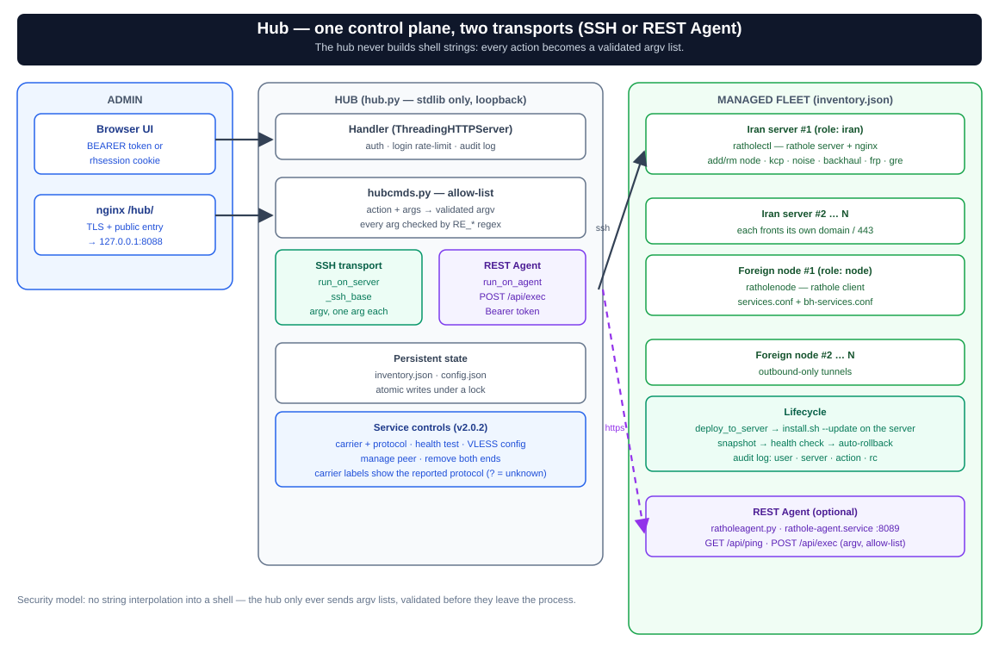

# مدیریت مرکزی با پنل وب Hub

**RatholeHub** یک پنل وب Python 3 stdlib (بدون pip و بدون build فرانت‌اند) است که مدیریت چندین سرور ایران و نود خارج را از طریق SSH، بدون agent روی سرورها، متمرکز می‌کند. backend در `hub.py`/`hubcmds.py` و UI در پوشه‌ی `ui/` قرار دارد.



---

## نصب

```bash
# روش پیشنهادی — از طریق ratholectl روی سرور ایران:
sudo ratholectl hub on [port]
# اگر hub نصب نشده باشد، install-hub.sh را خودکار اجرا می‌کند.

# یا مستقیم:
sudo bash rathole-manager/ratholehub/install-hub.sh

# نصب از GitHub:
curl -fsSL https://raw.githubusercontent.com/loopy-iri/tunnelplus/main/install.sh | sudo bash -s -- --hub
```

---

## دسترسی به پنل

**امن‌ترین روش (بدون باز کردن پورت):**
```bash
ssh -L 8088:127.0.0.1:8088 root@<ip_server>
# مرورگر: http://localhost:8088
```

**از طریق nginx روی همان دامنه:**
```bash
sudo ratholectl hub on 8088   # → https://<domain>/hub/
```

---

## افزودن سرورها

**روش ساده — دکمه‌ی «نصب خودکار» (Provision):**
در داشبورد، سرور را اضافه کنید و Provision بزنید. هاب یک‌بار با رمز SSH وصل می‌شود، کلید عمومی‌اش را به `authorized_keys` اضافه می‌کند، آخرین نسخه را از GitHub نصب می‌کند، و سرور را در inventory ثبت می‌کند.

**روش دستی:**
```bash
ssh-copy-id -i /root/.ssh/id_ed25519.pub root@<server_ip>
# سپس سرور را از طریق POST /api/servers اضافه کنید
```

---

## صفحات رابط کاربری

| صفحه | آدرس | محتوا |
|------|------|-------|
| **داشبورد** | `#/dashboard` | کارت سرورها، grid/list، وضعیت و badge نسخه؛ افزودن/Provision؛ آپدیت همه با progress |
| **صفحه سرور** | `#/server/<name>` | overview، دامنه/گواهی، پورت/path، carrierها، ingress، سرویس‌های rathole و Backhaul، game و log |
| **مسیریابی / کنسول** | `#/routing` | نمودار SVG قابل جابه‌جایی و نمای console/table برای ingress و lane تونل |
| **فعالیت** | `#/audit` | تاریخچه‌ی عملیات (زمان، کاربر، سرور، action، rc) |
| **تنظیمات** | `#/settings` | hint listen/token، چرخش API token و تغییر رمز مدیر |

UI نسخه ۱.۹.۱ برای موبایل/دسکتاپ ریسپانسیو است، تم روشن/تیره و RTL/LTR دارد، وضعیت focus و dialogهای keyboard-accessible را رعایت می‌کند و از `prefers-reduced-motion` پشتیبانی می‌کند. زبان و تم در مرورگر ذخیره می‌شوند.

### بخش Ports در صفحه سرور

| پورت | قابل ویرایش؟ | توضیح |
|------|-------------|-------|
| `fake-port` | ✅ | سایت فیک (پیش‌فرض ۸۰۸۰) |
| `sub-port` | ✅ | subscription (پیش‌فرض ۲۰۹۶) |
| `control-port` | ✅ | کنترل rathole (پیش‌فرض ۲۳۳۳) |
| `internal` | نمایش | پورت داخلی (پشت SNI) |
| `hub`, `plain`, `noise`, `backhaul`, `direct` | نمایش | پورت هر listener/core |

### دکمه‌های کلیدی

- **«آپدیت همه»** — همه سرورها را ترتیبی آپدیت می‌کند. progress bar زنده نشان می‌دهد: در صف → در حال آپدیت → ✓ نسخه‌ی جدید یا ✗ (rc=N). سروری که خودِ هاب روی آن است ممکن است پس از restart ناقص نشان دهد.
- **Badge نسخه** — سبز = به‌روز، زرد `vX→vY` = نیاز به آپدیت.
- **«Wire to node»** — یک نود ایران را به‌عنوان سرویس روی یک نود خارج ثبت می‌کند (token/inbound واقعی را خودکار دریافت می‌کند).
- **«Set main tunnel»** — نود خارج را به یک سرور ایران ثبت‌شده در هاب وصل می‌کند.
- **سرویس‌های Backhaul lane** — جدول مستقل مبتنی بر `bh-services.conf`؛ اضافه/حذف سرویس Backhaul، lane رتهول را خاموش نمی‌کند.
- **Log و خروجی** — خروجی بلند در modal قابل کپی باز می‌شود و log جمع‌آوری‌شده به فایل متن دانلود می‌شود.

---

## REST API

همه مسیرها با هدر `Authorization: Bearer <API_TOKEN>` (یا کوکی نشست از UI).

```
GET    /api/health
POST   /api/login                             {"password":"..."} → {token}
GET    /api/hubstatus                          وضعیت هاب + latest_version
GET    /api/servers                            لیست سرورها
POST   /api/servers                            {name, role(iran|node), host, ssh_user, ssh_port}
DELETE /api/servers/<name>
POST   /api/provision                          نصب خودکار (کلید SSH + deploy + ثبت)
GET    /api/servers/<name>/status              وضعیت سرور (JSON)
POST   /api/servers/<name>/action             {"action":"...", "args":{...}}
GET    /api/servers/<iran>/nodeconnect/<node>  token/inbound واقعی نود (برای wire-to-node)
```

**نمونه:**
```bash
TOKEN=your_token
curl -s -H "Authorization: Bearer $TOKEN" http://localhost:8088/api/servers
curl -s -H "Authorization: Bearer $TOKEN" -X POST \
  http://localhost:8088/api/servers/rp01/action \
  -H 'Content-Type: application/json' \
  -d '{"action":"status","args":{}}'
```

---

## مدل امنیتی

هاب هرگز رشته‌ی خام روی سرورها اجرا نمی‌کند:

1. هر درخواست به یک **action مجاز** از allow-list نگاشت می‌شود (`hubcmds.py`)
2. آرگومان‌ها با regex (`RE_NAME`, `RE_IPPORT`, `RE_KEY`, …) اعتبارسنجی می‌شوند
3. دستورات به‌صورت **argv لیستی** از طریق SSH اجرا می‌شوند — نه string interpolation
4. دکمه «آپدیت» در خودِ سرور آخرین `install.sh` را از GitHub (از طریق mirror ghproxy) می‌گیرد و با `--update` اجرا می‌کند؛ slug مخزن اعتبارسنجی‌شده تنها چیزی است که جای‌گذاری می‌شود
5. هر عمل در **audit log** ثبت می‌شود

---

## اجرای محلی (تست و توسعه)

```bash
RATHOLEHUB_MOCK=1 RATHOLEHUB_PORT=8088 python3 rathole-manager/ratholehub/hub.py
# مرورگر: http://127.0.0.1:8088
# RATHOLEHUB_MOCK=1 → SSH اجرا نمی‌شود، پاسخ‌های fake برمی‌گردد
```

متغیرهای محیطی: `RATHOLEHUB_HOST`, `RATHOLEHUB_PORT`, `RATHOLEHUB_CONF`, `RATHOLEHUB_INV`, `RATHOLEHUB_MOCK`.
